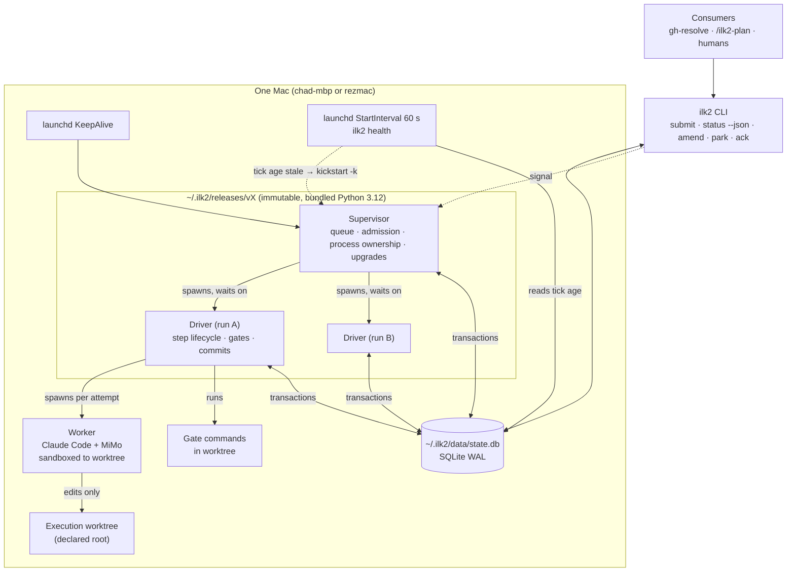
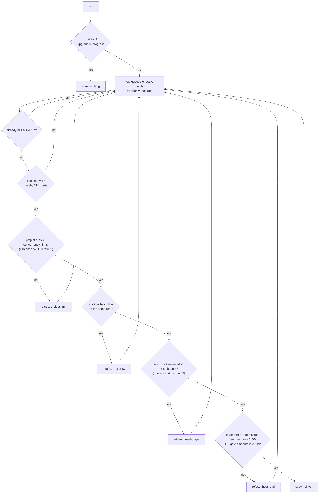
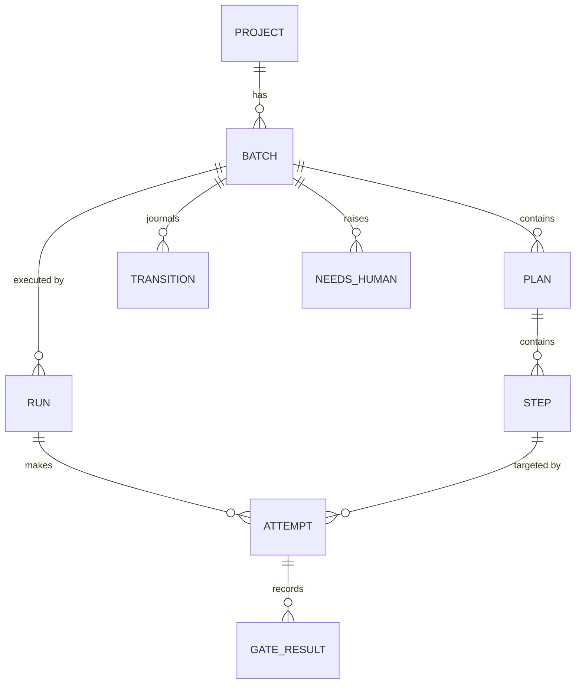
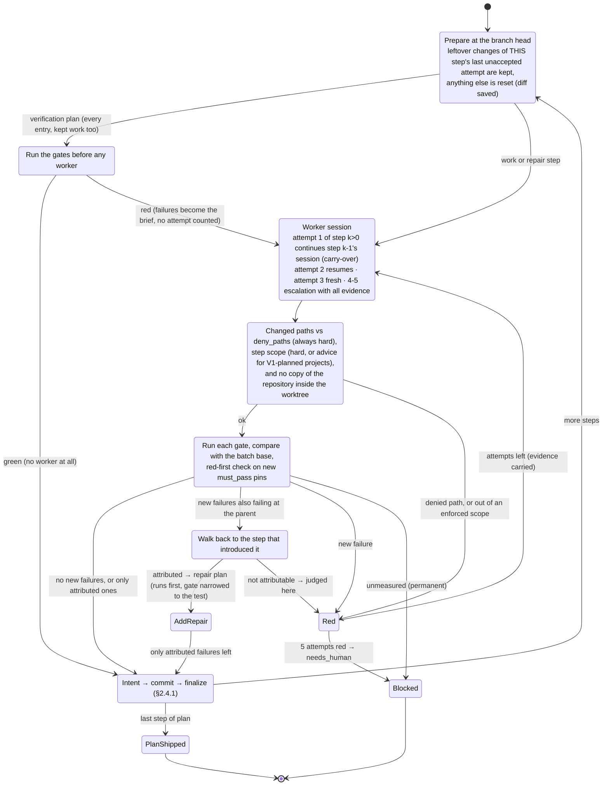
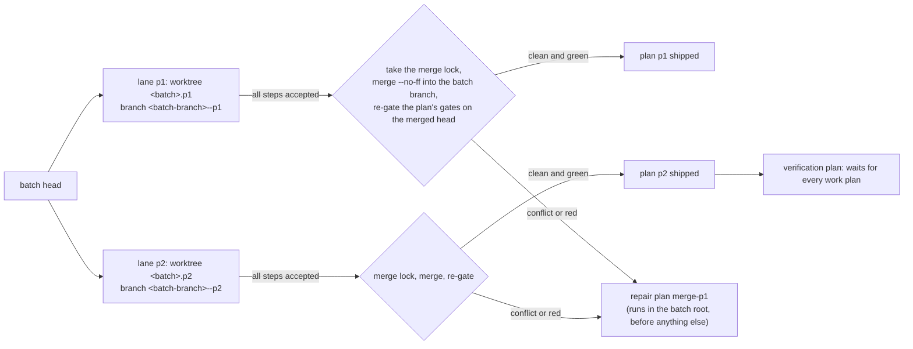
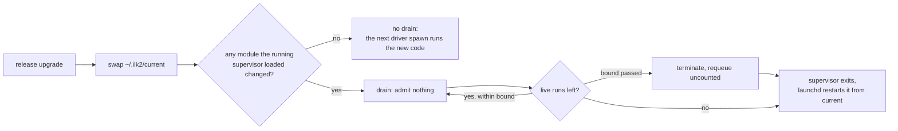
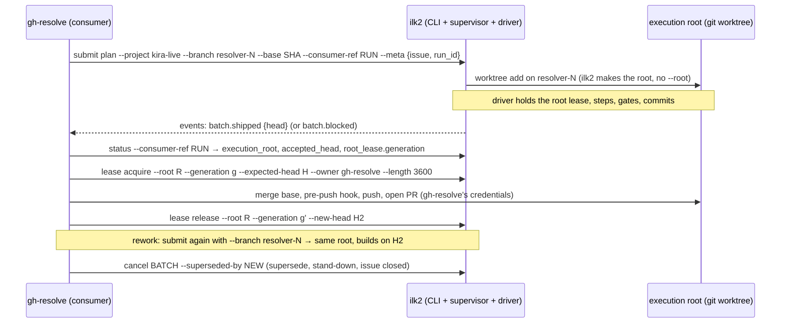
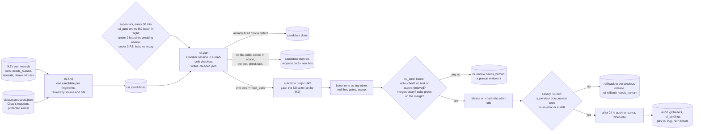

# 2. Architecture

ilk2 is one supervisor process per host. It starts one driver process per run, and each driver starts one worker at a time. All state goes through a single SQLite store. The worker edits code in a worktree; everything else is the driver's job.

## 2.1 Invariants

These are the rules every component must keep. Each one exists because V1 broke it; the V1 root causes are numbered as in [document 1](01-why-v2.md).

| # | Invariant | Removes V1 root cause |
|---|---|---|
| I1 | **Only the driver changes batch state** (step pointer, plan status, gate results, commits). The worker has no write path to state. | 1, 2 |
| I2 | **All state changes are SQLite transactions**, each with an actor, a reason and the previous version. Markdown is never written back. | 2 |
| I3 | **Identity is declared once, at submission:** project id, batch id, run id, execution root. Nothing is derived from paths afterwards. | 3 |
| I4 | **The supervisor owns only processes it started:** each driver is a child in its own process group, with PID and start time in the store. A restarted supervisor never adopts survivors. It terminates them (verified by PID and start time) and requeues their runs (§2.10). No pgrep or argv matching anywhere. | 4 |
| I5 | **A gate result is `pass`, `fail` or `unmeasured`.** `unmeasured` (harness error, no tests found, runner unknown) is never treated as pass or fail. | 5 |
| I6 | **A failure counts against a step only if it is new.** Base failures are measured per versioned gate specification and identified by test ID plus failure fingerprint, so a base-red test that starts failing differently counts as new (§2.5). | 5 |
| I7 | **Code runs only from immutable releases.** A run records its release; upgrades happen at step boundaries. ilk2 never edits its own release. | 6 |
| I8 | **One language (Python 3.12), one platform (macOS).** | 7 |
| I9 | **Every terminal state has a named reason.** No state is "stuck" without a reason a human can read in `ilk2 status`. | Oct 12 #8309 deadlock and "timeout" mislabel |
| I10 | **Every refusal to dispatch queued work is a recorded row.** The row names the reason, the action that clears it, and who takes that action (`supervisor`, `driver` or `human`). Refused hours are reported. A refusal whose clearing action is `supervisor` or `driver` must clear without a human. No guard exists only to re-check what the driver already wrote. | V1 refused queued work for about 0.8 h per hour worked ([evidence](evidence/2026-10-12-v1-stuck-and-slow.md) §1) |
| I11 | **Every non-terminal state has a time bound and an action when the bound passes,** including the supervisor itself, which is watched from outside (§2.11). The action is automatic, or it creates a `needs_human` row that stays open until acknowledged. Every retry loop has a counted limit. | V1's stalls: a hung runner, escalation loops, relaunch storms, a blocked dependency re-dispatched all night (§2.11) |
| I12 | **Git and the store are never assumed atomic together.** Accepting a step is an idempotent protocol in three phases: intent, commit, finalize. Recovery finishes or undoes it (§2.4.1). | Review of Oct 13: a crash between the commit and the state change duplicates or loses work |

## 2.2 Components



| Component | Responsibility | Never does |
|---|---|---|
| **Supervisor** (`ilk2 supervise`) | Admits submitted batches. Decides what runs by priority, then submission order, and keeps concurrency limits per host and per project. Records every refusal with its clearing action (I10). Spawns drivers and waits on them. Writes a tick timestamp every 30 s. On start-up, terminates surviving drivers and requeues their runs. Performs upgrades and drains. | Run gates, touch worktrees, call the model, adopt a process it did not start, or add a pre-dispatch audit of driver-written state |
| **Health job** (`ilk2 health`) | A separate launchd job every 60 s. If the supervisor's last tick is older than the bound, or its process is gone, it restarts the supervisor with `launchctl kickstart -k`. It also re-sends unacknowledged `needs_human` notices that are due | Touch runs or batches |
| **Driver** (`ilk2 drive <run_id>`) | Owns one run: prepares the worktree, freezes inputs, dispatches the worker, checks the diff's scope, runs gates, accepts the step (§2.4.1), retries with red evidence, and records the terminal reason | Choose which batch runs; edit another run's state |
| **Worker** | A Claude Code session with MiMo, under a private config dir, reached through the dispatch adapter (§2.6). Edits files in the worktree to complete one step | Write the store, plans, or anything outside the worktree; run `git commit` or `push`; decide step progress |
| **Store** | One SQLite file holding projects, batches, plans, steps, runs, attempts, gate results, transitions, events and `needs_human` rows | Hold secrets |
| **CLI** | Submission, status (human and `--json`), amend, park, resume, cancel, ack, lease acquire/release, project add/set/take-over, `v1 status/off/on`, report, export, doctor, upgrade | Bypass the transition API |

### 2.2.1 Admission (as built, Oct 14)

Every 30 s tick, the supervisor walks queued and active batches by priority, then submission order, and starts a driver for each one that passes every check. A batch that fails a check gets a refusal row with its reason and clearing condition (I10); the refusal clears itself when the batch is admitted.



- `host_budget` lives in `~/.ilk2/host.json` and is re-read every tick: changing it needs no supervisor restart (a restart would interrupt every live attempt).
- `concurrency_limit`, `reserve` and every other project setting change with `ilk2 project set <id> key=value` (journalled).
- Each batch has its own execution root and branch, so several batches of one project run side by side; batches on one root never run together (R4).

## 2.3 State model



- **PROJECT:** id, repo root, default branch, gate adapters, concurrency limit, setup hook (§2.5), and notification policy (`owner` or `consumer`; §2.11.3). Registered explicitly with `ilk2 project add`.
- **BATCH:** id, project, base commit, priority, consumer reference (for example a gh-resolve issue number, echoed in every event), status (`queued → active → shipped | blocked | parked | cancelled`), an immutable normalized plan snapshot (Q3), and the original imported documents.
- **ROOT LEASE:** the execution root's holder (`driver`, `consumer` or `released`), owner, generation, expiry, expected head and accepted head. It changes only by compare-and-set on the generation. Only the holder writes to the root's branch (§2.4.2).
- **PLAN** (V1 "sub-plan"): order, dependencies, status, `verification: true|false`, and for a repair plan `repair_of_step_id` (§2.5.7). A batch ships only when every plan, repair plans included, has shipped.
- **STEP:** index, instructions, declared gates with their specification version, expected reds, status (`pending → accepting → accepted`, or `blocked`).
- **RUN:** one driver process lifetime. Holds PID, PGID, start time, host boot time, release version, execution root and terminal reason.
- **ATTEMPT:** one worker dispatch for one step. Records session id, timings (model, thinking, tools, gates), diff hash, expected tree hash and outcome.
- **TRANSITION:** append-only journal: entity, from, to, actor, reason, previous version. The only way state changes.
- **NEEDS_HUMAN:** state, reason, created, last notified, acknowledged by and when. Stays open until `ilk2 ack` or the state it describes clears.

Concurrency control: every transition checks the row's version, so it is a compare-and-set. A run holds a lease on its batch, and only the lease holder may move that batch's steps. The store opens with a busy timeout, and transactions are short (no I/O inside them other than SQLite).

## 2.4 How a step runs

As built (Oct 14). The driver runs one step at a time; within a run, the worktree carries from attempt to attempt.



Added since the design closed (each with a test; why in [document 6](06-open-items.md), "Batch speed"):
- **`ilk2 apply`.** At prepare, after the kept-work decision, a step applies each commit requested for its batch unless its worktree already has it, and the brief names them. The commit goes in beside the step's uncommitted work: the worktree is staged first, because `git apply --3way` implies `--index`. Files the commit edits but the batch does not have (added on main after the batch began) are skipped and named in the `commit.applied` event. An overlap with the step's work is left as conflict markers, and the brief tells the worker to resolve them: take the applied commit's version where it replaces a workaround, and keep the step's own behaviour changes. Each application is recorded per worktree. A worktree that already took the commit with an accepted step, or with this step's kept work, does not take it again, because after a resolution the reverse check can no longer tell. Only a commit that cannot be applied at all opens an `apply-failed` needs-human row. (gh-resolve P6, Oct 14: the first version refused every file the worker had touched, and the whole commit over one file the batch did not have.)
- **No repository copies.** An attempt that adds 50 or more files repeating tracked paths under a new directory (a scratch checkout of the base inside the worktree) is red; the brief tells workers to keep such copies in `$TMPDIR` (Oct 14: 1,111 such files under `.base-tree/` nearly reached a commit).
- **Kept work.** A new run (resume, upgrade drain, crash recovery) keeps the step's own uncommitted work when the root is at the branch head and the step's last attempt ended red, interrupted, timed out or crashed. The brief says so. Anything else is reset, and its diff is saved as `leftover-<step>.diff`.
- **Session carry-over.** The first attempt of step *k* > 0 continues step *k*-1's session when that step was accepted and stayed under `carry_max_context` (400k). It skips re-reading the repo: carried steps took 6-19 min, fresh ones 24-33 min.
- **V1 ceremony merge.** At import, a V1 "Red-first pins" step folds into the next step, and a trailing "Neighbour gate" step into the one before. `amend merge_ceremony` does the same for a plan that has not started. Gates that look up the folded step's own commit are dropped, since that commit is the merged step itself.
- **Red-first inside a step.** A `must_pass` test in a file the plan added must fail on the code it replaces: on the step's parent, or on the plan's starting commit when the pin was written in an earlier step of the plan. A control test that passes on the old code by design does not belong in `must_pass`. Repair and verification plans are not checked: a repair's `must_pass` is the failing test it must turn green, not a new pin.
- **Verification plans run gates first, on every entry** (a fresh step, and again after repairs or a restart, so a worker never gets stale evidence), on the kept work too: kept work that is already green is accepted with no worker. A gates-first run is recorded but never counts as an attempt, so a red one always leaves the worker its attempts. If they are green, the step is accepted with no worker. If they are red, the worker is briefed that the gate already ran and that no V1 record exists.
- **Any step entered with kept work runs its gates first too** (built Oct 14, after P6). The brief then carries the failures as they stand under the current driver, not the last attempt's evidence. It is never accepted from that run, because kept work comes from an interrupted session. If the gates are green, the worker is told so and finishes the step. Like a verification step's gates-first run, it is recorded (outcome `measured` or `red`) and is not counted as an attempt. (gh-resolve P6, Oct 14: after a restart the brief still said a sibling's test file was missing, which the restarted driver no longer charged. The worker wrote the file, and it conflicted at the merge.)

What this removes from V1:
- **Plans ship themselves.** When the driver finalizes a plan's last step, the plan is shipped in that same store transaction. No separate worker ship, `gate_first` marker or ship script is needed, so the Oct 12 #8309 deadlock cannot occur.
- **Batch verification is a plan like any other.** Its steps run gates; it has no special dispatch rules.
- **Timeouts are real timeouts.** An attempt that dispatched nothing cannot exist: the driver either dispatches or ends the run with a named reason (I9).

### 2.4.1 Accepting a step (I12)

Git and SQLite cannot share a transaction, so acceptance has three phases. Each one can be retried safely.

1. **Intent (store transaction):** the step moves `pending → accepting`, recording the attempt id, the parent commit and the expected tree hash (the gated worktree's tree).
2. **Commit (git):** the driver creates the commit with an `ilk2-attempt: <attempt id>` trailer. Its author and committer are the repository's configured git user (local or global `user.name`/`user.email`), as V1's workers committed, and `ilk2 <ilk2@localhost>` only when none is set. Lane merges use the same identity. (gh-resolve on rezmac, Oct 14: its foreign-commit guard declined a publish of ilk2@localhost commits.) It does not commit if a commit with that trailer already exists on the branch with the expected tree and parent.
3. **Finalize (store transaction):** the step moves `accepting → accepted` with the commit SHA. If it is the plan's last step, the plan ships in the same transaction.

**Recovery**, run by the next driver before it prepares anything, for any step left `accepting`:

| Found in git | Action |
|---|---|
| A commit with the attempt's trailer, expected tree and expected parent | Finalize with that SHA. No work is redone |
| No such commit; branch head still at the recorded parent | Undo: the step goes back to `pending`, and the next attempt starts from the parent |
| A commit with the trailer but a different tree or parent, or the branch moved elsewhere | `blocked (acceptance-mismatch)`, with both trees recorded. A human decides. This should be impossible; it means something outside ilk2 wrote to the branch |

No step is ever `accepted` without its commit, and no commit with an `ilk2-attempt` trailer is ever left without a finalized step or a recorded mismatch.

### 2.4.2 Who may write the branch

A consumer may also push from the execution root. gh-resolve's reap and land push the issue branch from the same worktree (gh-resolve `push.py`). Two writers on one branch would turn every consumer push into an `acceptance-mismatch` (§2.4.1). An advisory "released" flag is not enough: a consumer could read it, `resume` could take the lease back, and the consumer would then push into a live run. So the execution root has a **lease acquired by compare-and-set**, with a generation number:

```
driver(gen n) --release--> released(gen n+1) --consumer acquire(gen n+1, expected_head)--> consumer(owner, gen n+2, expected_head)
consumer(gen n+2) --consumer release(gen n+2, new_head)--> released(gen n+3) --resume--> driver(gen n+4)
```

- **The driver holds the lease while the batch is `queued` or `active`.** It releases the lease when the batch reaches `shipped`, `blocked`, `parked` or `cancelled`, after any running attempt has been stopped and recovered.
- **A consumer acquires the lease before writing:** `ilk2 lease acquire --root <root> --generation <g> --expected-head <sha> --owner <name>`. This succeeds only if the lease is `released` at generation `g` and the root's branch head equals `expected-head`. It returns the new generation.
- **The driver never pushes,** so the consumer is the only writer to the remote branch. The checks ilk2 itself enforces are the expected local head at `acquire` and the new head recorded at `release`. A consumer's push is fast-forward only: gh-resolve's plain non-force push (its `push.py:296`, which rejects `--force-with-lease`) refuses a non-fast-forward, but it is not conditional on an expected remote SHA. When done it calls `ilk2 lease release --generation <g> --new-head <sha>`, recording the local and remote heads it left.
- **`ilk2 resume` fails while a consumer holds the lease.** Resume acquires the lease by the same compare-and-set from `released`. If the local branch or the recorded remote head moved since the last driver release, resume records the consumer's commits as the new step base (a `consumer-commits` transition), so they are never mistaken for a mismatch.
- **A consumer lease has a time limit and can be renewed.** A consumer doing a long operation calls `ilk2 lease renew --generation <g>` before the limit (§2.11.1). Expiry does **not** release the lease: it moves to `consumer-expired`, which still fences the driver. `resume` fails in that state, and a consumer that is still working can finish, push and release normally. Writer authority returns to `released` only by the consumer's own `ilk2 lease release`, or by `ilk2 lease recover --generation <g>` after an operator or the consumer confirms no consumer process can still write. Expiry creates a `needs_human` row under the project's notification policy (Codex review 3, finding 2).
- **`ilk2 status --json` reports** `root_lease` (holder, owner, generation, expiry) and `accepted_head`.

### 2.4.2a Lanes: independent plans in parallel (built Oct 14, opt-in)

With `max_lanes` > 1 (a project setting, default 1), independent work plans of one batch run at once. Each lane is a run bound to one plan (`runs.plan_id`). The batch keeps one branch, and consumers see no difference. Over 254 real V1 masters, 2 lanes shorten the critical path by a median 43% ([document 6](06-open-items.md), "Parallel plans").



- **Admission.** The supervisor starts the batch's first run bound to its first ready plan; that run measures the base. Once the base exists, it starts another lane for each ready plan, up to `max_lanes`. "Ready" means: dependencies shipped (merged), not taken by a live run, and no unshipped repair. Repair plans are a barrier (§2.5.7): while one is unshipped, only repairs are ready. Lanes count against `concurrency_limit` and the host budget like any run (§2.2.1).
- **A lane** cuts its worktree and branch from the batch head when it starts. If its run is requeued, it reuses them, with the step's kept work. Inside the lane, steps run exactly as in §2.4: carry-over, gates against the batch base, attribution, kept work. A step accepted in a lane commits to the lane branch; the batch's accepted head moves only at the merge.
- **Merging.** When a lane's steps are all accepted, its run takes the batch's **merge lock**: a store row naming the run, free once that run has ended. It merges the lane branch into the batch branch (`--no-ff`, consumer hooks off) in the batch root, then re-runs the plan's gates there against the batch base. The plan ships then, not at its last step, so dependents start from the merged head. The lane worktree is removed after the merge; the lane branch stays. A merge left half-done by a crash is aborted on the next entry, and a lane already merged skips straight to the re-gate.
- **Conflicts and red re-gates** become a repair plan `merge-<plan>` on the batch branch, with the conflicting files (and how to see the lane's diff) or the new failures as its brief. A failure that first appears at a merge commit is charged to that repair, never walked back into either lane.
- **Union-merge paths** (project setting `union_merge`, gitattributes patterns, opt-in) resolve a lane-merge conflict as the union of both sides, with no repair plan. They are meant for docs that every plan appends to. The merge still re-gates. Judgment call: opt-in, because a union garbles files whose order or uniqueness matters, without a conflict to show it. (gh-resolve P6, Oct 14: 2 of 3 merge repairs were one design doc, about 22 worker-minutes each.)
- **Repair and verification plans** run in the batch root, holding the merge lock for their whole run, so nothing merges under them. A verification plan waits for every work plan, not only its declared dependencies. **Only one of them runs at a time:** while a repair or verification run is live, no other plan is ready. (gh-resolve P6, Oct 14: two repairs started together; the second waited on the first's lock until its spawn was called stalled three times, and the batch sat in crash backoff.)
- **Lost lanes.** Restarts count on the lane's own step, or on its plan's last step while it merges, so a crashing merge climbs the same crash-loop ladder (§2.10) and ends in a blocked plan with a needs-human row. A blocked lane does not stop the others. When nothing is ready and nothing runs, a plain run ships the batch or blocks it with the reason.
- **Tests:** `tests/test_lanes.py` covers two lanes in parallel with both merged, a merge conflict becoming a repair, a dependent plan starting from the merged head, a blocked lane while the other ships, a lane whose driver dies mid-attempt, and `max_lanes` = 1 keeping the serial path.

## 2.5 Gates

### 2.5.1 What a gate is

- **Declared gates are commands** with an explicit adapter (`pytest` or `vitest` for test gates; `shell` for checks that are not tests), a working directory and a time cap.
- **Package scripts are resolved.** A gate written as a package script (`bun run test:non-ui:convex`, `npm test`) is read from `package.json` and resolved to the runner command it calls, with that runner's adapter. gh-resolve's consumer gates are of this kind, with `-c tests/convex-tests/vitest.config.ts`.
- **`shell` cannot be a test gate.** A shell gate reports no test IDs, so base exclusion and fingerprints cannot apply to it, and a shell gate that is red at the base could never pass. `ilk2 submit` rejects a step whose test gate does not resolve to a test adapter. A gate imported from V1's `local_checks` is the exception: a package script there that resolves to no test runner (`bun run typecheck:convex` → `tsc`) is an exit-code check, as in V1 (gh-resolve's kira plans, Oct 14). `shell` is kept for checks with plain exit-code meaning (lint, type check, build, and V1's `local_checks` acceptance checks such as "no `xfail` left in this file"). A shell gate is judged **absolutely**: it must exit 0 after its step. It may be red at the base (V1's acceptance checks usually are), and it is never compared with the base, which would let an unchanged red pass (revised Oct 13 from "must be green at the base", after real gh-resolve plans). **The exception is a plan-wide check** (Chad's go, Oct 16): a shell gate from a V1 sub-plan's frontmatter `local_checks` applies to every step, so it is a regression check, not a step's acceptance check. When it was red at the batch base, it passes after a step whose failing output lines are all already reported at the base (`gate.inherited-red`). The lines are the output lines with a failure marker (❌, 🚨, ✗, FAIL, `Error:`), normalised with their digits kept; when neither run has such lines, the failure fingerprint must be unchanged. A new failing line keeps it red, and the evidence names only the new lines as the step's to fix. A step's own shell checks stay absolute. (gh-resolve #8644: `consistency-regression.sh` was red at a stale base, and the absolute rule made the worker fix two unrelated PRD regressions.)
- **Each gate has a specification version:** a hash of the resolved command, adapter, working directory, pinned environment, and every configuration file that decides what runs. That includes `package.json` for a resolved script, the runner config, and any workspace or projects config.
- **The vitest adapter** finds the owning config by evaluating each config's `include` and `exclude` against the file, and resolves workspace and projects configs. If a file matches several configs, every matching config is run. If it matches none, it is recorded as `uncovered`. Added checks (V1's "mention gate") come only from this resolution, never from a bare `vitest run`.
- **The pytest adapter** uses the project's rootdir and its configured plugins.

### 2.5.2 The pinned environment

Gates run outside the worker sandbox but in a pinned environment, defined so that a test cannot see the host's ilk state:
- `HOME` is a private directory per run, created empty, with only the files the project declares copied in.
- All `ILK_*` and `ILK2_*` variables are removed. The paths `~/.ilk-data`, `~/.ilk` and `~/.ilk2` are therefore not reachable through `HOME`.
- `PATH` is the project's declared `PATH` prelude, the release's bundled tools, and then `/usr/bin:/bin:/usr/sbin:/sbin` (always appended; a prelude without `/usr/sbin` hid `lsof` from a gh-resolve gate on Oct 14, while the same test passed in the worker's run).
- Every other variable comes from an explicit per-project allow-list. Anything not listed is absent. The allow-list may also set named `ILK_*` variables (for example `ILK_TEST_TOOLKIT_ROOT`), but only to values the project declares, never copied from the host.

On Oct 12, 36 V1 loop-gate reds did not reproduce in an isolated copy, because tests leaked through `ILK_SKILL_HOME`, `ILK_CODE_ROOT` and `~/.ilk-data` (gh-resolve review, finding F7).

### 2.5.3 Setup hook

A project may declare a setup command, for example `bun install --frozen-lockfile`. It runs in the execution root under the pinned environment, before the base measurement and after any step that changes the lockfile. It has its own time cap (§2.11.1). A transient failure (killed by a signal, a network or registry error, or its cap hit under host load) is re-run once. If it fails again, or fails permanently, the batch is `blocked (setup)` with its output; it never becomes `base-unmeasured`. Setup time, in the execution root and in each diagnostic worktree, is recorded in the batch's timings.

### 2.5.4 Base measurement and new failures

- **The base:** the driver runs each gate at the batch base and stores the failing tests, each as a test ID plus a **failure fingerprint**. Fingerprints are adapter-specific. Each is a hash of:
  - the exception or failure type;
  - a digest of the assertion or error message, with only **recognized volatile values** replaced by placeholders: ISO and epoch timestamps, temporary paths, any path under `~/.ilk2` (a gate's `TMPDIR` is `~/.ilk2/data/runs/<run>/tmp`), the measurement root (a diagnostic worktree at the base, the execution root after a step), memory addresses, UUIDs and generated ids, commit SHAs and short hex ids (7+ characters mixing digits and letters), process ids and ports. Assertion operands such as "expected 1, got 2" are kept, so different assertions stay different;
  - the top three normalized frames inside the project.

  So two different assertion failures at the same line get different fingerprints, while line-number drift and temporary paths do not change them. The fingerprint rules have a version (now 3) that is part of every gate's specification version: when the rules change, earlier base measurements and probe results are measured again instead of being compared across rules (Oct 14: per-run paths and hex ids had made base failures read as new in every run).
- **A failure is new** when its test ID was not failing at the base, when it was failing at the base but its fingerprint changed (the worker's evidence then labels it "also failing at the batch base, message differs: likely pre-existing", because a message that embeds what the code did changes with any new call; Oct 14), or when the test did not exist at the base and is not declared as an expected red.
- **A declared test path that is absent after a step is a failure** (a missing test file the gate names, never a silent pass), **unless another plan creates it.** If the path is outside the step's scope, and inside the scope of a plan of the same batch that this plan does not depend on, it is owed by that plan. It is reported as `gate.path-owed`, not charged to this step. The owning plan's own gate, the merge re-gate and the verification plan still run it. (gh-resolve P6, Oct 14: V1 plans' gates name every sibling's new test file, and a lane running beside the plan that creates one went red on its absence.)
- **When a step changes a gate's specification** (a new test file, a changed runner config, the gate's own `package.json` script entry), the new specification is generally not portable to the base (§2.5.7). Its failures are then compared with the base **measured under the base's own specification**, by test ID and fingerprint: a failure identical at the base is not new, and every other failure is charged to the current step. Attribution is unavailable for that gate at that step (`spec-changed`). (Revised Oct 14. Until then every failure was charged, so a batch that touched `conftest.py` could never pass its full-suite verification while the base had any failures. Judgment call, recorded in `driver.py` `base_for`.) The one exception is a pure addition: new test files with the runner, config and environment unchanged. Then the base is measured in a diagnostic worktree at the base commit, the new tests are absent there ("0 tests"), and every collected new test counts as new. To limit spurious changes, the specification hashes only the gate's own `package.json` script entry, not the whole file. Plan authors should put gate-specification changes in a step of their own (Codex review 3, finding 4).
- **In M1, and until attribution lands before P4, every new failure is judged against the current step,** as in V1. The driver also records, for each new failure, whether it was already present at the current step's parent (one probe of the failing IDs in a diagnostic worktree at the parent commit; diagnostic worktrees are part of M1, §2.5.7). If it was, the failure is marked `possibly-inherited` in the attempt record and in the worker's red evidence, so the worker is told it may be repairing earlier damage. This is evidence only; it changes neither the verdict nor who repairs.
- **Before P4, attribution replaces that rule** (§2.5.7). P4 is where gh-resolve's own batches first run on ilk2, and cross-step damage (gh-resolve review F8) is where it cost the most.
- Every measurement is fresh, at the base, a parent or a probe commit, and never reuse of an earlier gate result. V1's false-green history (07m R1/R2) stays excluded. **One exception, base measurements only (F5, Oct 14):** a batch reuses its project's measurement of the *same commit* under the *same specification version*, if that measurement is under 24 hours old. The specification version hashes the command, its config files and the pinned environment, so this is the same measurement, not a result carried to a different tree. The copy keeps the original time, so reuse never extends a measurement's life, and the batch's events record `base.reused` with the source batch. Reuse only finds a measurement already stored, so two batches activated close together each ran the whole base suite (18b and 18c, 24 s apart: 11 `base.measured` each, 0 `base.reused`). **Single-flight (V3, Oct 19):** a batch atomically claims a measurement key before it measures; a later batch on the key waits for the owner's result (`base.reused`, with how long it waited) and takes over only when the owner's process is dead — another boot, or a pid no longer running its recorded start time — which it records as `base.takeover` naming the owner. No SQLite transaction is held while the suite runs. The key is a `measure-key-v1` digest of the project id, the gate's specification version, the commit, the project's setup command and the contents of each declared `home_file` (the same host files the pinned HOME copies), so a changed setup command or home file is a different measurement and is never adopted across; the version tag is the FINGERPRINT_VERSION rule, and bumping it measures again rather than comparing across rules. Step gates, parent probes and repair checks are always run fresh.
- **Every measurement that actually runs records its cost:** a `base.measured` event with the gate, the 12-character commit, its outcome, its failure count, the wall seconds of the whole `gates.measure` call, the cap hits and whether the gate ran twice after a capped first result (Oct 14: a kira base suite of 1,794 s against a 900 s cap could not be told apart from a capped run plus its re-run); a stored or reused row emits no such event.

### 2.5.5 Outcomes

A gate's result is `pass`, `fail` (with the new failures), or `unmeasured` (with the reason).

| Situation | Classified as |
|---|---|
| Harness crashed or killed by a signal; gate hit its own cap while the host was under load | `unmeasured`, transient. Re-run once on the same tree, with no new worker attempt. A run that hit its cap is re-run with **twice the cap** (Chad, Oct 16: #8519's first kira batch waited 12 h overnight on a suite near its 900 s cap; judgment call: ×2, wrong if suites outgrow any fixed multiple). Unmeasured twice stays a person's call: an unmeasured gate is never a pass (I5) |
| A single test hit its own runner timeout (vitest `testTimeout`, pytest `--timeout`), or an xdist worker crashed | A **timeout-class failure**: its fingerprint is the class, not the first frame, which is unstable for these. That test is re-run once alone, after the gate finishes. It counts as new only if it fails again on that re-run (gh-resolve review F6: 2 of 3 consumer pre-push runs failed this way, each on a different test) |
| Runner unknown, command not found, second run also unmeasured | `unmeasured`, permanent. The step is blocked with the reason |
| Collection error | Recorded **per file**. A file that errors at the base too is a base failure, not a batch blocker. A file that errors only after the step is a new failure |
| pytest exits non-zero with 0 failing tests (for example gh-resolve's D-69 unexpected-skip guard) | Compared with the base like any failure: its fingerprint is the exit code plus the normalized summary line. The same at the base makes it a base failure; otherwise it is a new `fail` with reason `nonzero-exit-no-failures` and that evidence, so the worker can see it. Never `unmeasured`, never a pass |
| No tests collected | `fail` only if the step declared tests for this gate; otherwise the gate is recorded as `uncovered` |

### 2.5.6 Expected reds

A red-first step declares the test IDs it expects to fail (`expect: red`), and optionally their fingerprints. The gate then passes only if exactly those IDs fail and nothing else is new. A later step that turns them green clears the expectation. (V1 retro `a-red-first-step-gated-on-green`: correct work was failed by its own gate, and the project was blacklisted for an hour.)

### 2.5.7 Diagnostic worktrees (M1) and attribution (before P4)

The feature is split in two (Codex review 3, finding 6).

**Diagnostic worktrees: required for M1.** Every base, re-base and parent measurement runs in an isolated diagnostic worktree, never in the execution root, so the current attempt's uncommitted changes are untouched.
- Each diagnostic worktree is keyed by (commit, gate specification version).
- The setup hook runs in it from that commit's own lockfile, so old source is never tested against later dependencies.
- Diagnostic worktrees are cached for the batch, and removed when it ends.

**Attribution: deferred to before P4** (Chad, Oct 13). Multi-commit attribution, repair plans and `pass-with-attributed` are not in M1. Their entry condition is P4's ([document 4](04-v1-relation-and-migration.md) §4.4), with the suite A1-A10 (§2.11.4).

**When attribution is possible.** A gate specification is portable across a commit boundary only if its resolved command, adapter, pinned environment and every configuration file it hashes are identical at both commits, and the failing test files exist at both. If not, the result is `unattributable (spec-changed)`. The tool never overlays new tests or config onto old source.

**The attribution phase.** When an attempt's gates show new failures that were already present at the step's parent, the driver enters an `attribute` phase. For each failure:
1. **Walk backwards.** Starting from the step's parent (known failing), probe the failing test IDs at each earlier accepted commit of the batch, newest first, until the first commit where the failure is absent. That commit and its child form the edge (last clean commit, first failing child). The child's step introduced the failure. Walking backwards, never binary search, means the edge found is always the **most recent** clean-to-failing transition, even if the history went clean, failing, fixed and failing again (Codex review 3, finding 3).
2. **Confirm it.** Re-probe both sides of the edge twice more. The failure must be absent on the clean side and present on the failing side every time. If any probe disagrees, the result is `unattributable (flaky)`.
3. **If the walk reaches the batch base and the failure is still there,** it is a base failure whose fingerprint changed, and it is judged against the current step.
4. **Probes run only the failing test:** the gate command with its test paths replaced by the test ID (every positional after the interpreter is a path; a bare `tests` used to survive and made each probe a full suite run).
5. **Budget.** Every probe run counts, confirmation probes included. Results already in the cache, keyed by (commit, specification version, test ID), are reused and do not count. The limit is 12 probes per failure and 20 minutes of wall time for the whole phase. The cache persists across requeues. When the budget is spent, the result is `unattributable (budget)`.

**What each result does:**

| Result | Current step | Repair |
|---|---|---|
| Attributed to step *k* of plan P | Passes if its only failures are attributed ones (`pass-with-attributed`, recorded with the failing IDs) | The driver adds a **repair plan** to the batch (amend, actor `driver`, reason `regression-attributed`), with `repair_of_step_id = k`, the failing IDs and the edge as its brief. Its gate is the failing gate **narrowed to the repaired test** (judged on the whole gate, any other open failure turned it red, Oct 14); the verification plan's full run still catches what a repair breaks. Repair plans are deduplicated by (test ID, fingerprint, edge): a second attribution of the same failure to the same edge joins the existing repair plan. Different tests that fail for one cause still get one repair each. So a **regression repair runs its narrowed gate first**, with no attribution, and is accepted with no worker if the test already passes (an earlier repair fixed the cause). A merge repair names no test and always gets a worker, because a green gate says nothing about whether the lane's work was re-applied. (gh-resolve P6, Oct 14: one line at test_50e:762 failed three identity-guard tests; repairs 4 and 6 were accepted from their gates after repair-5 fixed the line. Before this, a no-change attempt would have been red until each repair blocked the batch.) A repair plan is a **batch barrier**: it runs at the highest priority, and no other plan in the batch starts a new step until it ships. All plans share one branch, and no impact graph exists to prove a plan unaffected. P stays `shipped`; nothing is reopened. The batch cannot ship until every repair plan has shipped |
| `unattributable (spec-changed / flaky / budget)` | Judged on all new failures, as in M1 | None. The reason is recorded and reported in `ilk2 report` |
| Attributed to plan P's **lane merge** | Passes if its only failures are attributed ones (`pass-with-attributed`, recorded with the failing IDs), as above | A failure first seen at a lane-merge commit is attributed to the **plan that merge brought in**: its own gates ran on its lane, so they never saw the break, and the child of the merge is not a step's accepted commit. The repair anchor is **P's last step**, so `repair_of_step_id` stays valid. All failures on one plan-merge edge share one repair plan (the A10 key is `(step, edge)`, and they share both). The brief says the failure *came in with* P's lane merge (`<first failing>`), which is what happened on this edge, rather than "introduced by step". Otherwise as above |

`plans.merge_commit` records that merge (the first-parent commit whose second parent is the lane head), written **in the same transaction as the plan's `shipped` transition**. `lane.merged` alone is only an event emitted after that transition, so a crash between the two used to lose the mapping. It is found from the current batch head, so on the re-gate-only path (the lane was already merged before a crash) it is still the merge that brought *this* lane in, not a later plan's. It stays NULL when the merge never landed (a conflict aborted it): the pre-merge head did not bring the plan in, and recording it would blame this plan for other plans' failures.

## 2.6 Worker isolation

- **Private Claude config dir per run,** copied from a pinned template: model `mimo-v2.6-pro`, `CLAUDE_CODE_MAX_CONTEXT_TOKENS=1000000`, the hooks, and an MCP allow-list.
- **macOS `sandbox-exec` profile:** writes allowed only to the worktree and a per-attempt temp dir. **Reads are denied** (contents only, so path lookups still work) for `~/.ilk2/data` except the worker's own worktree and attempt dirs, the worker template, `~/.ilk-data`, and V1's worker homes (`~/.claude-worker*`, `~/.claude-manager`). V1's code releases (`~/.ilk`) stay readable: consumer tests load V1 skills through them. (Oct 14: a worker spent 21 of 25 minutes reading the store and ilk2's own source to work out why it had been refused.)
- **A hook refuses `git commit`, `git push` and edits outside the worktree**, as a second layer behind the sandbox.
- **One step is the context bound** (as in V1, where each iteration is a fresh session). An attempt is one session for one step, capped at 60 min and 400 turns; attempt 2 resumes, attempt 3 starts fresh (Q6), and no session spans two steps. Compaction is never a design element: auto-compact is pinned on in every worker session only as a safety net, and each attempt records `peak_context_tokens` and `compactions` in its timings, so a step that outgrows the bound is visible and gets split, not silently compacted (Chad, Oct 13).
- **The worker runs targeted tests only.** The brief tells it to run only the tests for the files it changed. A hook refuses any test command that resolves to the whole suite of a declared gate, with a message saying the driver runs that gate after the attempt. (gh-resolve review M1: the worker's own full-suite run plus the driver's gate cost about 13 minutes per iteration on rezmac. Chad approved the hook on Oct 13.)
- **The brief** contains the step instructions, the declared gates, the previous attempt's red evidence (all attempts' evidence in the escalation round), the step's scope (as a limit, or as advice for V1-planned projects), and the **plan documents**: a V1 master and its sub-plans are snapshotted at claim and copied into each attempt's temp dir, and the brief names their paths (workers had searched the disk for the MASTER every attempt). It contains no plan files the worker could edit.
- **The brief can preload context.** In V1, 42% of iteration wall time passed before the first edit ([evidence](evidence/2026-10-12-v1-stuck-and-slow.md) §2). That span includes model thinking, start-up, prompt processing and tool latency, not only discovery, so preloading's effect is unknown. The driver can assemble, at no model cost, the files and symbols the step names, their tests, the failing output, and the earlier steps' diff. As built: the `file:line` ranges the step text names come first (padded and merged), then scope and gate files, with identifier windows capped at 25k characters per file, all within 150k. Whether that lowers total time per accepted step is open question Q10, tested in P1 with a counterbalanced comparison over several steps.
- **Dispatch adapter (Q1):** one interface (`start`, `resume`, `cancel`, `stream events`) with the Claude Code CLI as the baseline implementation, since it already works with MiMo. A Claude Agent SDK implementation is adopted only if P1 proves, with MiMo: compatibility, stable session identity on resume, hook parity, cancellation by process group, streaming timing metrics, and the same sandbox behaviour.

## 2.7 Releases and upgrades

- **A release** is `~/.ilk2/releases/<version>/`: the code, a uv-built virtualenv and a manifest with hashes. `~/.ilk2/current` points at one release. launchd starts the supervisor and the health job from `current`.
- **Upgrades drain only when the supervisor's code changed** (Oct 14). At start the supervisor records a hash of every ilk2 module it loaded (`meta.supervisor_code`). `ilk2 release upgrade` swaps `current` atomically, then compares those modules with the new release:



  Drivers start from `current`, so driver, worker and gate changes reach the next run without a restart. The supervisor's start (`python -m ilk2 supervise`, which bypasses the CLI) loads only the bookkeeping modules (`supervisor`, `runs`, `batches`, `plans`, `store`, `lease`, `gitops`, `procs` and their basics); it imports the `Driver` lazily, only for cancel and park recovery. So a release that changes the driver, worker, gates or CLI does not drain (`tests/test_release.py` pins the module set). A drain admits nothing until every live run reaches an attempt boundary. It is bounded (§2.11.1): a driver still running when the bound passes is terminated and its run requeued, uncounted, with its work kept (§2.4). Runs record which release made each commit.
- **Retention.** Hourly, the supervisor removes what a finished batch left on disk once it has been shipped or cancelled for 7 days: its ilk2-made worktree (the branch stays), its diagnostic worktrees, and its runs' temp dirs (logs stay). A root another unfinished batch uses is left alone.
- **Both hosts** run the same release. `ilk2 release push --host rezmac` bundles `main` (the hosts share no remote), copies it into the other host's `~/.ilk2/src`, then builds and upgrades the same version there. `ilk2 doctor --hosts rezmac` compares each host's `current` with this one's over ssh.

## 2.8 Consumer interface

- **Submit-side fencing** (Oct 19, for gh-resolve's claim lock, ADR 0116). `ilk2 submit --not-after <unix-ts>` refuses with `refused:not-after` when the submit is processed after that time. `--fence <key> <token>` refuses with `refused:fence` when a newer integer token was already seen for that key; a submit that passes records its token. `ilk2 fence --key K --token N` advances a key's token without submitting; tokens only move forward. The authoritative check runs in the same transaction that makes the batch durable, so after the deadline plus a clock margin, an empty `ilk2 status --consumer-ref` is definitive. An earlier check also refuses before a worktree is made, and a refusal inside the transaction removes any worktree that submit created. Both checks also run under `--check`, which creates nothing. The refusal is the usual `{"error": "rejected", "problems": [...]}` shape, with the code as the first problem's prefix.
- **The CLI with JSON output is the contract:** `ilk2 submit <batch.md|json> [--priority N] [--consumer-ref REF] [--meta JSON] [--check]` (`--check` validates exactly as a submit would and creates nothing: run it on a renderer's real output before going live), `ilk2 status [--batch ID | --consumer-ref REF] --json` (each batch carries its `meta` back unchanged; `shipped_at`, the time of its `shipped` transition; `base_behind`, how far its base was behind `origin/<default branch>` at submit (`commits`, `days`; measured after a best-effort fetch). Submit and `--check` warn, never refuse, at 50 commits or 2 days, a judgment call agreed with gh-resolve (D-555, Oct 16: #8644 built on a stale dev commit whose checks were already red); and `setup`, the latest setup run in its execution root: `commit` and `lock_digest` it installed for, `ok`, `seconds`, `at`, and `deps_current`, whether the root's lockfiles still match. Every setup run is a `setup.ran` event. gh-resolve D-549/D-550, Oct 16), `ilk2 runs --json`, `ilk2 events --since <cursor> --json`, `ilk2 park|resume|amend|ack`, `ilk2 cancel <batch> [--superseded-by <batch>]`, `ilk2 lease acquire|release|renew|recover` (§2.4.2), `ilk2 export --v1`. Operator commands, not consumer contract: `ilk2 apply <batch> <commit> [--now] [--drop]` (bring a commit, e.g. a fix landed on the consumer's main, into every step of a running batch as it starts: applied uncommitted in the step's worktree unless already present, committed with the step; lanes get identical content), `ilk2 project add|set|take-over|remove [--give-back]`, `ilk2 v1 status|off|on [--apply]` (V1's scheduler per host, [document 4](04-v1-relation-and-migration.md) §4.9), `ilk2 report [--project P [--v1-baseline] | --batch B]`.
- **A consumer's batch, end to end** (gh-resolve's P6 live adapter; `tests/test_driver.py::test_the_p6_consumer_sequence_end_to_end`):



- **Versioning.** Every JSON output carries `api_version`. A consumer may pass `--api-version N` to get an older shape. The CLI keeps every version that a registered consumer has pinned, and at least the two previous ones; `ilk2 doctor --hosts` lists each host's pinned versions. (rezmac runs a pinned gh-resolve tag, so one previous version was not enough.)
- **`status --json` schema,** per batch: status, priority, consumer reference, terminal reason (from a fixed enum), the failing gate with its new failures and fingerprints, `root_lease`, `accepted_head`, and per accepted step its commit SHA, gate results, attempt count and release version. The per-step record is the publication evidence a consumer can cite. It replaces V1's ship-proof provenance fields.
- **Events** carry a monotonic cursor and are kept for 30 days. A cursor older than that returns `cursor-expired`, and the consumer re-reads `status`. Every event carries the batch's consumer reference.
- **Cancel** is terminal: it stops any running attempt as a crash would (§2.10), recovers an `accepting` step, releases the root lease, and records the reason (`issue-closed`, `claim-released`, `stand-down`, `superseded`). `--superseded-by` links the replacement batch. This replaces V1 consumers parking and unparking other masters.
- **gh-resolve** submits one batch per issue, with that issue's worktree as the declared execution root (I3) and the issue number as consumer reference. The concurrency limit is per project, so several issues run in parallel. V1 reached that on rezmac only on Oct 12, through a per-host flag and moving `host-compat.json` aside.
- **Amend** is append-only and version-checked, and only changes steps that have not started (Q3). From P4 the driver also amends, to add an attributed repair plan (§2.5.7).
- **Base-measurement cost is counted.** A consumer suite of about 14.5 minutes is measured at the base once per batch, plus parent probes and, from P4, attribution probes. All appear in each batch's timings and in minutes per accepted step.

## 2.9 Observability

- **Every attempt records** wall time, time to first edit, model API time, thinking time (when the stream reports it), tool time, gate time, outcome and reason.
- **`ilk2 report`** prints five comparison metrics:
  - minutes per accepted step (all attempts);
  - share of attempts that produce nothing;
  - human transitions per batch;
  - **refused hours:** queued but not dispatched, by reason and clearing actor (I10);
  - **minutes to first edit** per attempt, reported next to thinking time, because the two overlap.

  The first three come from the V1 assessment. The last two come from the Oct 12 [evidence](evidence/2026-10-12-v1-stuck-and-slow.md).
- **`ilk2 report --batch B`** prints the per-step table: kind (work, repair, verification), status, attempts, red, interrupted, minutes, first edit, whether the step continued the previous step's session, the step's peak worker context in thousands of tokens (W4), and its pace: model turns over all its attempts and model seconds per turn. A turn is one main-loop model response, counted from the stream, because a session killed at the cap reports no turn count of its own. `ilk2 report --project P` gives the medians (`seconds_per_turn_median`, `turns_per_accepted_step_median`), so planners can size steps against the worker's observed pace (kira-cloudflare-44, Oct 16). Gates-first runs are not counted as attempts or reds, though their minutes are included. That table is the baseline later batches compare against ([evidence](evidence/2026-10-14-gh-resolve-p5-batch-baseline.md)). Below it, `Phases (min): base 37.0, dispatch 12.3, ...` breaks the batch's wall time down by driver phase, summed over its runs, so time spent before the first worker is visible.
- **`ilk2 doctor`** shows the release, launchd jobs, supervisor tick age, worker template keys, open human waits, and the concurrency picture: live runs of `host_budget`, and per project its live runs of `concurrency_limit` and its queue.
- **The SwiftBar item** (`contrib/xbar/ilk2.10s.sh`) shows each running batch as `<done>/<total> done (+N repairs) · <current plan> · attempt N · <phase> <age>`, with every step in a submenu. It counts done steps rather than the current step's position, because repair plans sort first. An RSI branch a person must look at (held by landing for review, or landing switched off) counts as needing attention, as `needs review`, with `git log main..<branch>` in its submenu. One that simply has not landed yet is listed in the RSI section as `awaits landing`. The RSI section also reports the open candidates, the one being planned, and the trigger's last outcome (`trigger: …`). That section also shows the landing in progress with its stage (merged, canary minutes left, or hours until the rezmac push), the last five landings with a `git show --stat` copy item, today's batch count against the daily cap, and the landing switch. Near the top it shows `worker model: <m>`, the worker template's `model` key (else its `env.ANTHROPIC_MODEL`), appending `  (live: …)` when the running workers use other models, and each running batch's submenu opens with `--model: <m2>`, the model that batch's live attempt reported in its init event. The title signs a canary with ↻ while a release is in its canary.

## 2.10 Crash, restart and sleep behaviour

| Event | Behaviour |
|---|---|
| Supervisor restarts (crash, health-job kickstart, upgrade) | Reads runs in non-terminal state. For each driver still alive (PID plus start time match), it sends SIGTERM to the driver's process group, waits 30 s, then sends SIGKILL. Each run is marked `lost` and requeued from its last accepted step; a step left `accepting` is recovered first (§2.4.1). It never adopts (I4). The cost is the attempt in flight, up to one attempt cap. |
| Driver crashes mid-attempt | The supervisor sees the child exit. The attempt is recorded `interrupted`. The worktree is kept for diagnosis, and the next run starts from the last accepted commit. |
| Worker hangs | The driver kills the worker's process group at the attempt time cap. The outcome is `timeout`, and only then. |
| Process group does not exit after SIGKILL (for example, stuck in uninterruptible I/O) | After 60 s the run is `blocked (unkillable)`, with the PIDs, and a `needs_human` row. Its execution root is not reused until the PIDs are gone. |
| Host sleeps | All bounds are measured with `time.monotonic()`. On macOS that is `mach_absolute_time()` (checked on chad-mbp), which Apple documents as not advancing during sleep, so sleep does not use up a bound. When the gap between monotonic time and wall time grows by more than 60 s between two ticks, the supervisor records `host-slept`. |
| Host reboot | launchd starts the supervisor, and the same reconciliation runs. A run lost because `kern.boottime` changed counts as `lost (reboot)` and does not count toward the step's restart limit. |

## 2.11 Progress guarantee

**The promise:** a submitted batch either moves forward, or stops in a named state with an open `needs_human` row. No state waits without a bound, and the supervisor that enforces the bounds is itself watched from outside (I9-I11).

### 2.11.1 Bounds

| State or phase | Bound | When the bound passes | Who acts |
|---|---|---|---|
| Supervisor alive but not ticking | Last tick older than 3 min | The health job runs `launchctl kickstart -k` on the supervisor, which then restarts as in §2.10. Three kickstarts within an hour create a `needs_human` row | Health job |
| Supervisor start-up and reconciliation | 5 min to the first tick | Same as above | Health job |
| Driver spawned, waiting for its first phase event | 2 min | Kill the driver's group; run `stalled (spawn)`; requeue | Supervisor |
| Any run: no progress event at all | Attempt cap (Q7) + 15 min | Kill the driver's group; run `stalled (run)`; requeue. This outer bound also covers the gap between one phase ending and the next starting | Supervisor |
| Driver phase: prepare, scope check, accept | 10 min each | Kill the driver's group; run `stalled (<phase>)`; requeue from the last accepted step (a step left `accepting` is recovered first) | Supervisor |
| Dispatch (worker running) | Attempt cap (Q7) + 5 min | The driver kills the worker's group at the cap: outcome `timeout`. If the driver misses the grace period, the supervisor treats it as a stalled phase | Driver, then supervisor |
| Gate running | The gate's declared cap + 5 min | The driver kills the gate's group, which counts as a transient `unmeasured`. The gate is re-run once (§2.5). The supervisor is the backstop | Driver, then supervisor |
| Process-group termination | SIGTERM, 30 s, SIGKILL, 60 s | `blocked (unkillable)` with a `needs_human` row (§2.10) | Human |
| SQLite busy or locked | Busy timeout of 10 s per transaction; 3 retries | The actor's operation fails with `store-busy`. A driver treats it as a stalled phase (requeue); the CLI reports it and exits non-zero | Driver or supervisor |
| Setup hook (§2.5.3) | Declared cap, default 15 min; one re-run if transient | `blocked (setup)` with its output | Human, or the consumer (§2.11.3) |
| Attribution phase (§2.5.7, from P4) | 12 probes per failure (cached results do not count); 20 min wall time per phase; cache kept across requeues | `unattributable (budget)`; the current step is judged on all new failures | Driver |
| Consumer root lease (§2.4.2) | 30 min, renewable | Lease moves to `consumer-expired`, which still fences the driver (it does not release). `needs_human` row under the project's policy. Cleared by the consumer's release or `ilk2 lease recover` | Consumer, or human |
| Host under load (admission) | Checked every tick before starting a run | No new ilk2 run starts while the 5-minute load average exceeds the host's core count, free memory is under 2 GB, or 3 or more of ilk2's gate runs **in the last 30 minutes** timed out. The timeout signal decays with time, so it clears within 30 minutes of the last timeout without any new gate running. A `host-load` refusal row (I10), cleared by the supervisor | Supervisor |
| Cancel | Same as a crash: SIGTERM, 30 s, SIGKILL | `cancelled` with its reason; root lease released | Supervisor |
| Upgrade drain | Attempt cap + 15 min | Remaining drivers are terminated and requeued (§2.7) | Supervisor |
| Model API error (429, 5xx, overloaded) | Backoff of 1, 2, 4 … 30 min; 2 h per run | Not counted as an attempt. After 2 h the batch gets a `waiting (api)` refusal row (I10), cleared by the supervisor. It probes every 30 min and creates a `needs_human` row at 6 h | Supervisor, then human |
| Quota exhausted | Until the reported reset, or hourly probes if none is reported; 24 h at most | A `quota` refusal row, cleared by the supervisor. At 24 h it becomes `blocked (quota)` with a `needs_human` row | Supervisor, then human |
| Attempts on one step | 3 (Q6) | Step `blocked (attempts)`, with the red evidence of each attempt | Human |
| Restarts of one step (run lost, interrupted or stalled; reboot losses excluded) | 3 | Step `blocked (crash-loop)`, with all three reasons | Human |
| Plan whose dependency is blocked | Immediate | `blocked (dependency: <plan>)`. Independent plans keep running | Clears when the blocking plan clears |
| Batch with nothing runnable | Immediate | Batch `blocked`, listing each blocked plan and its reason | Human |
| Park, resume, amend | One store transaction each (SQLite busy row above) | Applied at the next step boundary. A running attempt is not interrupted except by `park --now`, which terminates it like a crash | Human, through the CLI |
| `needs_human` row unacknowledged | `owner` policy: re-notify after 4 h, then every 12 h. `consumer` policy: no re-sends; one off-host notice at 24 h | As the project's notification policy says (§2.11.3) | Health job |
| Queued but refused (I10) | Re-evaluated every tick | Rows cleared by the supervisor re-check themselves. Rows cleared by a human create a `needs_human` row | Per row |
| Parked | None: explicit human state | Shown at the top of `ilk2 status` | Human |

**How a stall is detected:** the driver writes an event to the store at the start and end of every phase. A phase which ends leaves the run in the gap state, whose bound is the outer bound above (the table's row already says the gap is covered by it). Every 30 s the supervisor compares the age of the current phase, and of the run's latest event, with their bounds, and writes its own tick. The heartbeat is the phase event itself, not a timer thread. A timer thread keeps beating while the main loop is hung, so it would hide the stall; V1's retro `the-ledger-spawn-held-the-runner` is a runner held by a child process it had started in the background. The supervisor's own tick is checked by the health job, a separate launchd job, so a supervisor that is alive but hung is caught. KeepAlive alone only catches one that exits.

### 2.11.2 Checks at submission and activation

`ilk2 submit` rejects a batch before it is queued, with every reason listed, when:
- a step declares no gate (vacuous; V1 memory `step-heading-colon-makes-gates-vacuous`);
- a declared gate resolves to no adapter, or its executable is not on the pinned `PATH` in the execution root;
- a plan dependency names a missing plan or forms a cycle;
- the execution root is missing, or is not a git worktree of the project.

When the batch becomes active, the driver runs the base measurement in the execution root before any worker starts. If the base is permanently `unmeasured`, the batch is `blocked (base-unmeasured)` and no model time has been spent. (V1 retro `the-gate-cannot-pass-from-the-worktree`: a batch parked four times in four hours because its gate could not pass from where the loop ran it.) A gate whose tests a later step creates is measured as "0 tests" at the base, not as unmeasured (§2.5).

### 2.11.3 Telling a human, or the consumer

Emitting a notification does not prove anyone saw it, so the record of record is a durable **`needs_human` row**:
- It is created once per entry into a state that ilk2 cannot clear itself. It records a reason from a fixed enum (`attempts`, `crash-loop`, `dependency`, `setup`, `base-unmeasured`, `acceptance-mismatch`, `unkillable`, `quota`, `api`, `consumer-lease-expired`), the command that clears it, and the batch's consumer reference.
- It stays open until someone runs `ilk2 ack <id>`, or the state clears (for example `ilk2 resume` or `ilk2 cancel`).
- A `needs_human` event appears in `ilk2 events --json` and at the top of `ilk2 status` in every case.
- A state meant for a human is never retried automatically.

What happens next depends on the project's **notification policy**:

| Policy | Who handles the row | Delivery | Re-sent |
|---|---|---|---|
| `owner` (default; projects Chad runs directly) | Chad | macOS notification on the host plus one channel off the host (Q12) | After 4 h, then every 12 h, by the health job |
| `consumer` (resolver projects) | The consumer, for example gh-resolve | The event only. No macOS notification and no off-host page | Never. If the row is still unacknowledged after 24 h, the health job sends one off-host notice that the consumer is not handling it |

**Why resolver projects never page Chad:** gh-resolve's ADR 0032, amended Sep 17, makes the merge the only human gate in the resolver pipeline. gh-resolve maps the event to its terminal `escalated` state (its `reap.py` releases the claim with `state="escalated"`), comments on the issue, writes its own ledger row, then calls `ilk2 ack`. Chad approved this policy on Oct 13. (V1 retro `a-designed-escalation-loops`: a stop that the code called a human escalation cycled every 35 minutes until someone parked it.)

### 2.11.4 The stall suite

Each case injects one fault into a throwaway batch. M1 requires all of them to pass ([document 4](04-v1-relation-and-migration.md) §4.4).

| # | Fault injected | Expected result | Source |
|---|---|---|---|
| S1 | Driver's main loop hangs in prepare | `stalled (prepare)`, requeued, the step then ships | retro `the-ledger-spawn-held-the-runner` |
| S2 | Worker hangs | `timeout` at the cap, killed by process group, named as a timeout and nothing else | retro `a-hard-stop-disguised-as-a-timeout` |
| S3 | Gate ignores its cap | Killed, transient `unmeasured`, re-run once | retro `a-verify-that-cannot-fit-its-own-gate` |
| S4 | Gate runner missing | `unmeasured` (permanent), blocked at once, 0 further attempts | retro `a-gate-that-could-not-pass-read-as-a-timeout` |
| S5 | API returns 429 and 5xx for 10 min | No attempt counted; the step continues afterwards | memory `exit-state-vocabulary-is-under-declared` (quota) |
| S6 | Driver killed at every start | `blocked (crash-loop)` after 3 restarts, one `needs_human` row | memory `relaunch-fixes-state-not-step-design` |
| S7 | One plan blocked, another depends on it, a third is independent | Dependent is `blocked (dependency)`, the independent plan ships, the batch ends `blocked`, one `needs_human` row | memory `blocked-dependent-is-not-runnable` |
| S8 | Red-first step whose test does not exist at the base | Passes with its declared expected reds; a later step turns them green and passes | retro `a-red-first-step-gated-on-green`; review finding 5 |
| S9 | Step with no gate; gate executable missing | Rejected at submit, no run created | memory `step-heading-colon-makes-gates-vacuous` |
| S10 | Base cannot be measured in the execution root | `blocked (base-unmeasured)` before any dispatch | retro `the-gate-cannot-pass-from-the-worktree` |
| S11 | Supervisor killed mid-batch | Surviving driver terminated, run requeued, the batch ships; no adoption | memory `runner-launched-pid-is-a-wrapper`; review finding 4 |
| S12 | A state cleared by a human, left unacknowledged | Exactly one `needs_human` row; re-sent at 4 h (time compressed in the test); 0 automatic retries | retro `a-designed-escalation-loops`; review finding 6 |
| S13 | Supervisor alive but its loop blocked | The health job kickstarts it within the bound; the batch ships | review finding 1 |
| S14 | Crash after intent, after commit, and before finalize (3 cases) | Each recovers per §2.4.1: undo, finalize, finalize. No duplicate commit, no accepted step without a commit | review finding 2 |
| S15 | Base-red test whose failure changes during a step | Counted as new; the step fails | review finding 5 |
| S16 | Host sleeps mid-attempt for longer than the attempt cap | No `timeout` and no `stalled`; `host-slept` recorded; the attempt continues | review finding 3 |
| S17 | Process group ignores SIGTERM | SIGKILL at 30 s; a simulated unkillable PID gives `blocked (unkillable)` | review finding 3 |
| S18 | Store held locked by another connection | `store-busy` after the busy timeout and retries; the run is requeued, not hung | review finding 3 |
| S19 | Step 1 breaks a test in a gate only step 3 declares (M1 behaviour) | Step 3 is judged on the failure, which is marked `possibly-inherited` with the parent-probe evidence in its brief; no attribution yet | gh-resolve review H2 (F8); Codex review 2, finding 1 |
| S20 | Gate written as `bun run <script>` that calls `vitest -c <config>`; then a step edits that config | Resolved to the vitest adapter with test IDs; the config edit changes the gate version and triggers a new base measurement. A `shell` test gate is rejected at submit | gh-resolve review H3 |
| S21 | One vitest test exceeds its own 15 s timeout under load | Timeout-class failure, re-run alone, passes; no attempt spent | gh-resolve review H6 (F6) |
| S22 | Lease races: (a) a consumer acquire and a `resume` at the same generation; (b) a consumer `acquire` with a stale expected head; (c) a legitimate consumer operation that crosses the 30 min limit without renewing; (d) one that renews | (a) exactly one succeeds; (b) the acquire is refused; (c) the lease moves to `consumer-expired`, `resume` still fails, and the consumer's late push and release succeed with no driver commit in between; (d) no expiry | gh-resolve review H4; Codex reviews 2-3 |
| S23 | `ilk2 cancel` mid-attempt, and while a step is `accepting` | Attempt stopped, acceptance recovered, batch `cancelled`, lease released | gh-resolve review H5 |
| S24 | Execution root without `node_modules`, setup hook declared | Setup installs, the base measures; with a failing setup the batch is `blocked (setup)`, never `base-unmeasured` | gh-resolve review H5 |
| S25 | A test reads `$HOME/.ilk-data` or `ILK_SKILL_HOME` | It sees an empty private `HOME` and no `ILK_*` variables | gh-resolve review H6 (F7) |
| S26 | Resolver project (policy `consumer`) blocked | `needs_human` event with the consumer reference; no macOS or off-host page; after 24 h unacknowledged, one off-host notice | gh-resolve review M2; ADR 0032 |
| S27 | Host load above threshold with a run queued; then 3 gate timeouts in 30 min followed by recovered load | No run starts; the `host-load` refusal clears by itself, at the latest 30 min after the last timeout, with no gate having run; then the run starts | Codex reviews 2-3 |

**Attribution suite (required before P4, §2.5.7; diagnostic worktrees themselves are tested in M1 by S19):**

| # | Fault injected | Expected result |
|---|---|---|
| A1 | Step 1 of plan P breaks a test that only step 3 declares; P has already shipped | Edge found at step 1; step 3 is `pass-with-attributed`; a repair plan with `repair_of_step_id` is added; the whole batch pauses behind it (as in A10); P stays `shipped`; the batch ships only after the repair |
| A2 | The gate's specification changed between the edge commits | `unattributable (spec-changed)`; step judged on all new failures; no overlay of new config onto old source |
| A3 | The current attempt has uncommitted changes when attribution runs | Probes run in diagnostic worktrees; the execution root and its changes are untouched |
| A4 | The failure is flaky at the boundary | Disagreeing re-probes give `unattributable (flaky)`, not a blamed step |
| A5 | A dependency version changed between the edge commits | Each diagnostic worktree installs from its own commit's lockfile; the result reflects that commit's dependencies |
| A6 | Probe budget exhausted (long batch, slow fixtures), then the run is requeued | `unattributable (budget)`; after requeue, cached probes are reused, not repeated, and not counted again |
| A7 | Base clean, step 1 red, step 2 red | Attributed to step 1 (the child of the last clean commit, found walking backwards), not to the commit where the walk stopped |
| A8 | Two different assertion failures at the same line ("expected 1, got 2" at base, "expected 3, got 4" after a step) | Different fingerprints; the second counts as new |
| A9 | History clean, failing (step 1), fixed (step 2), failing again (step 4) | Attributed to step 4, the most recent clean-to-failing edge, not step 1 |
| A10 | Two attributed failures with the same test ID, fingerprint and edge; and an independent plan queued | One repair plan, not two; the independent plan starts no new step until the repair ships |

### 2.11.5 Judgment calls in this section

Each needs data from P2 and is revisited at M1.
- **Phase bound of 10 min** for prepare, scope check and accept. Basis: these do git and store work only. Wrong if large repos make a normal prepare take longer; then derive the bound per project from measured phase times.
- **5 min grace** after the attempt and gate caps, and **attempt cap + 15 min** as the outer run bound and drain bound. Basis: process-group kill and cleanup take seconds; the outer bound only has to exceed the longest phase. Wrong if `stalled` fires on runs that were about to finish.
- **30 s supervisor tick; health job every 60 s; supervisor stale after 3 min.** Basis: cheap, and fine-grained compared with any bound; 3 min is 6 missed ticks. Wrong if store contention shows up in the timings, or if kickstarts happen on a healthy supervisor.
- **Kill escalation: SIGTERM, 30 s, SIGKILL, 60 s.** Basis: drivers and workers need seconds to flush. Wrong if `unkillable` fires on processes that exit shortly after.
- **SQLite busy timeout 10 s, 3 retries.** Basis: transactions do no I/O beyond SQLite, so they last milliseconds. Wrong if `store-busy` appears under normal load.
- **API backoff of 1-30 min with a 2 h budget per run; `needs_human` at 6 h; quota at most 24 h.** Basis: V1 outages were either minutes long or quota resets. Wrong if MiMo outages often last 2-6 h; then notify sooner.
- **3 restarts per step, reboot losses excluded.** Basis: matches the attempt limit (Q6). One crash is noise, three is a defect. Wrong if other host events still cause legitimate repeated losses.
- **One re-run for a transient `unmeasured`.** Basis: a second identical failure is not transient. Wrong if load-induced gate timeouts need a quieter re-run slot, in which case wait for the host's run count to drop before re-running.
- **Re-notify at 4 h, then every 12 h.** Basis: one working session, then twice a day. Wrong if Chad finds it noisy or too slow.
- **Events kept 30 days; the CLI keeps every pinned `api_version` and at least two previous.** Basis: consumers poll at least daily; rezmac can lag a release. Wrong if a consumer is offline longer, or if keeping old shapes costs real code.
- **Setup hook default cap of 15 min.** Basis: a cold `bun install` takes minutes. Wrong if first installs on rezmac exceed it.
- **Consumer-policy fallback: one off-host notice after 24 h unacknowledged.** Basis: a consumer that stops handling rows should not leave a batch silent forever, but resolver runs must not page by default. Wrong if gh-resolve's own escalation already covers a dead consumer.
- **Attribution budget: 12 probes per failure, 20 min per phase.** Basis: walking backwards costs one probe per accepted commit until the clean one. In typical batches the damaging step is a few steps back; with 4 confirmation probes that leaves about 8 for the walk. Wrong if real damage is usually further back than that; then raise the probe count, since the wall-time limit still bounds the cost.
- **Consumer lease 30 min, renewable; expiry fences instead of releasing.** Basis: reap and land push within minutes, and a stuck consumer must never let the driver write under it. Wrong if consumers often die holding a lease, which would leave batches waiting on `lease recover`.
- **Host-load admission: 5-minute load above core count, under 2 GB free, or 3 or more ilk2 gate timeouts in the last 30 minutes.** Basis: gate timeouts under load were the measured symptom (gh-resolve review F6); a time window cannot latch. Wrong if it refuses runs on a host whose gates are not slowing.
- **Kill and requeue on supervisor restart instead of adopting** (Chad, Oct 13: "go ahead"). Basis: I4 holds with no lease or IPC code; supervisor restarts should be rare. Cost: the attempt in flight. Wrong if supervisor restarts become frequent (more than one a day); then add a driver lease and a handshake.

## 2.11a RSI: ilk2 improving itself

Chad, Oct 14: "Reviewed RSI first". ilk2 finds its own improvements, plans them and runs them as batches on its own repository (the ilk2 project `ilk2`), unattended. **Since Oct 15 it also lands them unattended** (Chad: "RSI branches may merge and release without your review, as long as we can track back with some kind of audit logs"). Each landing is audited end to end, and anything the landing checks refuse waits for a person (AGENTS.md; docs/06 "RSI").



- **Chad's inputs** (Oct 16) outrank everything RSI finds, and RSI reads them but never writes them:
  - requests: `docs/rsi/requests.json`, or open GitHub issues on `inluck-net/ilk2` labelled `rsi:req` by chad007 only. The issue body is the acceptance check, and an empty one is skipped. Issues are read on the host whose host.json has `"rsi_issues": true` (chad-mbp), with `gh` found off PATH too (launchd's PATH lacks Homebrew; docs/08). An unreachable GitHub is an `rsi.issues-failed` event, not a failed tick.
  - goals: `docs/rsi/goals.json` (docs/08 stage B2, Oct 19). Each goal is `{"id", "project", "metric", "max" or "min", "window_days", "min_samples", "reset"?}`, with the metric from a closed registry (`goals.REGISTRY`). The file is validated goal by goal; a bad goal is an `rsi.goal-failed` event and the rest still count. Every tick reconciles the append-only ledger `rsi_goal_rounds`, then derives each goal's state (`in-round`, `held`, `judging`, `unjudgeable`, `met`, `stopped`, `waiting`, `eligible`) and projects it onto its `goal:<id>` candidate, which is `open` only when eligible. A round is judged only on samples after it closed. Two judged misses in a row, or three planner failures, stop a goal with an `rsi-goal` row; editing the goal or bumping its `reset` restarts it. Goals get 1 batch a day.
- **Finding** (`ilk2 rsi find`, `ilk2 rsi candidates`) is plain code and idempotent. Sources by weight:
  - Chad's requests (100);
  - driver errors (50);
  - stalled or lost runs (40);
  - needs_human reasons other than a step's own red attempts (30);
  - a gate whose full run keeps hitting its time cap (25), so the suite runs twice per gate run;
  - refusals that recur, other than capacity and leases (20);
  - shipped batches whose base phase outlasted their workers (10).

  Messages are normalised (paths, ids, numbers), so a recurring defect is one candidate with growing hits. A broken requests file stops the finder rather than reading as "no requests".
- **Planning** is one worker session (claude, sandboxed, the ilk2 project's worker settings) in a fresh read-only checkout of `main`. It may only write `.rsi-spec.json`.
  - **Outcomes:** the session either closes the candidate (`already_fixed`, `not_a_defect`, with its evidence), or writes one step: title, self-contained instructions, scope, and a `must_pass` test that fails first.
  - **Gate:** ilk2 sets the gate (the project's `rsi_gate`, by default the full suite with `-n 4`); a planner never chooses or weakens one.
  - **Shelving:** a session that writes no file, edits other files, puts the protected kernel in scope, omits a test, or fails `submit --check` shelves the candidate with its reason.
- **Each source reports itself, and RSI is watched from outside** (docs/08 §8.6, Oct 19). Records, requests, issues, goals and each other host run on their own: a failed source is recorded and the others still count. Every tick records `rsi.tick-started`, then `rsi.tick-completed` (with each source as `ok` or its error) or `rsi.tick-failed`, under one `tick_id`. When the ilk2 project has `rsi_auto`, the health job opens one `rsi-health` row if no tick has completed in 90 min, or if the last 3 ticks failed (a tick with no ending counts as failed after 60 min). The 90 min count from when the health job first saw `rsi_auto` on, and the row clears when a tick completes again. An acked row stays active, so acking does not spawn a second one.
- **Allowances** (docs/08 §8.7): Chad's requests skip every cap; goals get 1 batch per rolling 24 h, and everything else 3, counted separately from each batch's `meta.rsi_source`. A capped candidate yields to the next one whose allowance is free.
- **Other hosts' records** feed the same loop: host.json `rsi_hosts` (chad-mbp: `["rezmac"]`) makes each tick run the other host's finder over ssh and keep its candidates here, titled `[host] …`, with their status owned here. An unreachable host is an `rsi.remote-failed` event, never a failed tick. (Oct 14: kira-live runs on rezmac, and RSI plans and builds on chad-mbp.)
- **Landing** (`ilk2 rsi land`, run at the start of every tick when the ilk2 project has `rsi_land`) handles one stage of one batch at a time. Only one landing is ever between merge and the end of its canary, so a canary judges one change. A verified landing soaking before the push to rezmac does not hold the next one (Oct 15: one soak held every later batch for a day):
  - **merge** into `main` in the build checkout, only when it is on `main` and has no uncommitted changes, with trailers `ilk2-rsi-batch`, `ilk2-rsi-candidate`, `ilk2-rsi-branch`;
  - **verify**: the project's setup and RSI gate on the merged commit in a scratch worktree; red resets `main` to before the merge (`reset --keep`, only if nothing came after it);
  - **release** on chad-mbp, only when no run is live;
  - **canary** (15 min): the supervisor ticks and no run ended in an error or a stall since the release, else roll back to the previous release;
  - **push** to the `rsi_hosts` (rezmac) 24 h after a verified release, only when idle there.

  Refused for review, never retried: a diff touching the protected kernel. Since Oct 16 the kernel has two parts. **Governance** (AGENTS.md, CLAUDE.md, `docs/rsi/**`, `.github/**`) is the ilk2 project's `deny_paths`, so no RSI attempt may edit it at all. **RSI's own machinery** (`rsi.py`, `rsi_land.py`, `release.py` and their tests) may be fixed by RSI batches, but such a batch always lands by review, or removing a `def test_` or an `assert` line from an existing test file, or not merging cleanly, or red after merging. `ilk2 rsi log` reads back which version came from which batch and candidate. Judgment calls: 15 min and 24 h; wrong if regressions take longer to show.
- **The trigger** (`ilk2 rsi tick`, spawned by the supervisor every 30 min as its own process, never two at once) runs only when the ilk2 project has `rsi_auto`, no ilk2 batch is in flight, fewer than 2 shipped RSI branches await review (`ilk2 rsi pending`), and fewer than 3 RSI-found batches were submitted in the last 24 hours. Chad's requests skip that cap, and a cancelled batch uses no slot (Oct 15: a batch cancelled for a planner defect held the next request for half a day). Every no-op says why, and the panel shows the last one (`trigger: …`). A landing that passes its canary closes its candidate (`done`, with the version); a rollback shelves it. Judgment calls: 30 min, 2 and 3; the review queue is the real limit.

## 2.12 Code layout and size

| Module | Purpose | Seed from V1 (lines at `d17ffdcd`) |
|---|---|---|
| `ilk2/store.py` | Schema, migrations, transitions (CAS), events, `needs_human` | `plan_state.py` (492) |
| `ilk2/supervisor.py` | Queue, admission, process ownership, reconcile, upgrade, stall checks | `run_registry.py` (503) |
| `ilk2/health.py` | Supervisor health, re-notification | none |
| `ilk2/driver.py` | Step lifecycle, retries, acceptance protocol | `driver_step.py` (624), `iteration_context.py` (392) |
| `ilk2/worker.py` | Brief, config dir, sandbox, dispatch adapter, stream timings | `run_inputs.py` (480), `worker_dispatch.py` (199) |
| `ilk2/gates/` | Adapters (pytest, vitest, shell), specification versions, base measurement, fingerprints | `run_local_checks.py` (2,744; parts only) |
| `ilk2/plans.py` | Import V1 MASTER/sub-plan Markdown and ilk2 JSON, snapshot, export to V1 | `dispatch_target.py` (139) |
| `ilk2/notify.py` | Channels: macOS, events, one off-host channel | none |
| `ilk2/cli.py` | Commands and JSON output | none |
| `ilk2/release.py` | Build, install, verify, doctor | none |

**Size is a diagnostic, not a budget yet.** The first draft budgeted about 4.7k lines. The eight seed modules alone total 5,573 lines at `d17ffdcd`, before the acceptance protocol, health job, notification channels, fingerprinting, packaging and fault injection. Cutting seeds down may be possible, but 4.7k was an aspiration, not an estimate. A size estimate is made after P1 from the spike's real code, and then tracked per module in CI. Growth past that estimate is a signal to review coupling, not a kill condition by itself ([document 4](04-v1-relation-and-migration.md) §4.6).
