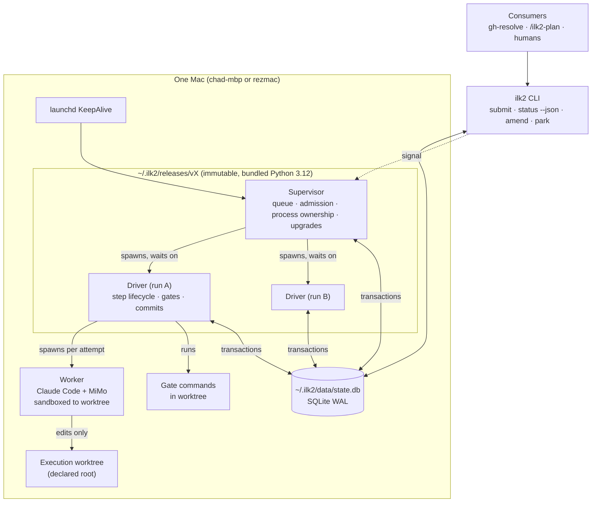
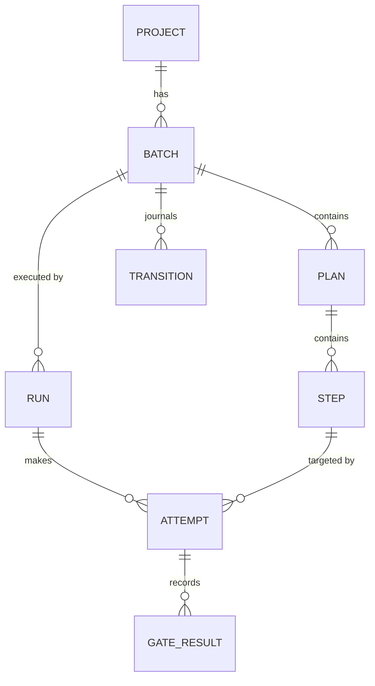
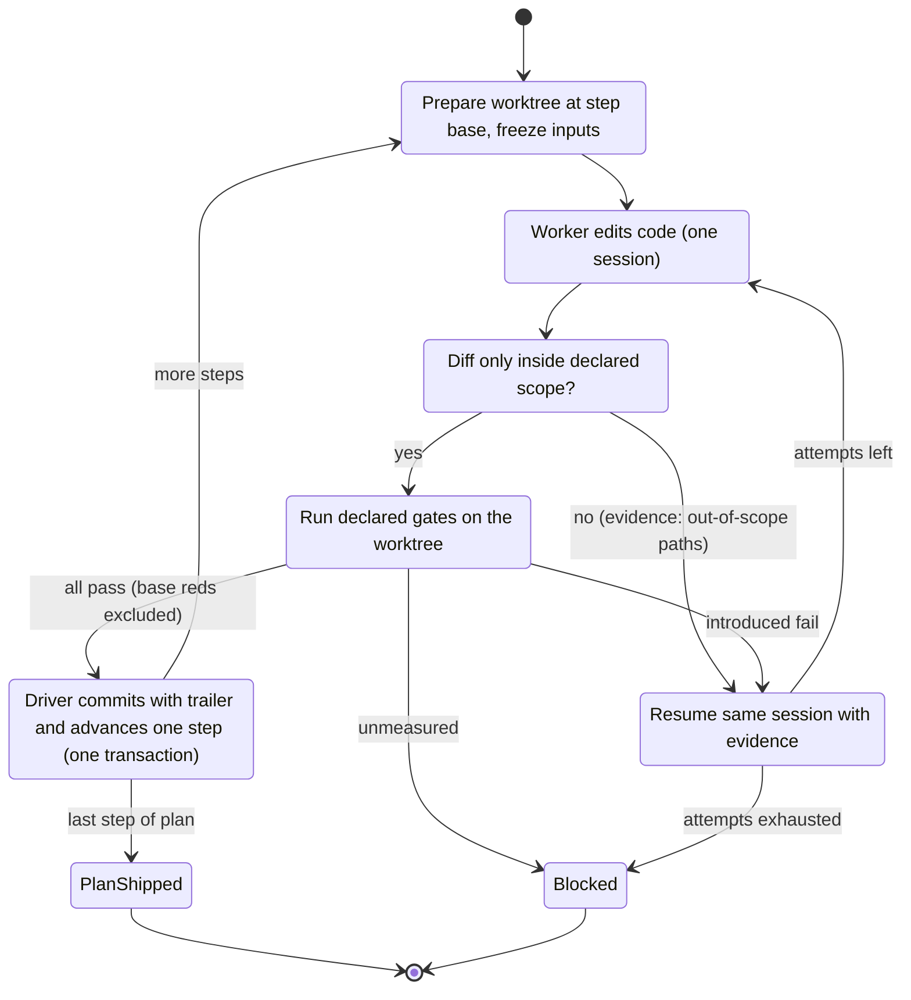

# 2. Architecture

ilk2 is one supervisor process per host. It starts one driver process per run, and each driver starts one worker at a time. All state goes through a single SQLite store. The worker edits code in a worktree; everything else is the driver's job.

## 2.1 Invariants

These are the rules every component must keep. Each one exists because V1 broke it; the V1 root causes are numbered as in [document 1](01-why-v2.md).

| # | Invariant | Removes V1 root cause |
|---|---|---|
| I1 | **Only the driver changes batch state** (step pointer, plan status, gate results, commits). The worker has no write path to state. | 1, 2 |
| I2 | **All state changes are SQLite transactions**, each with an actor, a reason and the previous version. Markdown is never written back. | 2 |
| I3 | **Identity is declared once, at submission:** project id, batch id, run id, execution root. Nothing is derived from paths afterwards. | 3 |
| I4 | **The supervisor knows every process because it started it:** a child process group, plus PID and start time in the store. No pgrep or argv matching anywhere. | 4 |
| I5 | **A gate result is `pass`, `fail` or `unmeasured`.** `unmeasured` (harness error, no tests found, runner unknown) is never treated as pass or fail. | 5 |
| I6 | **Reds that exist at the batch base are measured at the base and attributed to it.** Only reds introduced by the batch block a step. | 5 |
| I7 | **Code runs only from immutable releases.** A run records its release; upgrades happen at step boundaries. ilk2 never edits its own release. | 6 |
| I8 | **One language (Python 3.12), one platform (macOS).** | 7 |
| I9 | **Every terminal state has a named reason.** No state is "stuck" without a reason a human can read in `ilk2 status`. | Today's #8309 deadlock and "timeout" mislabel |

## 2.2 Components

| Component | Responsibility | Never does |
|---|---|---|
| **Supervisor** (`ilk2 supervise`) | Admits submitted batches. Decides what runs and keeps concurrency limits per host and per project. Spawns drivers and waits on them. On start-up, reconciles the store against live processes. Performs upgrades and drains. | Run gates, touch worktrees, call the model |
| **Driver** (`ilk2 drive <run_id>`) | Owns one run: prepares the worktree, freezes inputs, dispatches the worker, checks the diff's scope, runs gates, commits, advances one step, retries with red evidence, and records the terminal reason | Choose which batch runs; edit another run's state |
| **Worker** | Claude Code CLI with MiMo, under a private config dir. Edits files in the worktree to complete one step | Write the store, plans, or anything outside the worktree; run `git commit` or `push`; decide step progress |
| **Store** | One SQLite file holding projects, batches, plans, steps, runs, attempts, gate results, transitions and events | Hold secrets |
| **CLI** | Submission, status (human and `--json`), amend, park, resume, doctor, upgrade | Bypass the transition API |

## 2.3 State model

- **PROJECT:** id, repo root, default branch, gate adapters, concurrency limit. Registered explicitly with `ilk2 project add`.
- **BATCH:** id, project, base commit, status (`queued → active → shipped | blocked | parked`), source Markdown hash.
- **PLAN** (V1 "sub-plan"): order, dependencies, status, `verification: true|false`.
- **STEP:** index, instructions, declared gates, status (`pending → accepted | failed`).
- **RUN:** one driver process lifetime. Holds PID, PGID, start time, release version, execution root and terminal reason.
- **ATTEMPT:** one worker dispatch for one step. Records session id, timings (model, thinking, tools, gates), diff hash and outcome.
- **TRANSITION:** append-only journal: entity, from, to, actor, reason, previous version. The only way state changes.

Concurrency control: every transition checks the row's version, so it is a compare-and-set. A run holds a lease on its batch, and only the lease holder may move that batch's steps.

## 2.4 How a step runs

What this removes from V1:
- **Plans ship themselves.** When the driver accepts a plan's last step, the plan is shipped in the same transaction. No separate worker ship, `gate_first` marker or ship script is needed, so the Oct 12 #8309 deadlock cannot occur.
- **Batch verification is a plan like any other.** Its steps run gates; it has no special dispatch rules.
- **Timeouts are real timeouts.** An attempt that dispatched nothing cannot exist: the driver either dispatches or ends the run with a named reason (I9).

## 2.5 Gates

- **Declared gates are commands** with an explicit adapter (`pytest`, `vitest`, `shell`), a working directory and a time cap. They run in the worktree with a pinned environment.
- **Added checks** (V1's "mention gate") come only from an adapter that can resolve the runner for that file. The vitest adapter finds the config whose `include` matches the file; the pytest adapter uses the project's rootdir. If no adapter resolves a file, no command is made, and the file is recorded as `uncovered`.
- **Base measurement:** once per batch, the driver runs the declared gates at the batch base and records the failing test IDs. A step fails only on test IDs not in that set. This is a measurement taken at the base, not reuse of an earlier gate result. V1's false-green history (07m R1/R2) stays excluded.
- **Outcomes:** `pass`, `fail` (with introduced IDs), or `unmeasured` (with the reason). `unmeasured` blocks the step with that reason.

## 2.6 Worker isolation

- **Private Claude config dir per run,** copied from a pinned template: model `mimo-v2.6-pro`, `CLAUDE_CODE_MAX_CONTEXT_TOKENS=1000000`, the hooks, and an MCP allow-list.
- **macOS `sandbox-exec` profile:** writes allowed only to the worktree and a per-attempt temp dir. The store, plans, `~/.ilk2/releases` and `.git` internals are read-only to the worker.
- **A hook refuses `git commit`, `git push` and edits outside the worktree**, as a second layer behind the sandbox.
- **The brief** contains the step instructions, the declared gates, the previous attempt's red evidence, and paths the worker may read. It contains no plan files the worker could edit.
- **Spike before building:** test the Claude Agent SDK as the dispatch layer. It would give session ids, resume and hooks programmatically instead of parsing CLI stream output. It must work with the MiMo endpoint; if it does not, use the CLI with `--resume`.

## 2.7 Releases and upgrades

- **A release** is `~/.ilk2/releases/<version>/`: the code, a uv-built virtualenv and a manifest with hashes. `~/.ilk2/current` points at one release. launchd starts the supervisor from `current`.
- **Upgrades drain at step boundaries:** `ilk2 upgrade <version>` tells the supervisor to stop admitting new steps. Each driver finishes its current step and exits with reason `drained`. Then the supervisor re-executes itself from the new release and resumes the runs. Runs record which release made each commit.
- **Both hosts** install the same release with `ilk2 upgrade`. `ilk2 doctor --hosts` compares versions over ssh.

## 2.8 Consumer interface

- **The CLI with JSON output is the contract:** `ilk2 submit <batch.md|json>`, `ilk2 status [--batch ID] --json`, `ilk2 runs --json`, `ilk2 events --since <cursor> --json`, `ilk2 park|resume|amend`.
- **Every JSON output carries `api_version`.** Breaking changes bump it, and the CLI keeps the previous version for one release.
- **gh-resolve** submits one batch per issue, with that issue's worktree as the declared execution root (I3). The concurrency limit is per project, so several issues run in parallel with no keying workaround.

## 2.9 Observability

- **Every attempt records** wall time, time to first edit, model API time, thinking time (when the stream reports it), tool time, gate time, outcome and reason.
- **`ilk2 report`** prints the three comparison metrics from the V1 assessment: minutes per accepted step (all attempts), share of attempts that produce nothing, and human transitions per batch.

## 2.10 Crash and restart behaviour

| Event | Behaviour |
|---|---|
| Supervisor restarts | Reads runs in non-terminal state. For each one, checks PID plus start time. If alive, it adopts the driver; if gone, it marks the run `lost` and requeues the batch from its last accepted step. |
| Driver crashes mid-attempt | The supervisor sees the exit. The attempt is recorded `interrupted`. The worktree is kept for diagnosis, and the next run starts from the last accepted commit. |
| Worker hangs | The driver kills the worker's process group at the attempt time cap. The outcome is `timeout`, and only then. |
| Host reboot | launchd starts the supervisor, and the same reconciliation runs. |

## 2.11 Code layout and size budget

| Module | Purpose | Budget (lines) | Seed from V1 |
|---|---|---:|---|
| `ilk2/store.py` | Schema, migrations, transitions (CAS), events | 600 | `plan_state.py` |
| `ilk2/supervisor.py` | Queue, admission, process ownership, reconcile, upgrade | 700 | `run_registry.py` |
| `ilk2/driver.py` | Step lifecycle, retries, commit | 800 | `driver_step.py`, `iteration_context.py` |
| `ilk2/worker.py` | Brief, config dir, sandbox, dispatch, stream timings | 600 | `run_inputs.py`, `worker_dispatch.py` |
| `ilk2/gates/` | Adapters (pytest, vitest, shell), base measurement | 700 | `run_local_checks.py` (parts) |
| `ilk2/plans.py` | Import V1 MASTER/sub-plan Markdown and ilk2 JSON | 400 | `dispatch_target.py` |
| `ilk2/cli.py` | Commands and JSON output | 500 | none |
| `ilk2/release.py` | Build, install, verify, doctor | 400 | none |
| **Total** | | **about 4,700** | |
