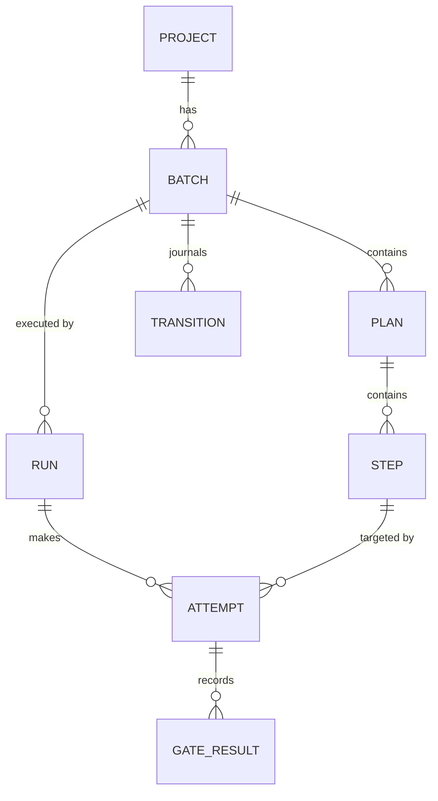
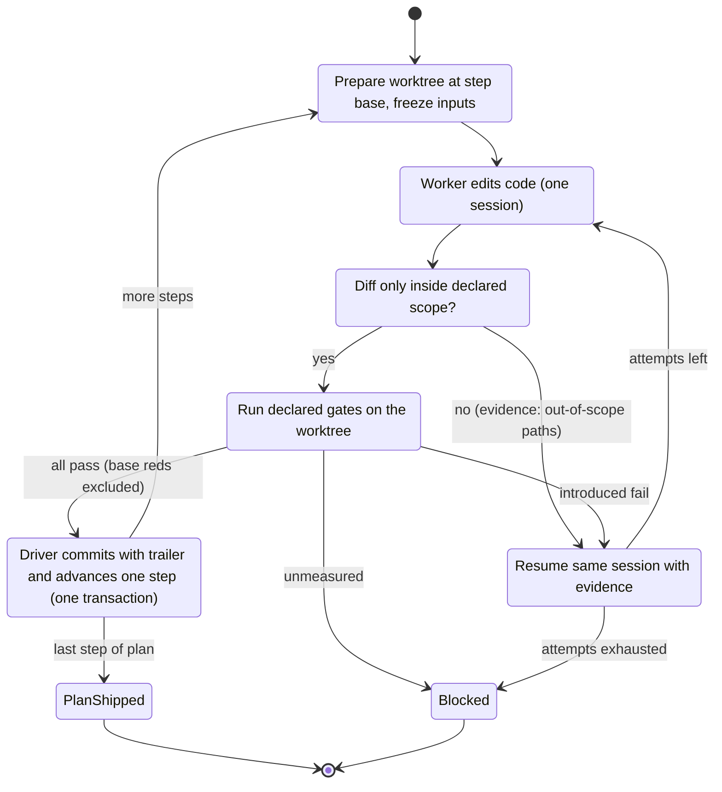

# 2. Architecture

ilk2 is one supervisor process per host. It starts one driver process per run, and each driver starts one worker at a time. All state goes through a single SQLite store. The worker edits code in a worktree; everything else is the driver's job.

## 2.1 Invariants

These are the rules every component must keep. Each one exists because V1 broke it; the V1 root causes are numbered as in [document 1](01-why-v2.md).

| # | Invariant | Removes V1 root cause |
|---|---|---|
| I1 | **Only the driver changes batch state** (step pointer, plan status, gate results, commits). The worker has no write path to state. | 1, 2 |
| I2 | **All state changes are SQLite transactions**, each with an actor, a reason and the previous version. Markdown is never written back. | 2 |
| I3 | **Identity is declared once, at submission:** project id, batch id, run id, execution root. Nothing is derived from paths afterwards. | 3 |
| I4 | **The supervisor knows every process because it started it:** a child process group, plus PID and start time in the store. No pgrep or argv matching anywhere. | 4 |
| I5 | **A gate result is `pass`, `fail` or `unmeasured`.** `unmeasured` (harness error, no tests found, runner unknown) is never treated as pass or fail. | 5 |
| I6 | **Reds that exist at the batch base are measured at the base and attributed to it.** Only reds introduced by the batch block a step. | 5 |
| I7 | **Code runs only from immutable releases.** A run records its release; upgrades happen at step boundaries. ilk2 never edits its own release. | 6 |
| I8 | **One language (Python 3.12), one platform (macOS).** | 7 |
| I9 | **Every terminal state has a named reason.** No state is "stuck" without a reason a human can read in `ilk2 status`. | Today's #8309 deadlock and "timeout" mislabel |
| I10 | **Every refusal to dispatch queued work is a recorded row.** The row names the reason, the action that clears it, and who takes that action (`supervisor`, `driver` or `human`). Refused hours are reported. A refusal whose clearing action is `supervisor` or `driver` must clear without a human. No guard exists only to re-check what the driver already wrote. | V1 refused queued work for about 0.8 h per hour worked ([evidence](evidence/2026-10-12-v1-stuck-and-slow.md) §1) |
| I11 | **Every non-terminal state has a time bound and an action when the bound passes.** The action is automatic, or it names a human and notifies them. Every retry loop has a counted limit. The full table is §2.11. | V1's stalls: a hung runner, escalation loops, relaunch storms, a blocked dependency re-dispatched all night (§2.11) |

## 2.2 Components

```mermaid
flowchart TB
  subgraph Host["One Mac (chad-mbp or rezmac)"]
    LD[launchd KeepAlive] --> SUP
    subgraph REL["~/.ilk2/releases/vX (immutable, bundled Python 3.12)"]
      SUP["Supervisor<br/>queue · admission · process ownership · upgrades"]
      DRV1["Driver (run A)<br/>step lifecycle · gates · commits"]
      DRV2["Driver (run B)"]
    end
    DB[("~/.ilk2/data/state.db<br/>SQLite WAL")]
    SUP -- spawns, waits on --> DRV1
    SUP -- spawns, waits on --> DRV2
    DRV1 -- spawns per attempt --> W1["Worker<br/>Claude Code + MiMo<br/>sandboxed to worktree"]
    DRV1 -- runs --> G1["Gate commands<br/>in worktree"]
    SUP <-- transactions --> DB
    DRV1 <-- transactions --> DB
    DRV2 <-- transactions --> DB
    W1 -- edits only --> WT1["Execution worktree<br/>(declared root)"]
  end
  CLI["ilk2 CLI<br/>submit · status --json · amend · park"] <--> DB
  CLI -. signal .-> SUP
  CONS["Consumers<br/>gh-resolve · /ilk2-plan · humans"] --> CLI
```

| Component | Responsibility | Never does |
|---|---|---|
| **Supervisor** (`ilk2 supervise`) | Admits submitted batches. Decides what runs and keeps concurrency limits per host and per project. Records every refusal with its clearing action (I10). Spawns drivers and waits on them. On start-up, reconciles the store against live processes. Performs upgrades and drains. | Run gates, touch worktrees, call the model, or add a pre-dispatch audit of driver-written state |
| **Driver** (`ilk2 drive <run_id>`) | Owns one run: prepares the worktree, freezes inputs, dispatches the worker, checks the diff's scope, runs gates, commits, advances one step, retries with red evidence, and records the terminal reason | Choose which batch runs; edit another run's state |
| **Worker** | Claude Code CLI with MiMo, under a private config dir. Edits files in the worktree to complete one step | Write the store, plans, or anything outside the worktree; run `git commit` or `push`; decide step progress |
| **Store** | One SQLite file holding projects, batches, plans, steps, runs, attempts, gate results, transitions and events | Hold secrets |
| **CLI** | Submission, status (human and `--json`), amend, park, resume, doctor, upgrade | Bypass the transition API |

## 2.3 State model

- **PROJECT:** id, repo root, default branch, gate adapters, concurrency limit. Registered explicitly with `ilk2 project add`.
- **BATCH:** id, project, base commit, status (`queued → active → shipped | blocked | parked`), source Markdown hash.
- **PLAN** (V1 "sub-plan"): order, dependencies, status, `verification: true|false`.
- **STEP:** index, instructions, declared gates, status (`pending → accepted | failed`).
- **RUN:** one driver process lifetime. Holds PID, PGID, start time, release version, execution root and terminal reason.
- **ATTEMPT:** one worker dispatch for one step. Records session id, timings (model, thinking, tools, gates), diff hash and outcome.
- **TRANSITION:** append-only journal: entity, from, to, actor, reason, previous version. The only way state changes.

Concurrency control: every transition checks the row's version, so it is a compare-and-set. A run holds a lease on its batch, and only the lease holder may move that batch's steps.

## 2.4 How a step runs

What this removes from V1:
- **Plans ship themselves.** When the driver accepts a plan's last step, the plan is shipped in the same transaction. No separate worker ship, `gate_first` marker or ship script is needed, so the Oct 12 #8309 deadlock cannot occur.
- **Batch verification is a plan like any other.** Its steps run gates; it has no special dispatch rules.
- **Timeouts are real timeouts.** An attempt that dispatched nothing cannot exist: the driver either dispatches or ends the run with a named reason (I9).

## 2.5 Gates

- **Declared gates are commands** with an explicit adapter (`pytest`, `vitest`, `shell`), a working directory and a time cap. They run in the worktree with a pinned environment.
- **Added checks** (V1's "mention gate") come only from an adapter that can resolve the runner for that file. The vitest adapter finds the config whose `include` matches the file; the pytest adapter uses the project's rootdir. If no adapter resolves a file, no command is made, and the file is recorded as `uncovered`.
- **Base measurement:** once per batch, the driver runs the declared gates at the batch base and records the failing test IDs. A step fails only on test IDs not in that set. This is a measurement taken at the base, not reuse of an earlier gate result. V1's false-green history (07m R1/R2) stays excluded.
- **Outcomes:** `pass`, `fail` (with introduced IDs), or `unmeasured` (with the reason). `unmeasured` has two kinds:
  - **Transient:** the harness crashed or was killed by a signal, or the gate hit its own cap while the host was under load. The driver re-runs the gate once on the same tree, with no new worker attempt.
  - **Permanent:** no tests were collected, the runner is unknown, the command was not found, or the second run is also unmeasured. The step is blocked with the reason.
- **Expected reds:** a red-first step declares the test IDs it expects to fail (`expect: red`). The gate then passes only if exactly those IDs fail and nothing else regresses. (V1 retro `a-red-first-step-gated-on-green`: correct work was failed by its own gate, and the project was blacklisted for an hour.)

## 2.6 Worker isolation

- **Private Claude config dir per run,** copied from a pinned template: model `mimo-v2.6-pro`, `CLAUDE_CODE_MAX_CONTEXT_TOKENS=1000000`, the hooks, and an MCP allow-list.
- **macOS `sandbox-exec` profile:** writes allowed only to the worktree and a per-attempt temp dir. The store, plans, `~/.ilk2/releases` and `.git` internals are read-only to the worker.
- **A hook refuses `git commit`, `git push` and edits outside the worktree**, as a second layer behind the sandbox.
- **The brief** contains the step instructions, the declared gates, the previous attempt's red evidence, and paths the worker may read. It contains no plan files the worker could edit.
- **The brief preloads what the worker would otherwise go and find.** In V1, 42% of iteration wall time passed before the first edit ([evidence](evidence/2026-10-12-v1-stuck-and-slow.md) §2). The driver can assemble most of that context itself: the files and symbols the step names, their tests, the failing output, and the relevant diff from earlier steps. It does this before dispatch, at no model cost. How much to preload is open question Q10. The P1 spike measures preloading against discovery on the same step.
- **Spike before building:** test the Claude Agent SDK as the dispatch layer. It would give session ids, resume and hooks programmatically instead of parsing CLI stream output. It must work with the MiMo endpoint; if it does not, use the CLI with `--resume`.

## 2.7 Releases and upgrades

- **A release** is `~/.ilk2/releases/<version>/`: the code, a uv-built virtualenv and a manifest with hashes. `~/.ilk2/current` points at one release. launchd starts the supervisor from `current`.
- **Upgrades drain at step boundaries:** `ilk2 upgrade <version>` tells the supervisor to stop admitting new steps. Each driver finishes its current step and exits with reason `drained`. Then the supervisor re-executes itself from the new release and resumes the runs. Runs record which release made each commit.
- **Both hosts** install the same release with `ilk2 upgrade`. `ilk2 doctor --hosts` compares versions over ssh.

## 2.8 Consumer interface

- **The CLI with JSON output is the contract:** `ilk2 submit <batch.md|json>`, `ilk2 status [--batch ID] --json`, `ilk2 runs --json`, `ilk2 events --since <cursor> --json`, `ilk2 park|resume|amend`.
- **Every JSON output carries `api_version`.** Breaking changes bump it, and the CLI keeps the previous version for one release.
- **gh-resolve** submits one batch per issue, with that issue's worktree as the declared execution root (I3). The concurrency limit is per project, so several issues run in parallel with no keying workaround.

## 2.9 Observability

- **Every attempt records** wall time, time to first edit, model API time, thinking time (when the stream reports it), tool time, gate time, outcome and reason.
- **`ilk2 report`** prints five comparison metrics:
  - minutes per accepted step (all attempts);
  - share of attempts that produce nothing;
  - human transitions per batch;
  - **refused hours:** queued but not dispatched, by reason and clearing actor (I10);
  - **minutes to first edit** per attempt.

  The first three come from the V1 assessment. The last two come from the Oct 12 [evidence](evidence/2026-10-12-v1-stuck-and-slow.md).

## 2.10 Crash and restart behaviour

| Event | Behaviour |
|---|---|
| Supervisor restarts | Reads runs in non-terminal state. For each one, checks PID plus start time. If alive, it adopts the driver; if gone, it marks the run `lost` and requeues the batch from its last accepted step. Each requeue counts against that step's restart limit (§2.11). |
| Driver crashes mid-attempt | The supervisor sees the exit. The attempt is recorded `interrupted`. The worktree is kept for diagnosis, and the next run starts from the last accepted commit. |
| Worker hangs | The driver kills the worker's process group at the attempt time cap. The outcome is `timeout`, and only then. |
| Host reboot | launchd starts the supervisor, and the same reconciliation runs. |

## 2.11 Progress guarantee

**The promise:** a submitted batch either moves forward, or stops in a named state whose clearing actor has been told. No state waits without a bound (I9, I10, I11).

### 2.11.1 Bounds

| State or phase | Bound | When the bound passes | Who acts |
|---|---|---|---|
| Driver phase: prepare, scope check or commit | 10 min each | The supervisor kills the driver's process group. The run ends `stalled (<phase>)`, and the batch is requeued from its last accepted step | Supervisor |
| Dispatch (worker running) | Attempt cap (Q7) + 5 min | The driver kills the worker's group at the cap: outcome `timeout`. If the driver misses the grace period, the supervisor treats it as a stalled phase | Driver, then supervisor |
| Gate running | The gate's declared cap + 5 min | The driver kills the gate's group, which counts as a transient `unmeasured`. The gate is re-run once (§2.5). The supervisor is the backstop | Driver, then supervisor |
| Model API error (429, 5xx, overloaded) | Backoff of 1, 2, 4 … 30 min; 2 h per run | Not counted as an attempt. After 2 h the batch gets a `waiting (api)` refusal row (I10), cleared by the supervisor. The supervisor probes every 30 min and notifies once at 6 h | Supervisor |
| Quota exhausted | Until the reported reset, or hourly probes if none is reported | A `quota` refusal row, cleared by the supervisor. Notifies once | Supervisor |
| Attempts on one step | 3 (Q6) | Step `blocked (attempts)`, with the red evidence of each attempt | Human, notified |
| Restarts of one step (run lost, interrupted or stalled) | 3 | Step `blocked (crash-loop)`, with all three reasons | Human, notified |
| Plan whose dependency is blocked | Immediate | `blocked (dependency: <plan>)`. Independent plans keep running | Clears when the blocking plan clears |
| Batch with nothing runnable | Immediate | Batch `blocked`, listing each blocked plan and its reason | Human, notified |
| Queued but refused (I10) | Re-evaluated every tick | Rows cleared by the supervisor re-check themselves. Rows cleared by a human notify when created | Per row |
| Parked | None: explicit human state | Shown at the top of `ilk2 status` | Human |

**How the supervisor sees a stall:** the driver writes an event to the store at the start and end of every phase. Every 30 s the supervisor compares the age of the current phase with its bound. The heartbeat is the phase event itself, not a timer thread. A timer thread keeps beating while the main loop is hung, so it would hide the stall; V1's retro `the-ledger-spawn-held-the-runner` is a runner held by a child process it had started in the background.

### 2.11.2 Checks at submission and activation

`ilk2 submit` rejects a batch before it is queued, with every reason listed, when:
- a step declares no gate (vacuous; V1 memory `step-heading-colon-makes-gates-vacuous`);
- a declared gate resolves to no adapter, or its executable is not on the pinned `PATH` in the execution root;
- a plan dependency names a missing plan or forms a cycle;
- the execution root is missing, or is not a git worktree of the project.

When the batch becomes active, the driver runs the base measurement in the execution root before any worker starts. If the base is permanently `unmeasured`, the batch is `blocked (base-unmeasured)` and no model time has been spent. (V1 retro `the-gate-cannot-pass-from-the-worktree`: a batch parked four times in four hours because its gate could not pass from where the loop ran it.)

### 2.11.3 Telling a human

Entering any state cleared by a human does three things, once per entry, not once per tick:
- posts a macOS notification on the host;
- writes a `needs_human` event to `ilk2 events --json`, where consumers such as gh-resolve can react;
- puts the state at the top of `ilk2 status`.

A state meant for a human is never retried automatically. (V1 retro `a-designed-escalation-loops`: a stop that the code called a human escalation cycled every 35 minutes until someone parked it.)

### 2.11.4 The stall suite

Each case injects one fault into a throwaway batch. M1 requires all of them to pass ([document 4](04-v1-relation-and-migration.md) §4.4).

| # | Fault injected | Expected result | V1 source |
|---|---|---|---|
| S1 | Driver's main loop hangs in prepare | `stalled (prepare)`, requeued, the step then ships | retro `the-ledger-spawn-held-the-runner` |
| S2 | Worker hangs | `timeout` at the cap, killed by process group, named as a timeout and nothing else | retro `a-hard-stop-disguised-as-a-timeout` |
| S3 | Gate ignores its cap | Killed, transient `unmeasured`, re-run once | retro `a-verify-that-cannot-fit-its-own-gate` |
| S4 | Gate runner missing | `unmeasured` (permanent), blocked at once, 0 further attempts | retro `a-gate-that-could-not-pass-read-as-a-timeout` |
| S5 | API returns 429 and 5xx for 10 min | No attempt counted; the step continues afterwards | memory `exit-state-vocabulary-is-under-declared` (quota) |
| S6 | Driver killed at every start | `blocked (crash-loop)` after 3 restarts, one notification | memory `relaunch-fixes-state-not-step-design` (a second failure at the same step is a design defect, not something to relaunch) |
| S7 | One plan blocked, another depends on it, a third is independent | Dependent is `blocked (dependency)`, the independent plan ships, the batch ends `blocked`, one notification | memory `blocked-dependent-is-not-runnable` |
| S8 | Red-first step | Passes with its declared expected reds | retro `a-red-first-step-gated-on-green` |
| S9 | Step with no gate; gate executable missing | Rejected at submit, no run created | memory `step-heading-colon-makes-gates-vacuous` |
| S10 | Base cannot be measured in the execution root | `blocked (base-unmeasured)` before any dispatch | retro `the-gate-cannot-pass-from-the-worktree` |
| S11 | Supervisor killed mid-batch | Driver adopted or run requeued; the batch ships (existing M1 case) | memory `runner-launched-pid-is-a-wrapper` |
| S12 | A state cleared by a human, held for 30 min | Exactly one notification, 0 automatic retries | retro `a-designed-escalation-loops` |

### 2.11.5 Judgment calls in this section

Each needs data from P2 and is revisited at M1.
- **Phase bound of 10 min** for prepare, scope check and commit. Basis: these do git and store work only. Wrong if large repos make a normal prepare take longer; then derive the bound per project from measured phase times.
- **5 min grace** after the attempt and gate caps. Basis: process-group kill and cleanup take seconds. Wrong if `stalled` fires on runs that were about to finish.
- **30 s supervisor tick.** Basis: it is cheap, and it is fine-grained compared with any bound. Wrong if store contention shows up in the timings.
- **API backoff of 1-30 min with a 2 h budget per run**, notifying at 6 h. Basis: V1 outages were either minutes long or quota resets. Wrong if MiMo outages often last 2-6 h; then notify sooner.
- **3 restarts per step.** Basis: matches the attempt limit (Q6). One crash is noise, three is a defect. Wrong if host sleep or reboots cause legitimate repeated losses; then exclude host-reboot losses from the count.
- **One re-run for a transient `unmeasured`.** Basis: a second identical failure is not transient. Wrong if load-induced gate timeouts need a quieter re-run slot, in which case wait for the host's run count to drop before re-running.
- **Line budget unchanged at about 4.7k.** Basis: these checks are table-driven and live in the supervisor (stall check, notifications), the driver (re-run, expected reds) and the plan importer (submit checks). Wrong if supervisor plus driver pass about 1.8k lines at M1; then the size kill criterion in [document 4](04-v1-relation-and-migration.md) §4.6 applies.

## 2.12 Code layout and size budget

| Module | Purpose | Budget (lines) | Seed from V1 |
|---|---|---:|---|
| `ilk2/store.py` | Schema, migrations, transitions (CAS), events | 600 | `plan_state.py` |
| `ilk2/supervisor.py` | Queue, admission, process ownership, reconcile, upgrade | 700 | `run_registry.py` |
| `ilk2/driver.py` | Step lifecycle, retries, commit | 800 | `driver_step.py`, `iteration_context.py` |
| `ilk2/worker.py` | Brief, config dir, sandbox, dispatch, stream timings | 600 | `run_inputs.py`, `worker_dispatch.py` |
| `ilk2/gates/` | Adapters (pytest, vitest, shell), base measurement | 700 | `run_local_checks.py` (parts) |
| `ilk2/plans.py` | Import V1 MASTER/sub-plan Markdown and ilk2 JSON | 400 | `dispatch_target.py` |
| `ilk2/cli.py` | Commands and JSON output | 500 | none |
| `ilk2/release.py` | Build, install, verify, doctor | 400 | none |
| **Total** | | **about 4,700** | |
