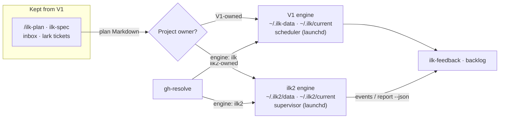
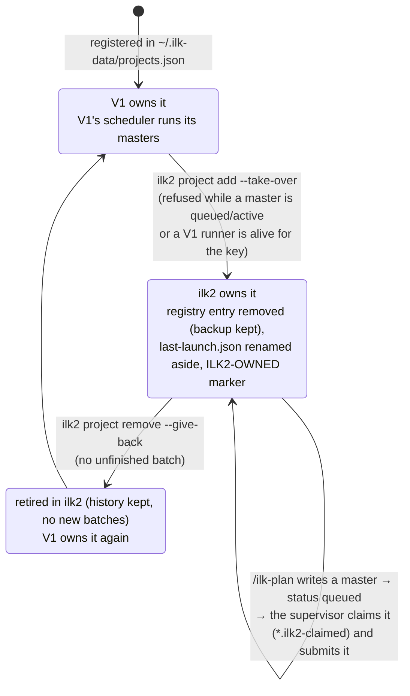
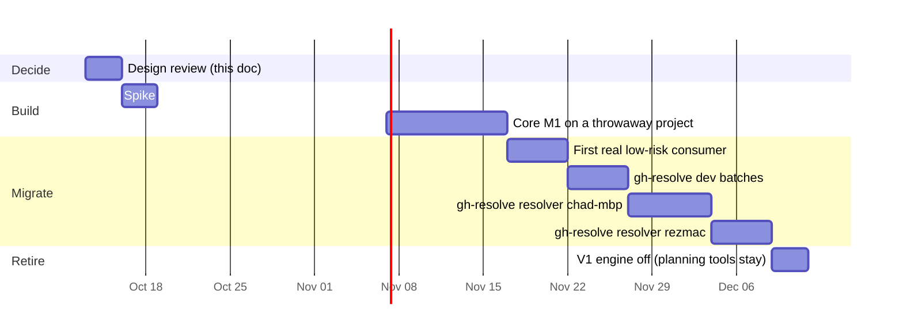

# 4. Relation to V1, and migration

V2 replaces V1's *execution engine* only. V1's planning, feedback and ticket tools stay and feed V2. Both engines run side by side on the same Macs, but **each project is owned by exactly one engine at a time.** Projects move one by one, with measured acceptance criteria and a rollback.

## 4.1 What V2 replaces, keeps and leaves alone

| V1 component (`ilk-skills/skills/…`) | Non-test lines | Fate under V2 |
|---|---:|---|
| `ilk-loop`: runner, driver, gates, ship-integrity | 62,056 | **Replaced** by `ilk2` supervisor, driver and gates |
| `ilk-watchdog`: scheduler, watchdog, triage | 11,215 | **Replaced** by the supervisor (admission, reconcile, restart) |
| `ilk-launcher`, `ilk-runner` | 4,466 + 2,268 | **Replaced** by `ilk2 submit` / `ilk2 supervise` |
| `ilk-ship` | 7,355 | **Mostly replaced:** shipping is a driver transition. Release tagging for consumers stays theirs |
| `ilk-upgrade` | 1,280 | **Replaced** by `ilk2 upgrade` (releases and drain) |
| `/ilk-plan`, `ilk-spec` (commands and skills) | n/a (prompts) | **Kept.** They author plan Markdown; `ilk2 submit` imports it |
| `ilk-feedback` (postmortems, backlog) | 6,460 | **Kept, adapted later** to read `ilk2 report` / `events --json` |
| `ilk-self-improve` | 3,164 | **Paused for ilk2.** Self-improvement of ilk2 happens only through reviewed releases |
| `ilk-inbox-tickets`, `ilk-lark-tickets` | 1,001 + 1,855 | **Kept.** They produce plans, which can target either engine |

Line counts: non-test `.py`, `.sh` and `.ps1` per skill dir at `d17ffdcd`.

## 4.2 How the two engines coexist

Mechanism:
- **Separate everything that can collide:**
  - data home: `~/.ilk-data` vs `~/.ilk2/data`
  - releases: `~/.ilk/releases` vs `~/.ilk2/releases`
  - launchd labels: `net.inluck.ilk.scheduler` vs `net.inluck.ilk2.supervisor`
  - commands: `/ilk…` vs `/ilk2…`
  - worker config templates

  V1's scheduler never scans `~/.ilk2`, and ilk2 never reads `~/.ilk-data`.
- **One owner per project.** ilk2 keeps a `projects` table; V1 keeps `~/.ilk-data/projects.json`. A project is listed in exactly one of them. `ilk2 project add` refuses a repo root that V1's `projects.json` still lists.
- **The one exception is a shadow project** (P5, §4.4). `ilk2 project add --shadow-of <repo>` registers a **separate clone** at its own root, never the V1-owned root. A shadow project:
  - has no push credentials, and its clone's remotes are set to push to nowhere;
  - gives the worker an empty MCP allow-list, so no external tools;
  - runs gates and the worker with no tokens other than the model credential the worker needs to reach MiMo (§2.5.2 of [document 2](02-architecture.md));
  - cannot acquire a consumer lease, and emits events marked `shadow`.

  It owns nothing V1 owns: not the repo root, branches, registry entry or external side effects.
- **No V1 code changes are needed for coexistence.** Ownership moves by removing the project from V1's registry, after its V1 batches have shipped or been parked (step 1 of 4.3).
- **Shared resources are the host CPU and the MiMo endpoint.** Each host has a run budget per engine. Separate budgets limit how many runs each engine starts; they do not isolate CPU, memory or the MiMo quota, so they cannot by themselves prevent one engine from starving the other. ilk2's budget starts at **2 concurrent runs** while V1 is active on the same host, as an **experiment guarded by host-load admission**: no ilk2 run starts while the host is under load ([document 2](02-architecture.md) §2.11.1). Gate timeout rates for both engines are compared before and after, and the per-project limit decides how ilk2's runs are shared. A host limit of 1 would make the chad-mbp resolver serial for all of P5 and fail P5's own "parallel runs" criterion (gh-resolve review H1). Judgment call, approved by Chad on Oct 13. Basis: P5 needs at least two concurrent resolver runs. Wrong if host load (CPU, memory, gate times) shows V1's runs slowing measurably; then lower V1's budget, not ilk2's, or move P5 to rezmac first.
- **Credentials:** the ilk2 worker template gets its own copy of the MiMo settings. It never reads V1 worker homes.

## 4.3 Moving one project (the handover procedure)

1. **Drain on V1:** let the project's active V1 masters ship, or park them with `/ilk-park`. Never stop a progressing batch for the migration.
2. **Take it over:** `ilk2 project add <id> <repo> --take-over` (or `ilk2 project take-over <id>` for a project already registered). Removing the project from V1's `projects.json` alone is **not** enough: V1's scheduler scans every `~/.ilk-data/projects/<key>/plans` and resolves the repo from `runtime/launcher/last-launch.json` first, the registry second, and skips a project it cannot resolve (`skip-unresolved`, ilk-skills `scheduler_scan.py`). So the takeover removes the registry entry (backup kept), renames `last-launch.json` aside, writes an `ILK2-OWNED` marker, and records the V1 key in the project's config. It refuses only while V1 could still run something for that repo's key: a `queued` or `active` master, or a live runner. Drafts, paused and blocked masters stay in V1's dir (`left_in_v1`) and do not block it. Under gh-resolve's per-run keys (`ilk_project_per_run`), each run's worktree is a separate V1 key with its own registry entry, so the clone can be taken over while V1 finishes its in-flight runs (rezmac, Oct 14). Every change is a rename or a backed-up rewrite (`ilk2/v1.py`).
3. **Keep V1's planning skills.** `/ilk-plan` still writes masters into the V1 plans dir. For a project ilk2 owns, the supervisor claims each `queued` master within one tick (renamed to `*.ilk2-claimed`, which V1's `MASTER-*.md` glob no longer matches; V1 polls every 5 min) and submits it. A plan ilk2 cannot accept opens a `plan-rejected` needs_human row. To stop `/ilk-plan` re-adding the repo to V1's registry (its step 8a), set `"autoschedule": false` in the repo's `.ilk-launch.json`.
4. **Or submit directly:** `ilk2 submit <master.md>`. The importer reads V1's MASTER and sub-plan Markdown, including what real plans contain (Oct 13, all 146 gh-resolve masters: steps only from the `## Steps` section, every YAML scalar style for `command:`, leading `VAR=value` as the gate's env, the last parseable `local_checks` block of a step; ilk2 commits carry V1's `[plan:<slug>#step-<idx>]` trailer). Added Oct 14, after gh-resolve's first live dispatch on rezmac was rejected: a bare `### Step N` heading is a step; a step with no `local_checks` of its own takes the sub-plan frontmatter's `local_checks`, as V1 does; `batch_verification: true` marks a verification plan. A step is vacuous only when both its own block and the frontmatter's are empty.
5. **Measure** with `ilk2 report` and compare with the project's V1 baseline (section 4.5).
6. **Roll back if needed, between batches only.** ilk2 never writes progress back to the Markdown (I2), so the original plan files still show every step as pending. Handing them to V1 would replay accepted work. Two safe paths:
   - **Between batches** (the default): let the ilk2 batch ship, or cancel it before its first step is accepted. Then `ilk2 project remove <id> --give-back`: it refuses while the project has an unfinished batch; it restores just that repo's V1 registry entry from the newest ilk2 backup (later registry changes are kept), renames `last-launch.json` back and removes the `ILK2-OWNED` marker. The project is retired, not deleted: it keeps its batch history and refuses new submissions.
   - **Mid-batch:** `ilk2 export --v1 <batch>` writes a V1-compatible plan snapshot. Each accepted step is marked done and linked to its commit, found by the `ilk2-attempt` trailer. V1 continues from that snapshot, never from the original files. Export refuses while any step is `accepting`.

**A project's owner over time** (one owner at a time, I3; [document 2](02-architecture.md) §2.4.2):

Per host, V1's scheduler stays on while anything still needs it, which `ilk2 v1 status` lists. `ilk2 v1 off --apply` disables it (plist moved to `disabled-by-ilk2/`, never deleted). `ilk2 v1 on --apply` is the rollback.

## 4.4 Migration phases

The dates are a sequence sketch, not a commitment. Each phase starts only when the previous phase's exit criterion holds.

| Phase | Exit criterion |
|---|---|
| P1 spike | Through the dispatch adapter with the CLI baseline: one MiMo session is dispatched, resumed with evidence, and killed by process group from Python. The sandbox denies a write outside the worktree. The SDK is tested against the adoption criteria in [document 2](02-architecture.md) §2.6 (Q1). The brief comparison runs over several representative V1 steps, both briefs per step, fresh worktrees and sessions, order counterbalanced ([document 3](03-v1-vs-v2.md) §3.4, Q10). A size estimate for the core is made from the spike's code. Written up in `docs/spikes/` |
| P2 core, milestone M1 | A throwaway consumer runs a 3-step batch unattended on ilk2: every step driver-gated and committed; 0 human transitions; a supervisor kill mid-batch is recovered. The stall suite S1-S27 ([document 2](02-architecture.md) §2.11.4) passes |
| P3 first real consumer | One repo that meets the criteria in Q5 (deterministic local gates, no production writes or credentials, representative multi-step work, suite under 5 min, easy rollback) ships 2 batches; metrics recorded. Provisional choice: `todo-triage`, if it meets them |
| P4 gh-resolve dev batches | Before P4 starts: attribution of new failures ([document 2](02-architecture.md) §2.5.7) is built and its suite A1-A10 passes. Then gh-resolve's own development batches run on ilk2 and meet the 4.5 targets. These are pytest only, so before P5 the vitest/bun path must also be proven: either a vitest consumer batch, or a dry run that resolves and runs the consumer's real gate (`bun run test:non-ui:convex`) on ilk2 at an issue's base (gh-resolve review M4) |
| P5/P6 resolver | gh-resolve submits issue batches to ilk2 with parallel runs (at least 2 at once on the host), first on chad-mbp, then rezmac. P5 starts in **shadow mode**: for its first issues, a shadow project (a separate clone, §4.2) runs the same issue alongside V1, with no push credentials, no external tools and no tokens, and its results are compared. It switches to live, through the normal one-owner handover, once the outcomes agree |
| P7 retire | V1 scheduler disabled on both hosts; V1 planning tools emit `ilk2 submit`; V1 repo is maintenance-only |

**Known cost of deferring attribution.** Until attribution lands before P4, a new failure that an earlier step caused is still repaired by whichever later step first runs that gate. The worker is told it is `possibly-inherited`, but must fix it, as in V1. That is the trap behind gh-resolve's F8 (two 60-minute iterations). It is accepted for M1 and P3 because P3's suite is under 5 minutes, which bounds the cost.

**As it happened** (dates 2026, CST):

| Phase | Done | What closed it |
|---|---|---|
| P1 spike, P2 core (M1) | Oct 13 | M1 met: 3-step batch unattended, supervisor kill recovered, stall suite S1-S27 |
| P3 first real consumer | Oct 13 | gh-triage (not todo-triage, Chad): 2 batches, 4 of 4 steps first-attempt, merged |
| P4 gh-resolve dev | Oct 13 | handover of gh-resolve's development; attribution A1-A10; the P5 adapter batch (15 steps) shipped Oct 14 05:37 and was merged (gh-resolve 2510bb8f). Baseline: [evidence](evidence/2026-10-14-gh-resolve-p5-batch-baseline.md) |
| ilk-skills dev | Oct 14 00:30 | taken over on chad-mbp (Chad's go), earlier than planned; V1's scheduler then switched off on chad-mbp (00:40) |
| P5/P6 resolver | Oct 14 ~20:40 | rezmac first (Chad): shadow mode on (`kira-shadow`), the clone taken over as `kira-live`, no shadow-agreement gate. The P6 live-adapter batch (12 of 12 steps, the first with parallel lanes) shipped 16:08, and gh-resolve merged it as v0.108.0. The resolver engine has been `ilk2` on rezmac since about 20:40. The first two live dispatches were rejected on V1-import gaps (bare step headings, frontmatter `local_checks`, script gates that are not test runners), fixed by 21:10; `ilk2 submit --check` now catches such gaps before go-live |
| P7 retire | half | chad-mbp done (Oct 14 00:40). rezmac: the resolver engine is ilk2, and V1's two in-flight masters (#8716, #8718) are blocked with their worktrees gone. `ilk2 v1 status` lists only 8 stale per-run registrations. `ilk2 v1 off --apply` on rezmac waits for Chad's go |

## 4.5 Acceptance targets (versus V1, same measurement method)

| Metric | V1 reference | ilk2 must reach |
|---|---|---|
| Minutes per accepted step, all attempts | 84-93 (Oct 12; re-measure per project before migrating) | No worse than V1 for the same project at P3; better by V1's wasted-attempt share by P5 |
| Share of attempts that produce nothing | 1/5 to 3/8 | Below V1 for the same project |
| Human transitions per batch | Several (owner re-plans, gate repairs) | 0 for M1; at most 1 per batch from P3 on, each with a recorded reason |
| Silent stuck states | Occurred (#8309 deadlock, mislabelled timeouts) | 0: every terminal state has a reason (I9) |
| Bound passed without an action | Not measurable in V1: no bounds were declared | 0. Every non-terminal state past its bound has a recorded action (I11), checked from the journal |
| Human waits | Found by someone looking | 1 durable `needs_human` row per state cleared by a human, delivered per the project's notification policy (`owner`: off the host too, re-sent until acknowledged; `consumer`: the event only, one off-host notice at 24 h); median minutes from creation to acknowledgement reported |
| Refused hours per hour worked (queued, not dispatched) | ≈0.8 on both projects, chad-mbp, Sep 15 to Oct 12 ([evidence](evidence/2026-10-12-v1-stuck-and-slow.md) §1) | 0 refusals without a named clearing action and actor (I10). The numeric target is set from M1 data, not before |
| Minutes to first edit, per attempt | Oct 12: 416 of 998 iteration minutes (42%) passed before the first edit; mean ≈17 min over 24 iterations. Overlaps with thinking | Reported, not targeted. The target is total minutes per accepted step (first row) |

## 4.6 Checkpoints and kill criteria (judgment calls, set before starting)

**Review checkpoints**, where Chad decides to continue, re-scope or stop:
- **After P1:** the spike's results and a size and effort estimate for M1, made from real code.
- **At about 60 hands-on hours into P2,** if M1 is not reached: a measured estimate of the remaining effort and the reason for the gap.
- **Size past the post-P1 estimate:** a review of which module grew and why. Line count is a diagnostic, not a kill signal on its own.

**Kill criteria:**
- **An invariant cannot be kept without coupling that recreates a V1 root cause** (for example, a second writer of batch state, or liveness inferred from process names). Basis: the invariants are the reason V2 exists. Wrong if a narrower form of the invariant serves the same purpose; then amend the invariant in review rather than kill.
- **The remaining effort to M1, measured at a checkpoint, exceeds the effort to retrofit the same five causes into V1** ([document 1](01-why-v2.md) §1.4). Basis: §1.4 is the alternative V2 must beat.
- **P4 metrics worse than V1 for the same project over 2 weeks.** Then stop, keep V1, and port the specific learnings (gate adapters, terminal reasons, the acceptance protocol) back into V1 as backlog rows.

## 4.7 What happens to V1 meanwhile

- **V1 keeps serving and gets only smoothness fixes** (standing rule: a smooth-to-not-smooth regression outranks feature work). Its D1/D2 work finishes as already assigned.
- **V1 backlog rows that an ilk2 invariant makes impossible** (for example `c5a10331421dcbb8` and `aa9501b25925c890`) are tagged "superseded by ilk2". They are closed only when their project migrates, not before.
- **gh-resolve gets an `engine: ilk | ilk2` setting** (its owner's change). Both paths keep working until P6.

## 4.8 What gh-resolve needs before switching engine

From gh-resolve's review (Oct 13). 28 of gh-resolve v0.106.0's 87 modules touch V1. They use plan Markdown found by run id, `last-exit.json` states, lock and pid files, ship-proof fields, `batch-gate.json`, `projects.json`, `park_master.py` and naming conventions. It never launches the loop itself.

| Blocker | How ilk2 covers it |
|---|---|
| One engine owner per repo root ([§4.2](#42-how-the-two-engines-coexist)) | The resolver's repo switches all at once per host, after its V1 resolver runs drain. Per-issue rollback stays cheap: one issue is one batch |
| No Markdown write-back (I2): every gh-resolve reader of plan files, `last-exit.json` and ship-proof must move | `status --json` carries status, terminal reason, failing gate, root lease, accepted head and per-step evidence ([document 2](02-architecture.md) §2.8) |
| gh-resolve parks and unparks other masters (supersede and re-dispatch) | `ilk2 cancel --superseded-by` |
| gh-resolve writes the registry itself | Not needed: `ilk2 submit` registers the batch; the project is registered once with `ilk2 project add` |
| Pinned tag on rezmac | `--api-version N`; the CLI keeps every pinned version |
| Q2, Q4, Q12 still open | Decide before P5 |
| Host limit of 1 (H1) | Resolved: ilk2 host budget of 2 (§4.2) |

## 4.9 Retiring V1: the checklist (P7)

V1's engine is off on a host when its launchd scheduler (`net.inluck.ilk.scheduler`) is disabled there. That is safe only when nothing on that host still needs V1 to run work. Inventory of Oct 13, 16:30 CST (read-only, both hosts; `scratchpad` script in the build session):

| What still needs V1 | Host | State | What retires it |
|---|---|---|---|
| gh-resolve's own development | chad-mbp | **moved to ilk2** (P4 handover; V1 resolves no repo for it) | done |
| ilk-skills' own development | chad-mbp | **moved to ilk2** (Oct 14, Chad's go): registry entry removed (backup `projects.json.bak-ilk2-1791908405`), `last-launch.json` renamed aside; 5 unshipped masters, none runnable, stay in V1's dir and are claimed if released | done |
| gh-resolve's resolver, fleet b (kira masters in V1's kira dir) | chad-mbp | 2 drafts, 1 blocked; no live runner | gh-resolve's `engine: ilk2` live on chad-mbp (P5). **Oct 14:** the P5 adapter is merged in gh-resolve (2510bb8f); shadow mode is not yet on, pending Chad's choice of host and time |
| gh-resolve's resolver (`kira-cloudflare-resolver`) | rezmac | V1-registered; main key 20 blocked, 3 paused; last close Oct 12 20:29 | gh-resolve's `engine: ilk2` live on rezmac (P6). **Oct 14 ~09:30:** the clone is taken over as ilk2 project `kira-live` (backup `projects.json.bak-ilk2-1791939434`; the 6 per-run V1 keys keep running and drain); shadow mode on (`kira-shadow`); P6 live adapter in progress in gh-resolve, no shadow-agreement gate (Chad) |

**The switch-off, per host, once its rows are retired:**
1. `ilk2 report` shows the host's ilk2 projects meeting §4.5, and `ilk2 v1 status` lists nothing that still needs V1 (a registered repo ilk2 does not own, a queued or active master, a live runner). A registered path that no longer exists is reported under `stale`, not as a blocker: V1's scheduler skips it (`skip-missing-path`). On rezmac, Oct 14, 5 of 8 per-run resolver registrations were like that.
2. Disable, do not delete: `ilk2 v1 off --apply` (refused while `status` lists anything) boots out `net.inluck.ilk.scheduler` and moves its plist to `~/Library/LaunchAgents/disabled-by-ilk2/`. `ilk2 v1 on --apply` moves it back and bootstraps it.
3. V1's data (`~/.ilk-data`) and releases (`~/.ilk`) stay as they are: history, baselines (`ilk2 report --v1-baseline`) and rollback.
4. V1's planning skills (`/ilk-plan`, `ilk-spec`, inbox and lark tickets) keep working: they write masters into V1's plans dir, and ilk2 claims the queued ones of the projects it owns.

**Order:** chad-mbp first (ilk-skills takeover now; fleet b at P5 live), then rezmac (P6).

**chad-mbp: V1 scheduler off** (Oct 14 00:40, Chad's go): `ilk2 v1 status` listed nothing, `ilk2 v1 off --apply` booted out `net.inluck.ilk.scheduler` and moved its plist to `~/Library/LaunchAgents/disabled-by-ilk2/`. Rollback: `ilk2 v1 on --apply`. rezmac still runs V1 (the resolver, until P6).
