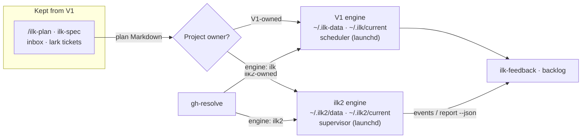
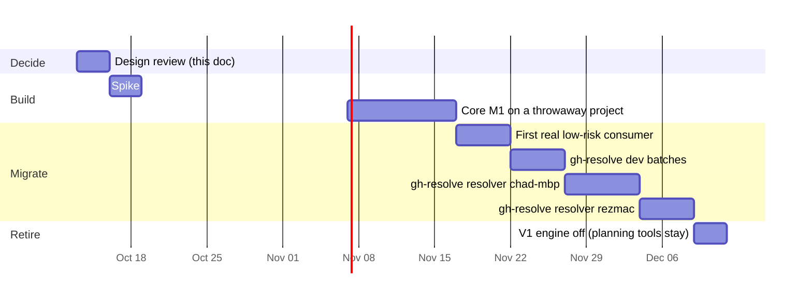

# 4. Relation to V1, and migration

V2 replaces V1's *execution engine* only. V1's planning, feedback and ticket tools stay and feed V2. Both engines run side by side on the same Macs, but **each project is owned by exactly one engine at a time.** Projects move one by one, with measured acceptance criteria and a rollback.

## 4.1 What V2 replaces, keeps and leaves alone

| V1 component (`ilk-skills/skills/…`) | Non-test lines | Fate under V2 |
|---|---:|---|
| `ilk-loop`: runner, driver, gates, ship-integrity | 62,056 | **Replaced** by `ilk2` supervisor, driver and gates |
| `ilk-watchdog`: scheduler, watchdog, triage | 11,215 | **Replaced** by the supervisor (admission, reconcile, restart) |
| `ilk-launcher`, `ilk-runner` | 4,466 + 2,268 | **Replaced** by `ilk2 submit` / `ilk2 supervise` |
| `ilk-ship` | 7,355 | **Mostly replaced:** shipping is a driver transition. Release tagging for consumers stays theirs |
| `ilk-upgrade` | 1,280 | **Replaced** by `ilk2 upgrade` (releases and drain) |
| `/ilk-plan`, `ilk-spec` (commands and skills) | n/a (prompts) | **Kept.** They author plan Markdown; `ilk2 submit` imports it |
| `ilk-feedback` (postmortems, backlog) | 6,460 | **Kept, adapted later** to read `ilk2 report` / `events --json` |
| `ilk-self-improve` | 3,164 | **Paused for ilk2.** Self-improvement of ilk2 happens only through reviewed releases |
| `ilk-inbox-tickets`, `ilk-lark-tickets` | 1,001 + 1,855 | **Kept.** They produce plans, which can target either engine |

Line counts: non-test `.py`, `.sh` and `.ps1` per skill dir at `d17ffdcd`.

## 4.2 How the two engines coexist

Mechanism:
- **Separate everything that can collide:**
  - data home: `~/.ilk-data` vs `~/.ilk2/data`
  - releases: `~/.ilk/releases` vs `~/.ilk2/releases`
  - launchd labels: `net.inluck.ilk.scheduler` vs `net.inluck.ilk2.supervisor`
  - commands: `/ilk…` vs `/ilk2…`
  - worker config templates

  V1's scheduler never scans `~/.ilk2`, and ilk2 never reads `~/.ilk-data`.
- **One owner per project.** ilk2 keeps a `projects` table; V1 keeps `~/.ilk-data/projects.json`. A project is listed in exactly one of them. `ilk2 project add` refuses a repo root that V1's `projects.json` still lists.
- **No V1 code changes are needed for coexistence.** Ownership moves by removing the project from V1's registry, after its V1 batches have shipped or been parked (step 1 of 4.3).
- **Shared resources are the host CPU and the MiMo endpoint.** The supervisor's host limit starts at 1 concurrent run while V1 is active on the same host. That is a judgment call: it keeps V1's measured baseline comparable. It is wrong if host load measurements show headroom; then raise it.
- **Credentials:** the ilk2 worker template gets its own copy of the MiMo settings. It never reads V1 worker homes.

## 4.3 Moving one project (the handover procedure)

1. **Drain on V1:** let the project's active V1 masters ship, or park them with `/ilk-park`. Never stop a progressing batch for the migration.
2. **Remove the project from V1's `projects.json`.** V1's scheduler stops seeing it.
3. **Register it in ilk2:** `ilk2 project add --root <repo> --gates <adapter config> --limit N`.
4. **Submit the next batch to ilk2** (`ilk2 submit <master.md>`). The importer reads V1's MASTER and sub-plan Markdown format unchanged.
5. **Measure** with `ilk2 report` and compare with the project's V1 baseline (section 4.5).
6. **Roll back if needed:** park the ilk2 batch, `ilk2 project remove`, then re-add the project to V1's `projects.json`. Plans are plain Markdown, so the same files work on V1.

## 4.4 Migration phases

The dates are a sequence sketch, not a commitment. Each phase starts only when the previous phase's exit criterion holds.

| Phase | Exit criterion |
|---|---|
| P1 spike | One MiMo session is dispatched, resumed with evidence, and killed by process group from Python. The sandbox denies a write outside the worktree. Written up in `docs/spikes/` |
| P2 core, milestone M1 | A throwaway consumer runs a 3-step batch unattended on ilk2: every step driver-gated and committed; 0 human transitions; a supervisor kill mid-batch is recovered |
| P3 first real consumer | One low-risk repo (candidates: `gh-triage`, `todo-triage`) ships 2 batches; metrics recorded |
| P4 gh-resolve dev batches | gh-resolve's own development batches run on ilk2 and meet the 4.5 targets |
| P5/P6 resolver | gh-resolve submits issue batches to ilk2 with parallel runs, first on chad-mbp, then rezmac |
| P7 retire | V1 scheduler disabled on both hosts; V1 planning tools emit `ilk2 submit`; V1 repo is maintenance-only |

ilk-skills itself is not on the list. Its development stays on V1 until P7, and its useful V1 fixes then become ilk2 inputs only where still relevant.

## 4.5 Acceptance targets (versus V1, same measurement method)

| Metric | V1 reference | ilk2 must reach |
|---|---|---|
| Minutes per accepted step, all attempts | 84-93 (Oct 12; re-measure per project before migrating) | No worse than V1 for the same project at P3; better by V1's wasted-attempt share by P5 |
| Share of attempts that produce nothing | 1/5 to 3/8 | Below V1 for the same project |
| Human transitions per batch | Several (owner re-plans, gate repairs) | 0 for M1; at most 1 per batch from P3 on, each with a recorded reason |
| Silent stuck states | Occurred (#8309 deadlock, mislabelled timeouts) | 0: every terminal state has a reason (I9) |

## 4.6 Kill criteria (judgment calls, set before starting)

- **M1 not reached within about 60 hands-on hours** after P1. Basis: the core budget is about 4.7k lines. Wrong if the spike reveals a dispatch-layer blocker that changes scope; then re-estimate rather than kill.
- **Core grows past about 7k lines before P3.** Basis: past that, the design is reproducing V1's sprawl.
- **P4 metrics worse than V1 for the same project over 2 weeks.** Then stop, keep V1, and port the specific learnings (gate adapters, terminal reasons) back into V1 as backlog rows.

## 4.7 What happens to V1 meanwhile

- **V1 keeps serving and gets only smoothness fixes** (standing rule: a smooth-to-not-smooth regression outranks feature work). Its D1/D2 work finishes as already assigned.
- **V1 backlog rows that an ilk2 invariant makes impossible** (for example `c5a10331421dcbb8` and `aa9501b25925c890`) are tagged "superseded by ilk2". They are closed only when their project migrates, not before.
- **gh-resolve gets an `engine: ilk | ilk2` setting** (its owner's change). Both paths keep working until P6.
