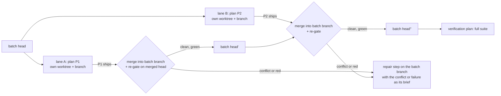

# 6. Open items after design close

The design was closed for P1 on Oct 13, 2026 (tag `design-accepted-p1`). Review rounds stopped there. Each item below is resolved at the phase that needs it, against real code, and reviewed at that phase boundary, not in further rounds on paper. Open questions that need Chad's decision stay in [document 5](05-open-questions.md).

## Review checkpoints from here

| When | Reviewed against | Reviewers |
|---|---|---|
| After P1 | The spike write-up in `docs/spikes/` and its code | Chad, Codex |
| At M1 | The core, the stall suite S1-S27, and the P2-1 evidence below | Chad, Codex |
| Before P4 | Attribution (§2.5.7) and suite A1-A10 | Codex, gh-resolve |
| Before P5 | The P5 addendum below, against gh-resolve's code at that time | gh-resolve, Codex |

## During P2, decided at M1

### P2-1: plan steps as the batch runs (Q17)

**Origin.** Chad, Oct 13, after P1 step 1: "is it better to plan beforehand or to plan as we go?" The design plans beforehand. A batch is submitted with its full step list. Amendments are version-checked, limited to steps that have not started, and recorded in an append-only journal (Q3). Nothing proposes the next step from what the last one found.

**Why it may matter.** Later steps are written against assumptions that earlier steps test. P1 had a case in its first step. Step 1 found that Claude Code's Bash tool runs commands in their own process group, so a kill of the worker's group orphans them (`spikes/p1/findings.md`, finding 1). That revealed a descendant-process hazard that step 3's sandbox or the supervisor's cleanup must cover. Whether step 3 itself has to change is not yet shown; the plan, written beforehand, did not name the hazard.

**Direction (not designed yet).** Fix the destination and its verification before the batch starts, and plan the steps as it runs:

| Sealed at submission: an autonomous amendment may strengthen these, never weaken them | May change as the batch runs |
|---|---|
| The batch goal | The concrete next 1-2 steps |
| The **verification obligations**: which gates exist, their minimum coverage, and a final verification plan. That plan is sealed: weakening, replacing, dropping or reordering it, or editing the verification assets it protects (its tests and gate configuration), needs a human amendment | The order of later pending steps |
| Bounds (§2.11), plus a **step budget** and a **planning budget** (below) | Replacing, splitting or dropping pending steps, by stable step id |

Gate *specification versions* are not frozen. They change legitimately when a step edits tests, runner configuration or `package.json` (§2.5.1). What is sealed is the obligation, not the hash.

**Who writes what (I1).** A planning pass writes nothing authoritative. It emits a **proposal**: the amendment, the plan version it was made against, and the evidence it cites (attempt ids, commits, gate output). Only the driver applies a proposal. It does so in one transaction, after checking the plan version, the sealed envelope, both budgets, and that every touched step is still pending. The journal is append-only. Each amendment may replace, reorder or drop pending steps. Acceptance stays with the driver's gates (§2.4-2.4.1).

**Budgets, so the loop is bounded (I11):**
- **The step budget is monotonic.** Every created step consumes a slot permanently, split replacements included, and a dropped step never refunds one.
- **There is a separate limit on planning passes and on applied amendments,** so a planner cannot churn the plan without adding steps.
- **A planning pass is a bounded phase with a retry limit.** Exhausting either budget ends in `blocked (planning-budget)` with a `needs_human` row.

**State it would need if adopted** (§2.3 has none of it today):
- batch fields for the goal, the sealed verification obligations, and each budget's limit and consumed count;
- an amendment record: actor and session, plan version before and after, evidence references, and the reason.

**Risks the guards answer:**

| Risk | Guard |
|---|---|
| Goal drift, where each step looks reasonable next to the one before | Sealed goal and verification |
| No natural end, because there is always one more step | Monotonic step budget |
| Churn | Planning budget |
| The planner grading its own work | Driver-only application and acceptance; protected verification assets |

**Open, for M1:**
- who plans: a separate model session, the consumer that submitted the batch, or a human through `/ilk2-plan`;
- what triggers a planning pass: every accepted step, or only a step whose evidence contradicts a later step's instructions;
- which stall cases the stall suite gains (a planner that adds steps forever, churns the plan, or proposes against a stale plan version).

**What P1-P2 do.** M1 is built with fixed step lists, as designed; nothing above is needed to build it. Every batch and phase records a manual evidence table.

*For every batch:* total steps and amendment opportunities, counting the steps where the original plan stayed valid. That is the denominator.

*For every step that had to change after an earlier one ran:*
- the original instructions and the assumption that failed;
- the evidence, with attempt ids and commits;
- whether the fact was knowable when the plan was written;
- the amendment, before and after;
- whether the goal, scope or verification obligations changed;
- the attempts and time wasted, or that would have been wasted, without the amendment;
- the time a human amendment took;
- the final gate outcome;
- what a planning pass would have proposed, and whether that would have helped.

**Decision rule, declared now:** adopt only if discoveries that were not knowable at planning time recur, cost material time, and would have been handled inside the sealed envelope. No numeric threshold is set. Chad decides Q17 at the M1 review from this table.

## Found while building M1 (P2)

| # | Finding | What M1 does |
|---|---|---|
| B1 | A test that fails at the batch base and still fails after a step is not a new failure (§2.5.4), so a step whose job is to make such a test pass could not say so. The first driver test "passed" with no change at all. | Steps may declare `must_pass: [test ids]`, judged as the inverse of `expect_red`: those ids must pass after the step whatever the base says. V1 import maps "remove the xfail" steps to it by hand for now. Review at M1 |
| B2 | A descendant that inherits the worker's stdout kept the driver's reader blocked until the attempt cap | stdout is read on a thread; the main thread watches the worker process and owns the cap |
| B3 | Python reuses a stale `.pyc` when a file is rewritten with the same size within one second, so a gate could test old code | Every gate run gets a fresh `PYTHONPYCACHEPREFIX` |
| B4 | S20's text says a config edit "triggers a new base measurement", while §2.5.4 (Codex review 3, later) says a changed gate specification has no comparable base | M1 follows §2.5.4: no comparable base, every failure counts; S20's test asserts that. Reword S20 at the M1 review |
| B5 | Three vacuous passes or refusals came from the same shape, an absent signal read as a pass: a base-red test that stays red (B1), a `must_pass` test in a file that fails to collect, and a parser that dropped a path's first letter so the first live M1 run refused its own step | `must_pass` requires the id among passed tests; changed paths read raw git output; each has a test that fails without the fix. The M1 review should look for this shape elsewhere |
| B6 | Observed on the M1 run (Oct 13 04:21): SIGKILL of the launchd-managed supervisor also ended its driver within a second, although the driver runs in its own session. Its worker was gone too: the only process left in the worktree was the next run's. Mechanism not verified (launchd job teardown is the likely one). S11 assumed drivers outlive their supervisor | Recovery is the same either way: reconcile finds no live driver, marks the run `lost` and requeues. S11 still covers the case where a driver survives (supervisor run outside launchd). Lost runs now close their in-flight attempt as `interrupted` |

## Self-resolution (Chad, Oct 13)

**Decision:** "the loop should help itself 99% of the time to get a result, not always depending on my presence." Target: at least 99% of batches end in a result (shipped, or a named terminal outcome) with no human transition, measured by `ilk2 report`. Notifications are opt-in (Q12). A `needs_human` row becomes the last rung of a bounded, counted ladder (I11), not the first response.

**Origin.** P3 batch `b-d30dd622bc7d` (gh-triage) blocked at 11:13:02 with `base-unmeasured` (pytest lives in the user site, hidden by the pinned HOME). ilk2 detected it in under a second, but its notice went nowhere (no off-host channel; macOS delivery unverified), and the builder's own watcher waited on an event name `block_batch` never emits. Chad found the halt himself.

| needs_human reason | Automatic rungs before it | Status |
|---|---|---|
| `base-unmeasured` | Collect-only preflight of every pytest gate at the base, in the pinned env, at `submit`: the submitter gets a synchronous rejection. Judgment call: projects with a setup hook are skipped (their gates may need the install); wrong if those turn out to be where base blocks happen | **done** (`test_submit_preflight_rejects_a_gate_that_cannot_run`) |
| `attempts` | One escalation round: fresh session with all attempts' evidence, 2 more attempts. Then, if Q17 adopts a planning pass, a re-plan inside the sealed goal and verification | **escalation round done** (attempt 4 fresh with every attempt's evidence, attempt 5 resumes it; `test_escalation_round_gets_all_the_evidence_in_a_fresh_session`); re-plan waits for Q17 |
| `crash-loop`, `setup` | Backoff and retry (15 min, then 1 h), counted, before a human | **crash-loop done**: 3 restarts back off 15 min, 6 back off 1 h (a `crash-backoff` refusal row that clears itself), 9 block for a human; an interrupted attempt no longer counts toward the attempt limit (like an API error). `setup` backoff still to do |
| `unmeasured`, `acceptance-mismatch`, `unkillable` | None: something outside ilk2 is wrong; expected rare | stays human |
| `api`, `quota` | Already automatic | done |

Also **done**: events kept 30 days, pruned hourly; a cursor older than that returns `cursor-expired` (exit 4, §2.8). Every transition of a batch to `blocked` emits one `batch.blocked` event, from the store itself, whichever path blocked it; and the default notify policy is `record` (no page), with `owner` and `consumer` opt-in.

## M1 code review (Codex, Oct 13): findings and fixes

Codex reviewed the core at `fcacd95` (prompt: `~/Documents/handoffs/ilk2-m1-code-review-prompt.md`). The builder checked each finding against the code before fixing it; all 7 held. Each fix has a test that fails without it.

| # | Finding | Fix | Test |
|---|---|---|---|
| C1 | Cancel ended the batch and run only: plans, steps and the attempt in flight stayed non-terminal (the live store's `b-1b3841db9323` showed it) | `Driver.finish_cancel`: recover `accepting`, close running attempts, plans and steps → `cancelled`, then release the root. Run from the driver's own `cancelled` stop, from `ilk2 cancel` when nothing runs, and by the supervisor for any cancelled batch with something left to end | S23 (both) assert the whole hierarchy; `test_cancel_of_a_queued_batch_ends_its_hierarchy` |
| C2 | A worker that crashed, errored or timed out was judged like a finished one, so green gates accepted it; an attempt with no change made an empty commit | Only `done` can be accepted; any other outcome is a counted red with the gate output as evidence. An unchanged tree is red | `test_worker_that_did_not_finish_is_never_accepted`, `test_attempt_that_changes_nothing_is_red` |
| C3 | A driver that ended its own run with `error` was never counted, so the supervisor respawned it every tick forever (I11) | `reap` counts any self-ended run whose reason is a failure (`driver.counts_as_restart`); the third reaches `blocked (crash-loop)`. Attempts under an ended run are closed every tick | `test_driver_error_counts_toward_the_crash_loop`, `test_attempt_left_running_by_an_ended_run_is_closed` |
| C4 | Recovery "undo" reset only the store, so a cancel could release a root with the uncommitted accepted tree in it | Undo runs `reset_hard(parent)` first | S23 cancel-while-accepting asserts a clean worktree |
| C5 | Survivors of SIGKILL opened a row but the run was still requeued, and a cancel could still release the root | Survivors fence the batch: `blocked (unkillable)` with the lease kept; a cancelled batch keeps its lease while any process is inside the root (`procs.strays`); `ilk2 resume` refuses until the root is empty | `test_unkillable_worker_fences_the_batch_and_keeps_the_lease`, `test_supervised_kill_with_survivors_fences_instead_of_requeueing`, `test_cancel_keeps_the_root_while_a_process_is_in_it` |
| C6 | A whole-file `must_pass` passed with a test still skipped or xfailed | Reports keep skipped and xfailed ids; a whole file needs none of them | `test_must_pass_file_entry_rejects_skipped_and_xfailed` |
| C7 | A `shell` gate passed submission but had no runner, so it always blocked as `base-unmeasured` | A shell runner per §2.5.1: exit code only, one pseudo-test `<gate>::<exit>`, and red at the base blocks the batch | `test_shell_gate_is_exit_code_only`, `test_shell_gate_runs_green_at_base`, `test_shell_gate_red_at_base_blocks_the_batch` |
| C8 | Found while fixing C7, not by Codex: `must_pass` and expected reds were judged per gate, so any step with two gates failed on ids the other gate runs | Both are step-level (`gates.unmet_obligations`): each id must be met by one of the step's gates | `test_step_obligations_span_gates`, `test_shell_gate_runs_green_at_base` |

Judgment calls in these fixes:
- **C2:** a timed-out worker whose partial work passes the gates is still not accepted; the next attempt resumes with that evidence. Wrong if P3's `ilk2 report` shows timeout reds followed by an immediate accept with no further change.
- **C2:** no opt-out for steps that change nothing. Wrong if P3 needs verify-only steps; then add a step flag (a schema migration).
- **C3:** a `lease` stop (the root not held by the driver) counts as a restart, so it ends in `crash-loop` after three instead of looping. Wrong once R4's lease waiting lands; that wait should be a refusal row instead.
- **C1:** `cancelled` is a new terminal state for plans and steps, not a reuse of `blocked`. No column changes, so no migration.
- **C7:** a shell gate red at the base uses the existing `base-unmeasured` reason, with the detail "red at the base".

### Stall suite strength review (Codex, Oct 13, at `275ae76`)

Codex rated S1-S27: 11 STRONG, 16 WEAK, 0 MISSING (prompt: `~/Documents/handoffs/ilk2-stall-suite-table-prompt.md`). The builder checked each claim against the tests:
- **CI never ran the vitest cases.** CI had no Node, so `tests/test_vitest.py` skipped (CI: 104 passed, 3 skipped). S20 and S21-vitest had only run on chad-mbp. CI now installs Node 20 and vitest 3.2.4 from `tests/fixtures/vitest-cache/package.json`, and with `ILK2_REQUIRE_VITEST=1` a missing cache fails the run instead of skipping it.
- **B5-shaped tests, confirmed and fixed:** S18 asserted a state set before the fault, S16 had no attempt, S22 raced sequentially and swallowed the loser's reason, S27 used batch status as proof nothing ran, S15 never checked its base. Also S14, which accepted the wrong recovery mode.
- **Refuted:** "S23 can cancel before an attempt exists" (the attempt row is inserted before the dispatch phase). S23 was weak for a different reason Codex missed: the test helper `until()` killed every driver on return, so S23 never cancelled a live run. `until(..., keep=True)` now keeps them.
- **Strengthened:** S3 (two real starts, no survivors), S5 (15 scaled minutes of API errors), S9 (through `submit`, no rows), S13 (kickstart within the start-up bound), S17 (KILL only after the TERM grace), S19 (the inherited tag reaches the worker's prompt), S21 (through the driver: one attempt), S23 (live worker gone, its attempt closed), S24 (base rows), S26 (the channel, not only the count).
- **Mutation-checked:** for S3, S5, S14, S15, S16, S17, S18, S19, S22, S23, S26, S27, a mutant with the defect Codex described passes the old test and fails the new one. S9, S13, S21 and S24 were strengthened without a mutant.

## P5 addendum: resolver integration (from gh-resolve's re-review at 5e0e3ca)

These items only matter once gh-resolve's resolver runs on ilk2. They stay open until a P5 design addendum, reviewed with gh-resolve before P5 starts.

| # | Item | Direction recorded so far |
|---|---|---|
| R1 | No unattended way out of `consumer-expired` if reap crashes holding the lease ([document 2](02-architecture.md) §2.4.2) | gh-resolve may run `ilk2 lease recover` once its own reap lock is free. ilk2 accepts it only if no process has its working directory inside the root **ilk2 side built Oct 13:** `lease recover` is refused while a process is inside the root (`test_r1_…`) |
| R2 | The 30 min lease limit is too short: gh-resolve's pre-push hook took about 871 s on rezmac, and one `push_branch` call can exceed 30 min. `lease renew` and `lease recover` are missing from the CLI lists in §2.2 and §2.8 | Each project declares its maximum lease length (gh-resolve about 60 min, a judgment call); `acquire` takes a length up to that maximum. Add both verbs to the lists **ilk2 side built Oct 13:** `max_lease_s` per project caps `acquire` and `renew` (uncapped when unset: judgment call, keeps today's callers working) |
| R3 | gh-resolve's base refresh (`reap.py:3443`) acts on queued runs, which the driver holds, so it can never acquire the lease | Proposed: `ilk2 advance-base <batch> --onto <sha>`, applied by the driver at its next step boundary. Alternative: gh-resolve turns base refresh off under ilk2. Chad to choose at P5 |
| R4 | A second batch on the same root (rework reuses `resolver-<issue>`, gh-resolve `pipeline.py:471-478`) is undefined | The lease belongs to the root. A new batch's driver acquires it from `released`; while a consumer holds it, the batch waits behind a refusal row that clears on release **Built Oct 13:** a batch whose root a consumer holds waits behind a `root-lease` refusal, not a crash; two batches never run on one root (`root-busy`); `submit` no longer checks out a branch in an existing root (that was a write to a root it did not hold); a cancelled batch never releases a root another live batch uses |
| R5 | How chad-mbp's 2 ilk2 runs are split between gh-resolve dev batches and the resolver | Proposed: per-project limits plus priority, with 1 run always reserved for the resolver (judgment call). Chad to confirm at P5 **Mechanism built Oct 13:** `reserve` per project keeps runs free for it; the split itself stays for P5 |
| R6 | [Document 4](04-v1-relation-and-migration.md) §4.8 should list "gh-resolve adopts the lease in reap, land and refresh" as a blocker | Add with the addendum |
| R7 | gh-resolve's pre-push hook time is outside ilk2's timings | ilk2 counts its own setup time; the hook time comes from gh-resolve's own records in the P5 comparison |
| R8 | Found Oct 13 (kira-cloudflare #8463): gh-resolve refuses issues whose write target is on its denylist (`convex/migrations/` here). ilk2 has no denylist, so a batch submitted to ilk2 would bypass that control | gh-resolve keeps enforcing its denylist before it submits; ilk2 adds a per-project `deny_paths` to the scope check (an out-of-scope red, never a pass), so the control holds whoever submits. Before P5 |

## Worker context (ilk2-f0 review, Chad's go, Oct 13)

| # | Item | State |
|---|---|---|
| W1 | One step is the context bound; compaction is never a design element ([document 2](02-architecture.md) §2.6) | written |
| W2 | Pin auto-compact on in every worker session, so a Claude Code default change cannot change behaviour. Judgment call: on, as a safety net; wrong if compacted sessions produce worse attempts than a fresh session with evidence, then pin it off and let attempt 3's fresh session cover it | **done**: `--settings '{"autoCompactEnabled": true}'` on every worker (the command line outranks the consumer repo's `.claude/settings.json`; Claude Code 2.1.296 `--settings <file-or-json>`), and `DISABLE_AUTO_COMPACT` / `DISABLE_COMPACT`, which would override it, never reach the worker. Compactions are counted from `system`/`compact_boundary` events, whose `compact_metadata.pre_tokens` also feeds the peak. Unverified: whether the key applies under `-p` (not documented), and whether the CLI stream emits `compact_boundary` (documented for the Agent SDK). The counter will show it on the first session that compacts. Judgment call: `autoCompactWindow` is not pinned; wrong if W4's peaks approach the window |
| W3 | Record `peak_context_tokens` (largest turn prompt: input + cache read + cache creation) and `compactions` per attempt in `timings` | done (`test_attempt_records_peak_context_and_compactions`) |
| W4 (P4) | Watch the numbers on gh-resolve batches. Measured over the 12 worker logs on chad-mbp so far: peak 140,224 tokens (the P4 D-469 rewrite), next 75,705; 0 compaction events. **Oct 14, 16:40:** 69 worker logs in `~/.ilk2/data/runs` on chad-mbp, 68 with usage: peak context 296,302 tokens (P6 push-holds attempt 1, which hit the attempt cap), median 121,982; 39 of 68 over 100k and 21 over 150k; 0 compaction events. The long attempts are the ones that time out. Resuming the session after a timeout carries the context over: P6 push-holds went from 296k to 356k on attempt 2 (accepted), and slots-liveness from 241k to 254k (accepted in 5 min, so resuming paid off). The worker model's window is 1,000,000 tokens (`modelUsage.contextWindow` in the result events), so the largest was 36% of it; no bound needed yet | open. `ilk2 report --batch` shows each step's peak context (built Oct 14), so a bound can be judged per batch |

Also fixed with these: an attempt closed because its run had already ended now ends when the run ended, not when it was found. `ilk2 report` had counted 294.6 and 291.4 min for two attempts that ran 0.7 and 0.2 min.

## P4 evidence (gh-resolve on ilk2)

`ilk2 report --project gh-resolve --v1-baseline --json` gives both sides by one method (§4.5 row 1: iteration or attempt minutes per accepted step).

| | Sample | Minutes per accepted step | Note |
|---|---|---|---|
| V1, gh-resolve | 14 close records, Oct 12 10:06-23:07 (`logs/.ilk-loop.log`), 669 min, 9 steps advanced, 5 iterations advancing nothing | 74.4 | the resolver-speed batch 2026-10-10c and neighbours |
| ilk2, gh-resolve | 1 batch, 2 steps (D-523, D-469), Oct 13 | 10.2 | test-only fixes: smaller steps than V1's sample |
| ilk2, gh-resolve | 2 batches, 13 steps (P4 batch + the P5 adapter batch's 11 implementation steps), Oct 13-14 | 33.8 | includes the 7 ilk2 defects found on the way (§ batch speed); after the last fix, 8 steps averaged 22.3 min (6.2-32.8), 7 of 8 first-attempt, and 5 of the 8 carry the work of a folded V1 pins step. 18 human transitions in the P5 batch are the build session's own parks, resumes and amends while fixing ilk2 |

**Not a verdict yet:** n=2 against n=14, and step sizes differ. §4.6's kill criterion asks for 2 weeks on the same project. gh-resolve's development now runs on ilk2 (P4 handover done Oct 13), so the evidence accumulates from real `/ilk-plan` batches, measured by this command.

### Batch speed, gh-resolve P5 batch `b-ffcd5f4a03e9` (Oct 13)

An 18-step V1 master took 2.5 h for 2 steps. Model time was 93% of worker time; gates took seconds. What it was spent on, and what changed (each with a test that fails without it):

| Found | Fix |
|---|---|
| A step's V1 `scope_paths` was enforced, but its gate needed a file outside it; 3 attempts red. V1 reads `scope_paths` only in `plan_lint` and the ship report | Scope is advice for projects taken over from V1 (`enforce_scope`); the brief states the scope either way |
| A worker spent 21 of 25 min querying `state.db` and reading ilk2's source to work out why it had been refused | The sandbox hides the store, run dirs, worker template, `~/.ilk-data` and V1 worker homes (contents only) |
| Every attempt spent 1-2 min searching the disk for the MASTER its sub-plan says to read | Plan documents are snapshotted at claim and copied into each attempt; the brief names them |
| Two tests failing at the base read as new in every later run: the gate's `TMPDIR` under `~/.ilk2/data/runs/<run>` kept the run id in the fingerprint | Paths under `~/.ilk2` and the measurement root are volatile; the fingerprint version is part of `spec_version` |
| A new run (resume, upgrade drain) reset the worktree; a 554-line diff red only on those inherited failures was lost | A new run keeps the step's own leftover work (`worktree.kept`) |
| Preload: 150k characters of identifier windows from 3 files, truncated before the gate's test files; the sub-plan's 8 `file:line` ranges absent | Named ranges first; windows capped at 25k per file (judgment call) |
| Imported before the ceremony merge: 18 steps | `amend` op `merge_ceremony`: 13 |
| The Neighbour gate step went red on two more base failures: commit SHAs and short hex ids in their messages differ per run | Hex tokens of 7+ characters mixing digits and letters are volatile (fingerprint v3) |
| My merge kept the implement step's gate that looks up the pins commit (`plan:<slug>#step-0`, then `pins_only_lose_xfail.py`): merged, that commit is the step itself, made after its gates pass, so 5 steps could never pass. The first one's worker spent 7.6 min reading git history and ilk2's source over it | The merge drops gates that reference the folded step's own commit; the 5 live steps were amended (batch version 19) |
| After the merge, 3 plans write pins in their first step and name them in `must_pass` in a later one, where the red-first check (files changed in this step) never looked | Such pins run against the plan's starting commit |
| A verification step dispatched a worker that spent 28 min trying to run and record the suite that is its own gate | Verification plans run their gates first; green needs no worker; red briefs the worker that the gate already ran |
| Repair steps were judged on the whole failing gate (the full suite), so any other open failure turned them red; narrowing to a test id kept a bare `tests` directory, so probes and repairs ran 8,000+ tests | A repair's gate runs only the repaired test; every positional after the interpreter is a test path |
| Red-first was applied to repair steps: a repair that edited its test's file was judged unable to detect anything | No red-first in repair or verification plans |
| Each release drained the supervisor, which admits nothing while draining; releases every 20-30 min kept new batches queued | Upgrades drain only when the supervisor's own code changed |

After the fixes the stuck step was accepted 13 min after a restart that kept its work, and the next step continued its session (`carried: true`). Parallel independent plans (lanes) were then built (Oct 14 04:00, §2.4.2a); here only 1 of 6 remaining plans could have overlapped. P6 was their first real batch ("Lanes on their first real batch" below).

### Parallel plans inside a batch (design proposal, Oct 14, for Chad's review)

**Evidence.** Today a batch's plans run one at a time on one root. Over 254 real V1 masters (gh-resolve and ilk-skills, median 12 steps), the plans' `depends_on` graphs allow more:
- 74% of masters with 2+ work plans have at least 2 plans runnable at once;
- with **2 lanes**, the critical path is a median **43%** shorter than running every step in sequence (mean 32%), and 69% of masters save at least 25%.

This is an upper bound: it ignores merge cost and assumes the extra MiMo session is free.

**Proposal: lanes.** The batch keeps one branch (consumers see no change). The driver gives each ready plan whose dependencies have all shipped a **lane**: its own worktree and lane branch, cut from the batch head when the lane starts. The lane runs the plan's steps exactly as today: carry-over, gates and attribution inside the lane. When the plan ships, the driver merges the lane into the batch branch, under the root lease, and runs the plan's gates once more on the merged head.

**Decisions for Chad:**
1. **Lanes per batch** (proposed: `max_lanes` per project, default 1, so nothing changes until a project opts in; 2 for gh-resolve and ilk-skills). Each lane is one MiMo session and counts against the host budget like a run.
2. **On a merge conflict, or a red re-gate** (proposed: add a one-step repair plan on the batch branch, with the conflict hunks or the new failures as its brief; the same mechanism as attribution repairs).
3. **Attribution across lanes:** a failure that first appears at a merge commit is attributed to the merge (that repair step), not walked back into either lane.

**Status: approved by Chad (Oct 14, ~02:55, all three decisions as proposed) and built the same night** ([document 2](02-architecture.md) §2.4.2a). It is opt-in: `max_lanes` defaults to 1. Enabled Oct 14: ilk-skills (~04:00) and gh-resolve (~06:00, after its P5 adapter batch shipped), with `max_lanes` 2 and `concurrency_limit` 2. To be judged on their first real batch with `ilk2 report --batch`. `tests/test_lanes.py` has 6 cases, among them a lane crash, a merge conflict, and a lane blocked while the other ships.

Found while building: a lane lost during its merge had no pending step to count restarts on, so it would have respawned forever instead of climbing the crash-loop ladder. Restarts now count on the plan's last step, and the plan blocks with a needs-human row.

### Lanes on their first real batch (P6, Oct 14)

P6's four work plans after the first merge all overlapped in scope (`ilk2_live.py`, `drain.py`, `reap.py`, and one design doc). Attempt minutes: reap 39, lifecycle 49, push-holds 99, slots-liveness 66, 253 in all. Serially they would have ended around 16:47. With two lanes the batch reached verification at 15:41, about 66 minutes sooner, despite 3 merge repairs costing 79 minutes (35, 22 and 22). Two of the three, 44 minutes, were the shared doc alone, which `union_merge` now removes. No change to lane admission: overlapping scope still paid off here. Judgment call, from one batch; wrong if merge repairs on shared code files grow longer than the overlap they buy.

### Upgrades block admission (found Oct 14, for P6)

`ilk2 release upgrade` sets `draining`; the supervisor then admits nothing until every live run reaches an attempt boundary, and exits so launchd restarts it from the new release (§2.7). With 3 batches live and releases every 20-30 min (Oct 14, 00:40-02:00), draining was nearly continuous: a queued gh-triage batch waited behind it for 20+ min with budget free.

| Option | Cost |
|---|---|
| Drain only when the supervisor's own code changed; drivers spawn from `current` and pick up driver/worker changes at their next run without a restart | the release must say which modules changed; cheap |
| A restarted supervisor adopts live drivers by pid + start time instead of terminating them | contradicts I4 ("never adopt", §2.10): design change, Chad's call |
| Operational: group changes into fewer releases | no code; adopted from Oct 14 02:05 |

### `ilk2 apply` against kept work (found Oct 14, P6 batch `b-1ed2752bd41b`)

gh-resolve's isolation fix 2cf192b2 was to go into P6's parked lane, which held 16 files of the worker's kept work. The released `ilk2 apply` would have failed on it in two ways. First, `git apply --3way` implies `--index`, so it refuses any file whose worktree differs from the index ("does not match index"), which is every file the worker touched. Second, the commit edited `test_49b`, which main gained after the batch's base, and `git apply` rejects the whole patch over one missing file. The build session merged it by hand (4 conflicts, all the worker's fixture workaround, resolved to the fix's version). The P6 gates, run in the pinned env, went from 3 failures to 0. **Fixed** (`test_gitops_apply.py`, plus 2 driver tests, all failing before the change):

- the step's work is staged before the 3-way apply;
- absent files are skipped and reported;
- overlaps go to the worker as conflicts, not to needs_human;
- a commit is applied once per worktree.

§2.4 "`ilk2 apply`" describes the current behaviour.

### A shared doc conflict costs a repair worker (found Oct 14, P6; built)

Every P6 plan's scope includes `docs/design/raw-ledger-readers.md`. The-push-holds-the-root-lease's lane merge conflicted only in that file, and the conflict became a merge repair plan, which is a full worker session. Candidates, for after P6:
- Merge a project-declared list of append-mostly docs with `merge=union`, then re-gate as usual.
- Let a plan author name a shared doc, so lanes append to it in a fixed order.

Judgment call: union merge only for paths the project declares. It is wrong if those docs hold ordered prose that a union merge garbles.

**Built Oct 14:** the project setting `union_merge` (`test_a_union_merge_path_needs_no_repair`, failing before). §2.4.2a. For gh-resolve it is offered, not set: the repo is theirs.

### Stale evidence after a rule change (found Oct 14, P6; built, released after P6 ships)

Lifecycle's attempt 1 was red only on `test_50b` ("declared, absent after the step"). The 13:03 restart loaded the owed-path rule, but attempt 2's brief still carried attempt 1's evidence. The worker then created its own `tests/test_50b_reap_follows_ilk2.py`, outside its scope, which this project only advises on. That file conflicted add/add with reap's real one at the merge, and a merge repair plan resolves it.

Fix: any step entered with kept work runs its gates first, as verification steps already did, so the brief carries the current failures. The run isn't counted and is never accepted, because the session was interrupted (`test_kept_work_is_gated_before_the_worker_so_its_brief_is_current`, failing before). §2.4. Owed paths no longer reach a fresh brief, because they are not failures.

## RSI: ilk2 improves itself (Chad, Oct 14: "Reviewed RSI first")

**What it is.** ilk2 runs batches on its own repository, as the ilk2 project `ilk2` on chad-mbp. A batch's step gates are ilk2's full suite (`pytest -n 4`, about 2 min), with red-first checks on the step's new tests. A setup hook (`uv sync --locked`) builds each worktree's virtualenv from the shared uv cache.

**Unattended triggering (built Oct 14, Chad: "go ahead"):** ilk2 finds, plans and submits its own RSI batches (docs/02 §2.11a). Review, merge and release are still by hand.

**Reviewed stage (now).**
- The build session writes each batch from the RSI inputs below.
- The build session reviews each shipped branch: the diff, the tests that pin the change, and the docs. It merges to `main` and releases by hand, as for any change. A rejected branch is recorded here with why.
- Nothing reaches `main` or a release unreviewed.

**Inputs, ranked:** Chad's requirements and steers outrank everything. Then open items in this document. Then defects ilk2 records about itself: needs_human rows, refusals, red attempts with an ilk2 cause, `report` numbers off target.

**Protected kernel.** RSI batches cannot edit `AGENTS.md`, `CLAUDE.md`, `docs/rsi/**` or `.github/**` (the project's `deny_paths`; edits there are red on every attempt). That is the rail that stops a batch loosening its own rules or CI. Tests stay editable, because batches add tests; review is what catches a weakened test in this stage.

**Going unattended (Chad's call).** Proposed bar: 5 consecutive reviewed RSI batches merged without a change of substance at review, and none later reverted. Then a shipped batch could merge and release itself on chad-mbp as a canary. It would roll back automatically (`ilk2 release upgrade --version <previous>`) if the next full suite or `ilk2 health` regresses, and push to rezmac after a clean day. Judgment call: 5 batches; wrong if the first batches are too small to show what review catches.

**Unattended merging: proposal for Chad, once the bar is met.**
1. **Where it merges.** A shipped RSI branch merges into a dedicated branch `rsi/main`, never into `main` directly. `main` is checked out in the build session's working tree here (this clone), and an unattended process moving it would leave that tree stale under a person mid-edit. `rsi/main` is fast-forwarded from `main` before each merge, and a conflict shelves the batch for review.
2. **Canary on chad-mbp.** Build and upgrade a release from `rsi/main` on chad-mbp only, then run the full suite and `ilk2 health` against it.
   - **Red:** roll back at once (`ilk2 release upgrade --version <previous>`). The batch goes back to review with the evidence.
   - **Green for 24 h** of real batches, with no new engine-error or stall candidates attributable to it: fast-forward `main` to `rsi/main` and push to rezmac. While this clone sits on `main` with uncommitted work, this step waits for the build session.
3. **What stays manual.** A release that drains, because the supervisor's code changed, still waits for review. A drain interrupts consumer batches, and that cost is a person's call.

Judgment calls: the 24 h soak, and drain-needing changes staying manual. Wrong if a regression only shows after a day, or if most RSI changes touch supervisor code.

| # | Batch | Shipped | Review |
|---|---|---|---|
| RSI-1 | `b-550a27b0c929`: `ilk2 report --batch` breaks time down by phase | Oct 14 22:29, 1 step, accepted on attempt 1 (about 13 min from admission; base 3 min) | **Merged as is** (2589c71, fast-forward). The spec was met: per-run pairing, unclosed phases closed by the next start or the run's end, and a test with exact arithmetic for both cases (re-checked by hand). Not a defect: nested phases would be counted twice, but the driver's phases are sequential. On P6 it shows dispatch 438.9 min, gates 25.0, base 17.6 |
| RSI-2 | `b-5f2f5a57bedc`: a phase that ends by an exception still records `phase.end` (`interrupted`, `error`, `reason`) | Oct 14 22:47, 1 step, accepted on attempt 1 (about 16 min) | **Merged as is** (2bd5324, fast-forward). The worker improved on the brief: it raised from `worker.dispatch` inside the phase, because `Driver.dispatch` holds the phase itself, so patching it as the brief suggested would have tested nothing. Checked: a store failure inside the `finally` could hide the original exception; the store-busy stall test passed in the gate |
| RSI-3 | `b-30636fcf3cb9`: every base measurement records its cost (`base.measured`: seconds, cap hits, re-run) | Oct 14 23:08, 1 step, accepted on attempt 1; its base was reused from RSI-2 (F5's first live use) | **Merged as is** (0c0675c, a merge commit, because main had moved). Minimal: one event, a `reruns` field on GateRun, and a test that forces a capped re-run. It answers #8718's 1,794 s question for the next base |
| RSI-4 | `b-dfb56e3251e5`: the RSI finder reports gates that keep hitting their time cap (`gate-cap`, weight 25) | Oct 15 ~00:45, 1 step, accepted on attempt 1 | **Merged as is** (951966e, merge commit). No double count: base measurements emit `base.measured`, not `gate.timeout`. Limitation recorded, not a defect: V1 gate names are positional (`local-check-1`), so `project:gate` may group different gates from different batches; each evidence row names its batch |
| RSI-5 | `b-bdef8f9b01b2`: the SwiftBar panel shows RSI. A branch awaiting review counts toward ⚠ N; a section shows open candidates and the one planning | Oct 15 ~01:00, 1 step, accepted on attempt 1 | **Merged as is** (merge commit). `main()` never raises: no table or an rsi error renders without the section. Not a defect: on rezmac the panel counts rezmac's own candidates, which chad-mbp imports and plans. **5 of 5 reviewed batches merged without a change of substance at review, none reverted: the proposed bar for unattended RSI is met.** Unattended merging waits for Chad's go (proposal above) |
| rsi-auto-1 | `b-4845b9a426ff`, **the first unattended batch**: found (`stalled (accept)`, P6 run r-546e0aa79010), planned, built and gated with no one involved. A run between phases is timed by the outer bound, not the ended phase's | Oct 15 00:40 submitted by the supervisor's tick; 1 step, accepted on attempt 1 | **Merged as is** (017352f). A real defect, the implementation against the design's own bound table: the `runs.phase` stamp outlived its phase, so a lane waiting on the merge lock after `accept` was killed after 10 min. The plan cited file:line throughout and changed no bound numbers. Trade-off recorded: a nested phase without an explicit restore runs on the looser gap bound after its inner phase ends, which can delay a hang's detection but never kills early. Release held: it drains, and gh-resolve's batch 2026-10-14c is running on chad-mbp |

**Unattended planner, first results (Oct 14 23:12-23:30):** 2 candidates planned at once (my manual tick and the supervisor's first, a race since guarded: one plan at a time). Both were closed as `already_fixed`, each with the fixing commit, file:line and an experiment:
- the GitError: ceb788c, hooks off for ilk2's git, reproduced in a scratch repo;
- the `stalled (spawn)` race: b7ed8b5.

No batch ran. About 18 min per plan.

## P5 shadow evidence

| Issue | Batch | Result | Checked outside ilk2 |
|---|---|---|---|
| kira-cloudflare #7794, convex half (agent card shows the text model, not the voice model) | `b-420f113d1eba`, shadow project `kira-shadow` (push-disabled clone at `dev` `b73a8031c`), Oct 13 | shipped: 1 step, 1 attempt, 34.5 min; 7 files, +249/−8; gates: `test:non-ui:convex` on the new test file plus `agentRuntime.test.ts`, and `tsc -p convex/tsconfig.json` | clean copy: 8 tests pass, `tsc` exit 0; `livekit.ts` change read as a behaviour-neutral extraction (`vc = snapshot?.voiceConfig`, `:6105`); mutation: the base `agentBuilder.ts` fails exactly the 3 voice-specific tests and passes the 3 controls. Not pushed **Not comparison evidence** (gh-resolve-e1): V1's triage declined #7794 (`dropped:disposition:decline`, rezmac 02:17), and the commit changes `convex/schema.ts`, which gh-resolve's `path_denylist` (`'**/schema.ts'`) refuses; `kira-shadow` carried only `convex/migrations/`. It now mirrors rezmac's list, and ilk2's matcher learned gitignore-style `**` (it missed top-level matches) |

Found on the way, fixed: kira's lefthook `post-checkout` broke `git worktree add` (ilk2's git now runs without consumer hooks); a diagnostic worktree's setup was keyed on creation, not completion; with the empty pinned HOME every worktree reinstalled 2053 packages cold (>10 min), so `kira-shadow` uses a persistent bun cache (3.2 s).

## Before P4

| # | Item |
|---|---|
| A | Attribution (§2.5.7) and suite A1-A10: **built Oct 13** (`src/ilk2/attribution.py`, `tests/test_attribution.py`, 10 tests, each property mutation-checked). Additions to §2.5.7, all judgment calls: a result `current` when the parent fails with a different fingerprint (the current step changed the failure, so it is judged there), and `foreign` when the failing side is not an ilk2 step (a consumer commit); a probe that cannot measure counts as `flaky`; each failure is probed alone (one test id per run), simpler and more expensive than batching ids. Fixed on the way: parent probes on vitest gates used pytest-style ids, and parent-probe diagnostic worktrees skipped the setup hook (A5 requires it in every diagnostic worktree). Wrong if P4's probes are too slow one id at a time; then batch the ids per commit |
| B | P4 is pytest-only, so the vitest/bun gate path must also be proven before P5 ([document 4](04-v1-relation-and-migration.md) §4.4). Read against kira-cloudflare's real gate on Oct 13 (`test:non-ui:convex` = `TZ=UTC vitest run -c tests/convex-tests/vitest.config.ts`): the config is explicit and has no `projects`, so per-file workspace resolution does not block this gate. Found and fixed: the script's leading `TZ=UTC` was dropped; gates now carry the script's assignments (`Gate.env`), in every run, probe and spec version. Still open: the spec version hashes the config file but not the files it imports (`setupFiles: ./lib/convex-test-env.ts`, the reporter), so editing the setup file does not change the spec version. **Dry run, Oct 13** (shadow clone `~/.ilk2/shadow/kira-cloudflare` at `dev` `37d2b47dd`, push URL disabled, no worker): `bun install --frozen-lockfile` 4.2 s (2053 packages; bun's copy-on-write cache keeps per-worktree setup cheap). The gate first measured **unmeasured** on every run: kira uses vitest 4.1.11, whose reporters get `onTestRunEnd(testModules)` instead of vitest 3's `onFinished(files)`, so ilk2's reporter never wrote a report (B5-safe: unmeasured, never a pass). Fixed: the reporter takes both hooks, and the vitest tests run on 3.2.4 and 4.1.11 (CI builds both caches). After the fix, `convex/__tests__/voiceSurveyMigration.test.ts`: 25/25 passed in 1.9 s with `TZ=UTC`; a deliberate red gave the failing id with the real assertion in its fingerprint, and a one-id probe reproduced the same fingerprint. Also seen: kira's lefthook `post-checkout` runs `bun install` on every checkout, so each ilk2 worktree triggers it outside the pinned environment (harmless here, 0.2 s; note for the shadow project) |

## From the full-suite cost evidence (E2, Oct 13)

Chad asked whether splitting projects into component repos would keep full suites cheap. [E2](evidence/2026-10-13-full-suite-cost.md) measured V1's repos on both hosts, and the answer is no, as the main fix. The cost comes from suites that are never green, run in the wrong place, and run more than once. These items follow from it.

| # | Item | Phase |
|---|---|---|
| F3 | **Hook gap, confirmed by experiment** against `worker_hook.py:44-64` at `bfc7976`. A command that names the gate's whole collection as a directory is allowed: `pytest tests/`, `vitest run -c <config> convex/__tests__`. The resolved gate command names no paths to compare against. A package script whose name lacks `test` (`bun run check`) is also allowed. In V1, directory-wide worker runs cost gh-resolve 5.8 h over 435 calls (E2 §1). Fix: treat a path as covering the whole suite when it contains the gate's collection root (pytest rootdir or testpaths; the vitest config's `include` roots). Resolve package scripts by their entry, not by their name | **fixed Oct 13** by the build session: the hook reads pytest `testpaths` and the vitest config's `include` roots from the worktree, refuses a directory that holds one, and follows package scripts to their entry (`test_full_suite_covers_collection_roots_and_scripts`, failing before the fix). The hook stays stdlib-only (`python -I`) |
| F4 | **Change-based selection for step gates.** A project may declare a `selector` command: changed files in, test files out. The fallback to the full suite is recorded with its reason. Both large consumers already have one (ilk-skills `gate_scope.py`, kira-cloudflare `scripts/select-pr-tests.ts`). A batch then runs at most one full suite, in its verification plan. Judgment call: selection is advisory to the driver's verification plan, never a replacement for it; wrong if selected sets miss regressions the verification plan then catches often | **deferred Oct 14** (judgment call): of the step gates in chad-mbp's store, kira-shadow's name test files in 17 of 17 (its planner already selects), gh-resolve's run a whole collection in 4 of 32 (mostly verification, which should), and gh-triage's in 5 of 5 (a small suite). Neither consumer's selector fits a changed-files-in protocol as is: kira's diffs `BASE_SHA..HEAD` and would miss uncommitted step work, and ilk-skills' picks a tier, not files. Wrong if V1-imported plans start declaring whole-suite step gates. **That happened the same evening:** gh-resolve's live render for #8718 on rezmac kira-live (b-be3aef5e0528) gates its work step on the whole convex suite (base measurement about 30 min) and the whole frontend suite. Put to gh-resolve: (a) render focused gates, for example from kira's `select-pr-tests.ts`, or (b) ilk2 builds this selector protocol |
| F5 | **Cache base measurements per project.** `base_measurements` is keyed by `(batch_id, gate, spec_version, commit_sha)`, so batches on the same base re-measure it. On rezmac a base suite costs a median of 710 s (E2 §2). Key on (commit, spec version) across a project's batches. Judgment call: wrong if a base result depends on state outside the commit and spec version, which the pinned environment is meant to rule out | **built Oct 14**: reuse within 24 h (judgment call), keeping the original time; `base.reused` event; `test_a_projects_batches_on_one_base_share_its_measurement` (failing before). §2.5.4 |
| F6 | **ilk2's own suite stays green and bounded.** CI gates main with no tolerated red baseline. No test reaches the real HOME or host state. A fast tier gets a time budget (judgment call: 60 s; wrong if it fails on normal growth rather than on slow tests). CI took 131 s at `273c0e0` and 323 s at `96ae7cb` | **partly built Oct 14:** the suite (253 tests) took 6.5-9 min serially on chad-mbp. Its 40 slowest tests are the integration tests (stall, attribution, lanes, driver), about 360 s, so a fast tier that leaves them out would skip what matters. Instead `pytest-xdist` is a dev dependency, and `uv run pytest -n 4` takes 2-2.5 min with the same 253 passed. In 12 small parallel runs, one lanes test failed once (`test_a_dependent_plan_starts_from_the_merged_head`). Cause: it compared run timestamps, but p1's run row ends after its plan ships, and the supervisor may start p2 in between. It now asserts that p2's first attempt descends from p1's merge commit (5 of 5 parallel runs passed). CI stays serial: nothing is pushed until Chad asks, so a faster CI buys little now (judgment call). Also tidied: the worker's stderr file, its stdout pipe and each spawned driver's `driver.out` were closed by the garbage collector rather than explicitly (ResourceWarning under `-n`). The live supervisor held 0 `driver.out` descriptors, so this was not a leak that accumulates |

Outside ilk2: kira-cloudflare's pre-push could reuse its own selector, and gh-resolve's reap re-runs the consumer's full pre-push after the engine's gate has passed (P5 addendum).

## Decided during review, recorded for traceability

All findings from five review rounds were applied: Codex ×3, gh-resolve ×2. The [README](README.md) revision notes list each round, and the commits carry the details.
