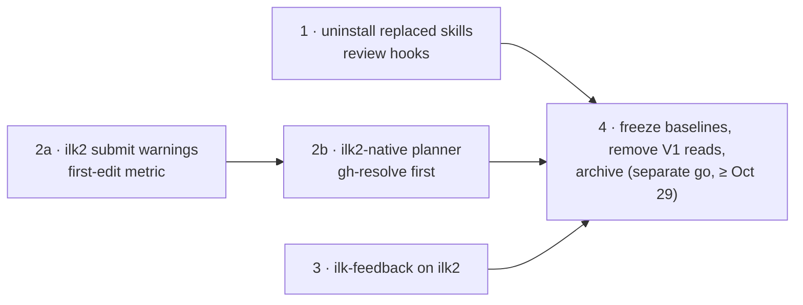

# 7. Retiring V1 completely

**Status: proposed, Oct 17, 2026, for review (Codex).** Written by the ilk2 build session after batch 17d. Chad reviewed the summary page (`~/Documents/keyreply/chad/ilk-skills/20261017-retire-v1-plan.html`) and asked for this design before any work starts. The tracker is `~/Documents/handoffs/ilk2-retire-v1-handoff.md`.

This document changes two decisions in [document 4](04-v1-relation-and-migration.md):
- **§4.1:** V1's planning and feedback tools were "kept". Now they become ilk2-native, and V1's other skills are removed.
- **§4.9 steps 3-4:** V1's data stayed as history and rollback, and the planners kept writing into V1's plans folder. Now both end, at a gated last stage.

It also proposes an answer to Q2 in [document 5](05-open-questions.md).

## 7.1 Why

- **The engine moved, the planner did not.** ilk2 has run every project since Oct 15 (V1's scheduler is off on both hosts, P7). But every plan ilk2 runs is still written by V1's `/ilk-plan`, for V1's engine. All 12 ilk skills and 19 ilk commands installed for Claude Code, Codex and Cursor resolve to the V1 release `~/.ilk/releases/v0.9.198`. Of their files, 0 mention ilk2 apart from one test path.
- **The planner's rules exist, and nothing enforces them.** Batch 17d (gh-resolve, Oct 17) took about 6 h for 7 steps ([evidence](evidence/2026-10-17-batch-17d-where-the-time-went.md)). ilk2's orchestration was about 11 min of that. The rest was the worker writing steps 3 times the median size (2,972 inserted lines per step, against 981 over the other 23 gh-resolve batches), in a strictly serial chain.
  - V1's own sizing rules forbid steps like these: a sub-plan body of about 200 lines or less and about 5 files or fewer (`decomposition-principles.md:84-96`), and an edit surface within half the iteration window (`lint_step_window_fit`, `plan_lint.py:1754`).
  - The rules live in V1's linter. The planner runs it at its own discretion. ilk2 only checks that a plan parses and its gates are well formed (`plans.py:348-392`).
- **V1's preflight checks the wrong parser.** `/ilk-plan` runs `plan_preflight.py` before a master goes from `draft` to `queued` (`ilk-plan.md:1022-1040`). It imports V1's `plan_status`, `run_local_checks` and `safety_kernel` (`plan_preflight.py:29-37`). So it proves that V1 could read the plan, and ilk2 is the one that reads it.
- **Stale V1 instructions mislead every session.** The run commands (`/ilk`, `/ilk-status`, `/ilk-doctor`…) answer questions about an engine that is off. The installer's auto-plan block in `~/.claude/CLAUDE.md`, `~/.codex/AGENTS.md` and `~/.cursor/rules/ilk-auto-plan.mdc` routes all work through V1's `/ilk-plan`.
- **Every fix is a handoff.** Today a planning finding needs a message to the consumer session, which then briefs its own planner agents differently. The rule never reaches the next project.

## 7.2 Goal and done criteria

**Goal:** no V1 code is needed to plan, run, observe or debug work on either host.

**Done when**, on chad-mbp and rezmac:
1. Of the installed skills, commands and hooks in Claude Code, Codex and Cursor, 0 resolve into `~/.ilk/` or into V1's `ilk-loop` code.
2. A batch planned by the new `/ilk-plan` reaches ilk2 through `ilk2 submit`, with no `~/.ilk-data` claim, and ships. This has happened for at least 3 batches across at least 2 projects.
3. `ilk-feedback` writes a postmortem for an ilk2 batch from `ilk2 report` and `ilk2 events` alone.
4. `ilk2` has no runtime read of `~/.ilk-data` or `~/.ilk` (`v1.data_root()` and its callers removed or inert, §7.4.4). The V1 baselines are frozen inside ilk2.
5. `~/.ilk`, `~/.ilk-data` and V1's launchd plists are archived on both hosts.

## 7.3 What changes, by component

| Component | [Document 4](04-v1-relation-and-migration.md) §4.1 | Now |
|---|---|---|
| `/ilk`, `ilk-loop`, `/ilk-run`, `/ilk-stop`, `/ilk-status`, `/ilk-doctor`, `/ilk-schedule`, `/ilk-park`, `/ilk-resume`, launcher, runner, watchdog | Replaced by ilk2 | **Uninstalled** (stage 1). The ilk2 equivalents are `ilk2 status`, `report`, `events`, `doctor`, `park`, `resume` and `cancel` |
| `ilk-ship`, `ilk-upgrade` | Mostly replaced | **Uninstalled** (stage 1). Batches ship through the driver. ilk2 has `ilk2 release`. A consumer's own release tagging stays the consumer's |
| `ilk-self-improve` | Paused for ilk2 | **Uninstalled** (stage 1). ilk2's own improvement is RSI (`docs/rsi/`) |
| `/ilk-plan`, `ilk-spec` | Kept unchanged | **Made ilk2-native** (stage 2b, §7.4.2) |
| inbox and Lark ticket planners | Kept | **Made ilk2-native** (stage 2b). Their ticket adapters (`scripts/cli.py`) stay, and their data moves out of `~/.ilk-data` |
| `ilk-feedback` | Kept, adapted later | **Rebuilt on ilk2** (stage 3, §7.4.3) |
| `ilk-handover`, `/ilk-file` | Not listed | **Kept as they are** (stage 1 checks for V1 paths) |
| Hooks linked into `~/.claude/hooks` from the dev clone (no-full-suite, no-duplicate-read, no-live-clone-edit, no-foreign-plan-edit, no-sealed-read, worker-write-scope) | Not listed | **Reviewed in stage 1.** Each is kept (re-pointed at a release, not the dev clone), moved into ilk2's worker template, or dropped. They apply to interactive sessions today, not only to V1 workers |
| Auto-plan routing block (`conventions/auto-plan-routing.md`, `auto_use_ilk_plan`) | Not listed | **Rewritten for the ilk2-native planner** in stage 2b. Removed from V1's installer in stage 1 only if stage 2b is not ready, so sessions are never left without a planning route |

## 7.4 Design

### 7.4.1 Stage 2a: ilk2 checks plans at submission (in this repo)

`ilk2 submit` already validates a spec (`plans.check`, `plans.py:348`). Stage 2a adds **warnings**. They are printed by `submit --check`, recorded as `submit.warning` events, and shown in `ilk2 status`. Each comes with its basis:

| Warning | Fires when | Threshold (judgment call) | Wrong if |
|---|---|---|---|
| `step-size` | A step's declared scope spans more than N files, or its stored instructions are more than M characters | N = 6 files, M = 30,000 characters. Basis: 17d's steps touched 7-10 files with 25,317-character instructions on average. The other 23 gh-resolve batches averaged 941-32,598 per batch, median 14,266. Warning only, because 17d itself sat under M | Large steps prove as fast per line and as reliable as small ones. Measure minutes per accepted step by size band after 2 weeks |
| `serial-chain` | Every plan after the first depends on every earlier plan, and at least 2 plan pairs have disjoint `scope_paths` | Pairs with disjoint scope are the ones lanes could run | Scopes are under-declared, so "disjoint" pairs really share files. Lane-merge repairs would show it |
| `brief-size` | The rendered brief for a step is more than K characters | K = 200,000. 17d ran 171-185k | Brief size shows no relation to minutes per step |

Warnings never refuse a batch. A refusal would stall unattended consumers (gh-resolve submits from its own processes) over a threshold that is a judgment call. Promoting a warning to a refusal is a later decision, made with measurements.

Stage 2a also fixes the **first-edit metric**. `report` records when the first editing request *starts* and the longest single request per attempt, alongside today's figure. Today's figure is stamped when the editing request ends, so it counts writing time as discovery ([evidence](evidence/2026-10-17-batch-17d-where-the-time-went.md), "Inside an attempt").

`ilk2 submit --check` becomes the planner's preflight. It parses with ilk2's own parser, which is the parser that matters. That replaces `plan_preflight.py`.

### 7.4.2 Stage 2b: an ilk2-native planner (in ilk-skills, as ilk2 batches)

**Q2, proposed answer:** keep V1's Markdown layout (a MASTER plus one file per sub-plan) as the format people and planners write. ilk2 already imports it (`parse_v1_subplan` and `parse_v1_master`, `plans.py:226-310`). Change only **how the plan is delivered** and **which rules are enforced**. A JSON form stays for machine submitters such as gh-resolve, as Q2's default already says. Basis: the Markdown format holds months of planning conventions, and the slowness was in the content, not the format. Wrong if ilk2 finds V1 fields it cannot map, with more than a handful of import special cases; then define an ilk2 format.

What changes in `/ilk-plan`, `ilk-spec` and the inbox and Lark planners:

| Today (V1 dependency, `ilk-plan.md` line) | ilk2-native |
|---|---|
| `ilk_paths.py` resolves project root, key and plans dir (:44-77) | The project is looked up from the repo root in ilk2's registry. Plans are drafted in a working folder outside any project repo, under `~/.ilk2/` |
| Master written to `~/.ilk-data/projects/<key>/plans/`, released by `status: queued`, claimed by ilk2's supervisor tick (:419-426) | `ilk2 submit --project P <master>` after `ilk2 submit --check` passes. The claim path stays readable until stage 4 for old masters |
| `plan_preflight.py`, which checks V1's parser (:1022-1040) | `ilk2 submit --check` (stage 2a) |
| `plan_lint.py` (6,020 lines, 52 checks) | **Kept as a standalone checker**, moved out of `ilk-loop` into the planner's own folder. Its plan-quality checks stay: gate correctness, red-first, scope, test-quality, step window. Its V1-runner checks are dropped: verify-sub-plan machinery, gate budgets read from `~/.ilk-data`, `supervised_only`, `ilk_profile`. Judgment call: porting it into ilk2 would roughly double this stage. Wrong if a check must run at submission, in which case it moves into 2a |
| `register_project.py` (:1000-1014) | `ilk2 project add`, once per project |
| `worker_mcp.py list` reads V1's worker home (:167-195) | The MCP allow-list in ilk2's worker template |
| `loop_status.py`, "`/ilk` to start" text (:1087-1120) | `ilk2 status --batch` |
| Verify sub-plan built from `ship_audit` and V1 baseline files (:465-485) | ilk2's verification plan: the full suite judged against the base, with attribution, already built (docs/02 §2.5.4, §2.5.7) |
| `.ilk-launch.json` keys (:376, 459, 996) | ilk2 project settings |
| Runner-written frontmatter (`current_subplan`, `base_sha`, `pause_after_ship`) | Not written. ilk2 records base and progress in its store |
| Inbox data `~/.ilk-data/inbox-projects.json`; Lark `~/.ilk-data/ilk-lark-tickets/config.json` | Moved to the skills' own data folder before stage 4 |

New planning rules, enforced by the planner and checked by 2a:
1. **Step size.** A step is about 25-30 worker-minutes: split by acceptance-criteria group, with failing tests first in each step. Basis: gh-resolve's fresh-session merged steps of 24-33 min ([E3](evidence/2026-10-14-gh-resolve-p5-batch-baseline.md)), and gh-resolve-e1's agreement on Oct 17.
2. **Dependencies are justified.** A plan depends on another only when they share files (`scope_paths`) or one needs the other's behaviour, and the master says which for each edge. Plans with disjoint scope have no edge and run in lanes. Basis: 17d's chain was copied from earlier batches (gh-resolve-e1), and lanes help only with disjoint scope (repairs in 15d and in the 15f/15g merge).
3. **No re-reading what the brief preloads.** The planner is told what ilk2's brief contains: the step, its sub-plan, and windows of the files and tests it names. A sub-plan's "Before you start" section names only what is *not* preloaded. Basis: 17d's workers re-read preloaded files because their sub-plans told them to.
4. **Stale V1 instructions removed:** `docs/plans/` scaffolding and "commit and push" in `ilk-inbox.md` (:31, :109, :119) and in `ilk-lark-tickets/SKILL.md` (:175-180).

**Rollout:** one project first (gh-resolve, its next batch). Its batches are compared with 17d and with the median in §7.6 before the auto-plan block points every session at the new planner.

### 7.4.3 Stage 3: ilk-feedback on ilk2 (in ilk-skills)

ilk-feedback reads V1's run files: `last-launch.json`, `.ilk-loop.log`, per-iteration logs and `last-exit.json` (SKILL.md:55-90).

The rebuilt version:
- reads `ilk2 report --batch --json`, `ilk2 status --batch --json` and `ilk2 events --batch --json`;
- reads the worker transcripts under `~/.ilk2/data/runs/` for turn timing, the way the 17d evidence was measured.

It classifies each batch with the subset of V1's taxonomy that ilk2's outcomes support:
- timeout-bound, from `timeout` and the attempt cap;
- stuck-no-progress, from judged attempts with no edits (`report.py:40`);
- api-flaky and api-blocked, from `api` outcomes and refusals;
- budget-exhausted, from `quota`;
- interrupted;
- local-checks-stuck, from repeated `red` on one gate.

V1-only labels are dropped: shipped-unverified, self-hosting-drift, and the selfmod merge labels.

Postmortems are written under `~/.ilk2/`.

**The improvement backlog** (`~/.ilk-data/ilk-skills-improvements/candidates.json`) loses its readers in stage 1: self-improve, watchdog and scheduler. **Open (D7):** its new destination. Proposal: postmortem findings about ilk2 go into the RSI inputs the way any defect does (`docs/06` "RSI", ranked inputs). Findings about a planner or skill become a row in the ilk-skills project's backlog. ilk-feedback does not write into ilk2's RSI tables directly, because RSI's inputs are governed (`docs/rsi/**`, protected kernel).

### 7.4.4 Stage 4: removing the rollback (both hosts, by hand)

Preconditions, all of them:
- stages 1-3 have shipped;
- done criteria 1-3 hold;
- 2 weeks have passed with no `ilk2 v1 on` (judgment call matching the length of §4.6's comparison window; no earlier than Oct 29);
- Chad gives a separate go. This step removes the only rollback (`ilk2 v1 on --apply`), and AGENTS.md reserves it.

Order:
1. **Freeze the V1 baselines.** `ilk2 report --v1-baseline` parses V1's `.ilk-loop.log` live (`v1.py:183-228`). Each project's baseline is computed once and stored in ilk2: a store table, or a JSON file under `docs/evidence/`. `--v1-baseline` then reads the frozen copy.
2. **Remove ilk2's V1 reads.**
   - Remove the supervisor's `claim_v1` tick (`supervisor.py:97, 176-196`) and the claim path (`v1.py:164-180`). By now no queued master is left in V1's plans folders, because `v1 status` checks that.
   - Clear `v1_key` from project configs.
   - Remove `ilk2 v1 status/on/off`, `project take-over`, `give_back` and `export --v1`.
   - Keep `_v1_tooling` gate stripping (`batches.py:202-217`) while old masters are still importable. Keep `~/.ilk-data` in the worker's private dirs (`worker.py:77`); it is harmless.
   - Each removal has a test.
3. **Archive on each host:** `~/.ilk`, `~/.ilk-data`, `~/Library/LaunchAgents/disabled-by-ilk2/net.inluck.ilk.*`, V1's worker and manager homes (if present), and the stray `~/.agents/skills/ilk-handover` link.
   - Each goes to a dated archive folder, never deleted, and is verified by a copy on the other host (the same rule `keyreply-docs tidy` follows).
   - Credentials inside V1 homes are not printed, copied off-host or read. They are archived as they are.
4. **Mark the ilk-skills repo:** V1's `ilk-loop`, `ilk-watchdog`, `ilk-launcher`, `ilk-runner`, `ilk-ship` and `ilk-upgrade` code moves to an archive branch or tag, with a README saying where V1 went.

## 7.5 Order and size

| Stage | Repo | Batches · steps (estimate) | Depends on |
|---|---|---|---|
| 1 | ilk-skills (install manifest, auto-plan, hooks) | 1 · 2-3 | — |
| 2a | ilk2 | 1 · 3-4 | — |
| 2b | ilk-skills | 1-2 · 5-7 | 2a |
| 3 | ilk-skills | 1 · 3 | — |
| 4 | ilk2 (step 2) + both hosts | 1 · 2 in ilk2, plus about 1 h by hand | 1, 2b, 3; 2 weeks; Chad's go |

The estimates are from code size and the script calls found in the planner files. At 30-40 minutes per step that is about 12-16 worker-hours.

## 7.6 How we know it worked

- **Stage 2b is measured, not assumed.** The new planner's first 3 batches are compared with 17d and with the median of the other 23 gh-resolve batches (981 inserted lines and 29.7 min per accepted step), using the same method as the 17d evidence. Reported: minutes per accepted step; the share of steps above 40 min; how often attempts hit the cap; lanes used; batch wall time. The comparison accounts for step size, so smaller steps do not look faster per step only because they are smaller: batch wall time and minutes per 1,000 inserted lines are also reported.
- **Wrong if:** batch wall time does not fall, or minutes per 1,000 inserted lines rise by more than 20%. Smaller steps would then cost more in session starts than they save. Revisit rule 1.

## 7.7 Risks

- **The ilk-skills project has never run an ilk2 batch.** It is registered (`ilk2 project` id `ilk-skills`), with 0 batches in the store and 0 `ilk2/b-*` branches in the clone. Stages 1, 2b and 3 are its first. Its gates (V1's suite is about 200k test lines) are unproven on ilk2.
  - **Mitigation:** stage 1 is small and goes first, as a shakedown. Fix its gate set before 2b.
- **Bootstrap.** Stage 2b's batch is itself planned by the old `/ilk-plan`. It follows the new step-size rule by hand.
- **The planner is shared by every project.** A bad planner change reaches every project's next batch.
  - **Mitigation:** roll out on gh-resolve first. The auto-plan block switches only after §7.6.
- **Hooks are global.** Unlinking a V1 hook changes interactive sessions too, for example no-full-suite.
  - **Mitigation:** stage 1 lists each hook's current effect before any change.
- **rezmac.** rezmac's installs must follow the same stages. Stage 1's apply runs on both hosts. The tracker records each host's state.

## 7.8 Out of scope

- The worker's model and effort settings per project (docs/06 "Speed levers from docs/03 §3.4 that were never built"). That lever addresses the long thinking turns and is separate. gh-resolve asked for the step-size rule to be measured first.
- The 3600 s attempt cap. It stays (Q7). In 17d, the attempt that timed out kept its work and resumed.
- An ilk2-specific plan format (see Q2 above).

## 7.9 Decisions

| # | Decision | Proposed | Status |
|---|---|---|---|
| D1 | Retire V1 completely, in these stages | yes | Chad: summary page "looks good", Oct 17 |
| D2 | Where the client skills live | Stay in ilk-skills and change only through ilk2 batches. Moving them into ilk2 would put the planner where RSI can edit it, which would need the protected kernel | awaiting review |
| D3 | `plan_lint.py` standalone, or ported into ilk2 | standalone (§7.4.2) | awaiting review |
| D4 | Exit criterion before stage 4 | stages 1-3 shipped, done criteria 1-3, 2 weeks with no `v1 on` | awaiting review |
| D5 | Start order | 1 and 2a in parallel, then 2b; 3 at any time | awaiting review |
| D6 | Stage 4 needs a separate go | yes | awaiting review |
| D7 | Destination of the improvement backlog | §7.4.3 proposal | awaiting review |
| D8 | Q2: keep Markdown and change delivery to `ilk2 submit` | yes (§7.4.2) | awaiting review |
| D9 | Thresholds of the 2a warnings | §7.4.1 table, warnings only | awaiting review |
