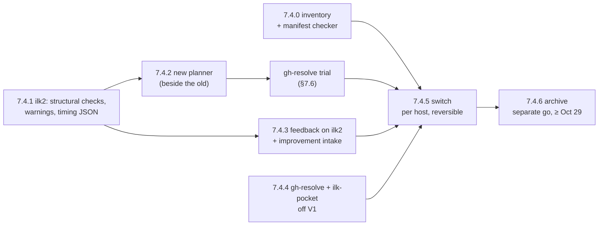

# 7. Retiring V1 completely

**Status: accepted, revision 3, Oct 17, 2026** (Chad: "approved all with default options"; the work is authorized end to end, the archive still needs its separate go, D6). Revised after two Codex reviews: of `32cbb91` (15 findings, 5 of them blockers) and of `8cb89f2` (5 partly resolved, 5 new). All findings were verified against the code and data and accepted (§7.10). Written by the ilk2 build session after batch 17d. Chad reviewed the summary page (`~/Documents/keyreply/chad/ilk-skills/20261017-retire-v1-plan.html`) and asked for this design before any work starts. The tracker is `~/Documents/handoffs/ilk2-retire-v1-handoff.md`.

This document changes two decisions in [document 4](04-v1-relation-and-migration.md):
- **§4.1:** V1's planning and feedback tools were "kept". Now they become ilk2-native, and V1's other skills are removed.
- **§4.9 steps 3-4:** V1's data stayed as history and rollback, and the planners kept writing into V1's plans folder. Now both end, at a gated last stage.

It also proposes an answer to Q2 in [document 5](05-open-questions.md).

## 7.1 Why

- **The engine moved; the shared planner did not.** ilk2 has run every project since Oct 15 (V1's scheduler is off on both hosts, P7). The interactive planner every session uses is still V1's `/ilk-plan`, written for V1's engine.
  - All 15 of 15 gh-resolve batches created since Oct 15 were V1 masters that ilk2 claimed. The other 10 of the 25 ilk2 batches in that period were submitted directly (3 ilk2 RSI, 5 kira-dev, 2 kira-live).
  - On both hosts, Claude Code, Codex and Cursor each have 12 ilk skills and 19 ilk commands installed. All of them resolve to the V1 release `v0.9.198`, which mentions ilk2 in one upgrade test only.
- **V1's sizing guidance is prose, and nothing enforces it.** Batch 17d (gh-resolve) ran 5.23 h for 6 work steps ([evidence E5](evidence/2026-10-17-batch-17d-where-the-time-went.md)). Outside the worker, ilk2's phases took 25.9 min of that, most of it the final full-suite verification. The rest was the worker writing steps of about 3 times the median size (2,958 inserted lines per step against a median of 981 over the other 23 gh-resolve batches), in a strictly serial chain.
  - `decomposition-principles.md:84-96` asks for a sub-plan of about 200 lines and typically about 5 files or fewer.
  - The linter's `lint_step_window_fit` (`plan_lint.py:1754`) compares counts with minutes and found 0 issues across 17d's six sub-plans. 17d's steps touched 6-11 files.
  - ilk2 checks only that a plan parses and its gates are well formed (`plans.py:348-392`).
- **V1's preflight checks with the wrong parser.** `/ilk-plan` runs `plan_preflight.py` before a master goes from `draft` to `queued` (`ilk-plan.md:1022-1040`). Its readers are V1's: `plan_lint` and `plan_status` (`plan_preflight.py:29-37`), `run_local_checks` (:321) and `safety_kernel` (:390). It proves that V1 could read the plan, but ilk2 is the one that reads it.
- **ilk2's import is lenient where V1's preflight was strict.** `parse_v1_master` silently skips a linked sub-plan file that is missing (`plans.py:271-272`). A missing file therefore gives a smaller batch instead of an error.
- **Stale V1 instructions mislead every session.** The run commands (`/ilk`, `/ilk-status`, `/ilk-doctor`…) answer questions about an engine that is off. The installer's auto-plan block in `~/.claude/CLAUDE.md`, `~/.codex/AGENTS.md` and `~/.cursor/rules/ilk-auto-plan.mdc` routes all work through V1's `/ilk-plan`.

## 7.2 Goal and done criteria

**Goal:** no V1 code or data is needed to plan, run, observe or debug work on either host.

**Done when**, on chad-mbp and rezmac:
1. **The installed-artifact manifest (§7.4.0) resolves clean on both hosts.** 0 skills, commands, hooks, settings blocks, PATH entries, tool links, worker homes or launchd items resolve into `~/.ilk`, `~/.ilk-data` or V1 code in the ilk-skills clone. Anything that remains is on a reviewed allow-list, with the reason.
2. **The new planner submits directly.** At least 3 batches planned by the new `/ilk-plan`, across at least 2 projects, reached ilk2 through `ilk2 submit`, with no `~/.ilk-data` claim, and shipped.
3. **`ilk-feedback` needs only ilk2's JSON.** It wrote a postmortem for an ilk2 batch using only versioned ilk2 JSON (`ilk2 report`, `status` and `events`), with no reads of ilk2's run directories.
4. **No consumer reads V1, and nothing can recreate it.** gh-resolve and ilk-pocket have 0 runtime reads of V1 data or code, or a reviewed allow-list that proves each remaining reference inert. mac-provision installs ilk2, and a dry-run test shows it creates no V1 artifact (§7.4.4).
5. **ilk2 no longer reads V1 at runtime.** ilk2 has no runtime read of `~/.ilk-data` or `~/.ilk`, the V1 baselines are frozen inside ilk2, and that release is installed on both hosts.
6. **V1's trees are archived** under §7.4.6's rules, with a documented restore drill.

## 7.3 What changes, by component

| Component | [Document 4](04-v1-relation-and-migration.md) §4.1 | Now |
|---|---|---|
| `/ilk`, `/ilk-run`, `/ilk-stop`, `/ilk-status`, `/ilk-doctor`, `/ilk-schedule`, `/ilk-park`, `/ilk-resume`, launcher, runner, watchdog | Replaced by ilk2 | **Uninstalled at the switch** (§7.4.5). The ilk2 equivalents are `ilk2 status`, `report`, `events`, `doctor`, `park`, `resume` and `cancel` |
| `ilk-loop` (the skill folder) | Replaced by ilk2 | **Uninstalled last, at the switch.** Until then the old planner and feedback import its scripts (`ilk_paths`, `loop_status`, `timing`, `plan_lint`, `plan_preflight`…), so removing it earlier breaks them |
| `ilk-ship`, `ilk-upgrade`, `ilk-self-improve` | Mostly replaced / paused | **Uninstalled at the switch.** ilk2 has `ilk2 release` and RSI |
| `/ilk-plan`, `ilk-spec`, inbox and Lark ticket planners | Kept unchanged | **Rebuilt ilk2-native** beside the old ones (§7.4.2), then switched in |
| `ilk-feedback` | Kept, adapted later | **Rebuilt on ilk2's JSON** (§7.4.3), then switched in |
| `ilk-handover`, `/ilk-file` | Not listed | **Kept.** The inventory checks them for V1 paths |
| Hooks in `~/.claude/hooks` (6, linked from the dev clone) | Not listed | **Each one is decided in the inventory**: kept and re-pointed at a release, moved into ilk2's worker template, or dropped. They affect interactive sessions too |
| Auto-plan routing block (`conventions/auto-plan-routing.md`, `auto_use_ilk_plan`) | Not listed | **Rewritten for the new planner and switched in the same step as the planner.** Sessions always have a planning route |
| PATH links `claude-worker`, `claude-manager`, `claude-worker-switch` (into the dev clone, chad-mbp); `tools/migration` links in all three hosts | Not listed | **Decided in the inventory** (they are V1 worker tooling; ilk2 has its own worker template) |
| gh-resolve's V1 code paths (106 non-test references in 21 files under `tools/gh_resolve`) | Not listed | **Retired in gh-resolve, by its owner** (§7.4.4) |
| ilk-pocket (`net.inluck.ilk-pocket-agent`, running on both hosts, data root `~/.ilk-data`, 22 references in its Python) | Not listed | **Moved to its own data root** (§7.4.4) |
| mac-provision's resolver installer (`lib/install-resolver-stack.sh`: creates `~/.ilk-data` at :153, writes and enables `net.inluck.ilk.scheduler` from :176, links V1's xbar plugin) | Not listed | **Changed to install and verify ilk2.** Otherwise a host rebuild or repair brings V1 back (§7.4.4) |

## 7.4 Design

### 7.4.0 Inventory and manifest (first)

This step builds one **installed-artifact manifest** per host and a checker that resolves every entry's real target. It runs before anything is removed. It covers:
- skills, commands and hooks in Claude Code, Codex and Cursor;
- the settings blocks: the auto-plan block, and hook registrations in `settings.json`;
- PATH entries and `tools/*` links;
- V1 worker and manager homes;
- every launchd file whose label or content matches `ilk` or `.ilk-data`, in any folder on both hosts, including rezmac's older scheduler plist backups and `net.inluck.ilk-pocket-agent`;
- the consumer and provisioning repos that read or create V1 state (gh-resolve, ilk-pocket, mac-provision), as counts of runtime references. Each count records the repo commit and the exact `rg` command, and says whether it counts matching lines or occurrences.

Search space for "no other consumer" (Codex, round 2): all 12 top-level git checkouts under `~/Projects/github/inluck-net` and the ilk-skills worktrees, excluding `.git` and `node_modules`, for `.ilk-data`, `.ilk/current`, `ILK_DATA_HOME`, `ILK_DATA_DIR`, `park_master.py` and `skills/ilk-loop`. Apart from ilk2 and V1 themselves, only gh-resolve, ilk-pocket and mac-provision match. In `~/Library/LaunchAgents`, by name and content: 4 matching files on chad-mbp, and 7 name matches and 5 content matches on rezmac.

Done criterion 1 is this checker coming back clean. Its first output becomes the baseline in the tracker.

### 7.4.1 ilk2 checks plans at submission (in this repo)

**Structural checks, before `submit --check` becomes the planner's preflight.** These checks are ported from what `plan_preflight.py` enforced (Codex review, finding 5). Each one *refuses* submission, because each is a broken plan, not a judgment call:
- a linked sub-plan file that is missing or cannot be parsed. Today it is silently dropped (`plans.py:271-272`);
- a mismatch between the master's sub-plan registry table and the sub-plans it links;
- a step that can produce no commit and does not say so (V1's `--allow-empty` convention);
- a gate executable that is not resolvable (already checked, `plans.py:381-386`);
- a step whose `local_checks` fence is present but cannot be extracted or parsed. V1 checks this in `plan_preflight.py:310`. Today ilk2 could drop such a gate silently, leaving the step with fewer gates than written;
- a step whose declared writes (YAML scope plus `Write`/`Edit` bullets) touch the project's `deny_paths`. This **replaces** V1's safety-kernel admission (`plan_preflight.py:389`, `safety_kernel.check_plan_admission`), which applies only to the ilk-skills repo itself. Its `rules` tier becomes the ilk-skills project's `deny_paths`, which ilk2 already enforces on every attempt (`batches.py`, `deny_paths`); the admission check adds the same refusal at submission. Its `kernel` tier (owner-only supervised builds) has no equivalent and needs none, because ilk2 batches on ilk-skills land on `ilk2/b-*` branches that are merged by hand, never unattended.

**Not ported, with the reason (built Oct 17):**
- **V1's declared-test-path check (AC2).** ilk2 already handles a test file that is absent at the base, and does it at run time. The file may be written by the step itself (red-first), or owed by another plan (`gate.path-owed`, gh-resolve P6). If it is still absent after the step, the step goes red with the path in its evidence. Tests: `test_s8_expected_red_then_green`, `test_a_gate_path_another_plan_creates_is_owed_by_that_plan`, `test_declared_test_path_still_absent_after_step_is_red`. A submit-time refusal was built and then withdrawn: the full suite showed it refused those deliberate patterns (6 tests red).
- **V1's step-commit feasibility (`--allow-empty`, AC3).** ilk2 accepts a step with no diff at its parent, with no empty commit (`driver.py:1303`).

**Swept before release:** every V1-claimed batch's master was re-imported and checked at its own base. 0 of 25 would have been refused by the final checks. A first version refused 4, all false positives: a prose placeholder link, and gates that re-run test files created by earlier plans.

**Cross-parser check, instead of real-master fixtures (Oct 17).** ilk2 is a public repository (Q9), and real plans can carry issue and tenant detail, so real masters are not copied into its tests. Instead, V1's own readers (`plan_status.extract_subplan_files`, `run_local_checks.step_gate_fence`) and ilk2's were run once over every V1 master on chad-mbp: 422 masters, 1,747 sub-plans, 5,448 steps.
- **It found a gap.** 45 masters name their sub-plans only as plain text in the registry table, which V1's runtime reads and ilk2's link-only importer missed. ilk2 now reads the same references as V1, plus links (`plans.subplan_names`). After the change, 0 of 422 masters disagree with V1's list or order. The 25 masters ilk2 had claimed import exactly as before.
- **Gate blocks:** ilk2 reads a gate block V1 cannot in 6 steps (it is more lenient), and V1 reads one ilk2 cannot in 1 step. That step is from May, and ilk2 now refuses that shape instead of skipping it silently.
- Synthetic fixtures in `tests/test_plans.py` pin each case.

**Warnings, as telemetry, not refusals.** Each is printed by `submit --check`, recorded as a `submit.warning` event, and shown in `ilk2 status`:

| Warning | Fires when | Threshold (judgment call) | Wrong if |
|---|---|---|---|
| `files-per-step` | A plan's distinct scope entries divided by its steps exceed N | N = 6. A V1 sub-plan's steps share its scope and preamble, so this is measured per plan, per step. Over 53 gh-resolve plans whose steps all shipped, it ranks with minutes per step at Spearman 0.48. At 6 it flags 16 plans, 10 of them slow (over 40 min per step), and misses 8 slow ones | It stops tracking minutes per step on new batches |
| `chars-per-step` | A plan's text (its shared preamble once, plus each step's own section) divided by its steps exceeds M characters | M = 12,000. Spearman 0.45 on the same 53 plans; it flags 15, 10 of them slow, and misses 8. Checked: 17d warns on all 5 work plans, 17e (split by gh-resolve on Oct 17) on none | Same as above |
| `serial-chain` | The transitive closure of `depends_on` totally orders the plans (direct lists like 17d's, or a chain B→A, C→B…), and at least 2 plans ordered only by dependency have disjoint `scope_paths` | Disjoint pairs are the ones lanes could run | Scopes are under-declared, so "disjoint" pairs really share files. Lane-merge repairs would show it |
| `brief-size` | Recorded, never warned | The brief is 171-185k characters in 17d, and its relation to minutes is not shown | — |

Warnings never refuse a batch. A refusal would stall unattended consumers (gh-resolve submits from its own processes) on thresholds that are judgment calls. The planner fails its own QC on the same rules (§7.4.2); ilk2 only reports.

**Classification evidence in the JSON.** `ilk2 report --batch --json` gets a versioned per-attempt record, so ilk-feedback never reads run directories (Codex findings 11 and round 2). Each record carries:
- **timing:** request count, long-request count and minutes, tool minutes, and the first editing request's start and end;
- **outcome:** the attempt's outcome and reason, and the termination cause from `timings.outcome`. 17d's timed-out attempt is stored as outcome `red` with `timings.outcome: timeout`;
- **edits:** the count by tool. Today this exists only as an aggregate (`report.py:29-40`);
- **refusals:** each refusal or admission hold that touched the attempt, with its reason;
- **gates:** each gate's identity (name, adapter, command digest) and its result history across the step's attempts, including new, inherited and attributed failures.

Each label ilk-feedback keeps (§7.4.3) gets a **JSON-only fixture**: a recorded report for a batch that shows the label, with a test that classifies it correctly from that JSON alone.

The timing part replaces today's first-edit figure, which is stamped at the end of the editing request and so counts writing as discovery (E5). `tools/batch_time.py` is the reference method the report has to agree with.

### 7.4.2 The ilk2-native planner (in ilk-skills, as ilk2 batches)

**Q2, proposed answer:** keep V1's Markdown layout (a MASTER plus one file per sub-plan) as the authoring format. Make ilk2's parser the canonical one, with a versioned schema and refusals for missing or ambiguous imports (§7.4.1). The normalized SQLite snapshot stays canonical once a batch is submitted (Q3). A JSON form stays for machine submitters, as Q2's default says. Basis: the Markdown format holds months of planning conventions, and the slowness was in the content, not the format. Wrong if ilk2 needs many special cases to map V1 fields; then define an ilk2 format.

**`plan_lint.py`, a hybrid** (Codex D3):
- The structural, submission-critical checks move into ilk2 (§7.4.1).
- The authoring heuristics stay in a standalone checker in the planner's folder: test quality, red-first shape, degrade discipline, scope coverage.
- V1-runner checks are dropped: verify-sub-plan machinery, gate budgets read from `~/.ilk-data`, `supervised_only`, `ilk_profile`.
- The unit-mismatched `lint_step_window_fit` is replaced by the measured file and instruction rules of §7.4.1.

What changes in `/ilk-plan`, `ilk-spec` and the inbox and Lark planners:

| Today (V1 dependency, `ilk-plan.md` line) | ilk2-native |
|---|---|
| `ilk_paths.py` resolves project root, key and plans dir (:44-77) | The project is looked up in ilk2's registry by repo root. Drafts go in a folder under `~/.ilk2/`, outside any repo |
| Master written to `~/.ilk-data/projects/<key>/plans/`, released by `status: queued`, claimed by ilk2's supervisor (:419-426) | `ilk2 submit --check`, then `ilk2 submit --project P <master>` |
| `plan_preflight.py` (:1022-1040) | `ilk2 submit --check`, with the structural checks of §7.4.1 |
| `register_project.py` (:1000-1014) | `ilk2 project add`, once per project |
| `worker_mcp.py list`, which reads V1's worker home (:167-195) | The MCP allow-list in ilk2's worker template |
| `loop_status.py`; "`/ilk` to start" (:1087-1120) | `ilk2 status --batch` |
| Verify sub-plan from `ship_audit` and V1 baseline files (:465-485) | ilk2's verification plan: the full suite judged against the base, with attribution (docs/02 §2.5.4, §2.5.7) |
| `.ilk-launch.json` keys (:376, 459, 996) | ilk2 project settings |
| Runner-written frontmatter (`current_subplan`, `base_sha`, `pause_after_ship`) | Not written |
| Inbox `~/.ilk-data/inbox-projects.json`; Lark `~/.ilk-data/ilk-lark-tickets/config.json`, which holds a credential and a token cache | Moved to the skills' own data folder, with permissions kept, before the archive. The credential is moved and never printed |

New planning rules. The planner fails its own QC on each:
1. **Step size.** A step is about 25-30 worker-minutes: per step, at most 6 files of scope and 12,000 characters of plan text (the §7.4.1 measures). Split by acceptance-criteria group, with failing tests first in each step. Basis: gh-resolve's fresh-session steps of 24-33 min ([E3](evidence/2026-10-14-gh-resolve-p5-batch-baseline.md)), and gh-resolve-e1's agreement on Oct 17.
2. **Dependencies are justified.** A plan depends on another only when they share files (`scope_paths`) or one needs the other's behaviour, and the master says which for each edge. Basis: 17d's chain was copied from earlier batches (gh-resolve-e1), and lanes help only with disjoint scope (repairs in 15d and 15f/15g).
3. **No re-reading what the brief preloads.** The planner is told what ilk2's brief contains. A sub-plan's "Before you start" section names only what is *not* preloaded.
4. **Stale V1 instructions removed:** `docs/plans/` scaffolding and "commit and push" in `ilk-inbox.md` (:31, :109, :119) and `ilk-lark-tickets/SKILL.md` (:175-180).

**Built beside the old planner.** The new skills are installed under temporary names (for example `/ilk2-plan`) next to the old ones. Codex and Cursor get them too. They are smoke-tested on both hosts and trialled on gh-resolve (§7.6). Only then are they switched in (§7.4.5).

### 7.4.3 ilk-feedback on ilk2, and an improvement intake (ilk-skills and ilk2)

ilk-feedback today reads V1's run files: `last-launch.json`, the `.ilk-loop.log` summary and per-iteration logs (`ilk-feedback/SKILL.md:55-90`), and the run's `last-exit.json` (SKILL.md:95-105). The rebuilt version:
- reads only versioned ilk2 JSON: `ilk2 report --batch --json` with the timing fields of §7.4.1, `ilk2 status --batch --json` and `ilk2 events --batch --json`;
- classifies each batch with the subset of V1's taxonomy that ilk2's evidence supports:
  - **timeout-bound:** `timings.outcome: timeout` or the attempt cap, not the attempt outcome alone;
  - **stuck-no-progress:** judged attempts with no edits (`report.py:40`);
  - **api-flaky and api-blocked:** `api` outcomes and refusals;
  - **quota-exhausted:** the `quota` outcome. It is kept distinct from budget-exhausted, as V1 does;
  - **interrupted;**
  - **local-checks-stuck:** repeated `red` on one gate;
- drops the V1-only labels: shipped-unverified, self-hosting-drift and the selfmod merge labels;
- writes postmortems under `~/.ilk2/`.

**An improvement intake (D7, Codex finding 13).** The V1 backlog `~/.ilk-data/ilk-skills-improvements/candidates.json` loses all its readers at the switch. It is replaced by a neutral, versioned contract in ilk2:

`ilk2 improvement add --project P --source postmortem|review|human --fingerprint F --evidence <json> [--api-version 1]`

- It is backed by an `improvements` table: project, source, fingerprint (the dedup key), evidence, status and an audit history.
- RSI consumes the rows that target project `ilk2`, as one more ranked input below Chad's requests and goals (`docs/06` "RSI"). RSI's protected inputs (`docs/rsi/**`) are unchanged.
- The ilk-skills project, and any other project, reads its own rows with `ilk2 improvement list --project P`.
- Open V1 candidates are imported once, with their fingerprints.

### 7.4.4 Consumers off V1 (gh-resolve and ilk-pocket)

**gh-resolve**, done by its owner session, with this design as the contract:
- Baseline at gh-resolve `349fe13c`: `rg -n --glob '*.py' --glob '!**/tests/**' -e '\.ilk-data|ILK_DATA_HOME|ILK_DATA_DIR|\.ilk/current|ilk-loop|park_master\.py' tools/gh_resolve` gives 107 matching lines (113 occurrences with `-o`) in 21 files. "Reference" below means a matching line. Examples:
  - `reconcile.py:404` reads `~/.ilk-data/projects`;
  - `verify.py:842` points `_ILK_SCRIPTS` at the ilk-skills clone's `ilk-loop/scripts`.
- Some sit on V1-engine branches that are unreachable with `engine: ilk2`, which both hosts run (`~/.gh-resolve-data/config.json:220`). Others still scan plans, sentinels and registries, or call V1 scripts.
- **Done when** contract tests with `engine: ilk2` cover reconciliation, reap, GC, verification, liveness and plan lookup, and the grep shows 0 runtime matches or a reviewed allow-list where each remaining match is shown inert.

**ilk-pocket:**
- `net.inluck.ilk-pocket-agent` runs on both hosts. Its plist logs to `~/.ilk-data/pocket/agent.log`. Its config defaults `ILK_DATA_HOME` to `~/.ilk-data` (`ilk_pocket/config.py:11`), with 22 references across its Python.
- Steps:
  1. choose a new data root for it;
  2. migrate its state, including registry data, without printing it;
  3. update its plist and restart the agent;
  4. smoke-test it on each host before the archive.
- Baseline: `rg -n -e '\.ilk-data|ILK_DATA_HOME' ilk_pocket/` gives 22 matching lines.
- Owner: the build session, by hand. It is not an ilk2 project. Its repo change is small, and its launchd change is host state.

**mac-provision** (Codex, round 2):
- `lib/install-resolver-stack.sh` creates `~/.ilk-data/{logs,projects,gh-resolve}` (:153), writes and enables `net.inluck.ilk.scheduler` from V1's `scheduler.sh` (:176), and links V1's xbar plugin. Run on a rebuilt or repaired host, it would bring V1 back after retirement.
- Change it to install and verify ilk2: the supervisor and health plists, `~/.ilk2/current`, and ilk2's xbar plugin.
- Add a dry-run test proving that it creates no V1 artifact: no `~/.ilk-data`, no `net.inluck.ilk.*` V1 plist, no V1 skill links.
- Owner: the build session (D12).

### 7.4.5 The switch (per host, reversible)

All conditions:
- the new planner and feedback have passed their smoke tests on both hosts;
- the gh-resolve trial has reported (§7.6);
- §7.4.4 is done.

Then, one host at a time, in four phases (Codex round 2, finding 17). A single install run is not a rollback specification, because a failure halfway could leave a host with no usable planner.
1. **Record.** Write the current manifest to a dated file. Every entry is a resolved link target, settings-block content with its checksum, or a plist label and state. This is the restore point.
2. **Stage and validate.** Build the complete final tree beside the live one:
   - the new skills and commands under their final names, all three hosts' link sets, the rewritten auto-plan block for each host file, the hook and PATH decisions;
   - nothing live points at the staged tree yet.

   Validate it: the manifest checker over the staged tree, `ilk2 submit --check` on a sample master through the staged planner, and an ilk-feedback run over a shipped batch.
3. **Switch.**
   - Repoint each link with an atomic rename (`ln -s` to a temp name, then `mv -f`).
   - Write each settings file through a temp file and a rename.
   - The order is: hooks, then skills and commands, then the auto-plan blocks, then the removals, with `ilk-loop` last. A session that starts mid-switch sees either the old route or the new one, never neither.
4. **Verify, or restore automatically.** Run the clean manifest check and the same smoke tests against the live paths. If any fails, the switch script restores the recorded manifest from phase 1 and verifies that it matches. The host is declared switched only when the clean check passes.

Nothing on disk is deleted in this step, and V1's installer at `v0.9.198` remains a second way back.

### 7.4.6 Removing the rollback (both hosts; separate go)

**Preconditions, all of them** (Codex finding 7):
- the switch is done on both hosts, and done criteria 1-4 hold;
- ilk2's V1 reads are removed in a release installed on both hosts;
- 2 weeks have passed with no `ilk2 v1 on` (judgment call, matching §4.6's window; no earlier than Oct 29);
- both supervisors are idle;
- `ilk2 v1 status` is empty on both hosts. That is, `v1.needs_v1()` returns `[]`: no unowned V1 registration, no queued or active master, no live V1 runner (`v1.py:245-258`);
- a separate scan of every key's plans folder lists no claimed master still being imported, and no draft, paused or blocked master that anyone still intends to run. Each master found is listed, with the decision taken on it;
- the frozen baselines' checksums are verified;
- archive space is checked;
- a restore drill is written down, and rehearsed on one small tree;
- **Chad gives a separate go.** This removes the only rollback (`ilk2 v1 on --apply`), and AGENTS.md reserves it.

**Order:**
1. **Freeze the V1 baselines.** `ilk2 report --v1-baseline` parses V1's `.ilk-loop.log` live (`v1.py:183-228`). Each project's baseline is computed once and stored in ilk2, in a table with a checksum. `--v1-baseline` then reads the frozen copy.
2. **Remove ilk2's V1 reads** (ilk2 release):
   - the supervisor's `claim_v1` tick (`supervisor.py:97, 176-196`) and the claim path (`v1.py:164-180`);
   - `v1_key` in project configs;
   - `ilk2 v1 status/on/off`, `project take-over`, `give_back` and `export --v1`.

   Keep `_v1_tooling` gate stripping (`batches.py:202-217`) and the `~/.ilk-data` entry in the worker's private dirs (`worker.py:77`), both harmless. Each removal has a test.
3. **Archive, one host first, verified, then the other.**
   - **Credential-bearing trees are archived locally only,** with their permissions and a checksum manifest, and are never copied off-host. These are V1 worker and manager homes, the Lark config and token cache under `~/.ilk-data`, and ilk-pocket's registry data if any remains.
   - **Non-secret history is replicated to the other host as a second copy,** from an explicit, scrubbed allow-list: plans, logs, postmortems and close records.
   - Sizes measured Oct 17: `~/.ilk-data` 11 GB on chad-mbp and 3.2 GB on rezmac; `~/.ilk` 92 MB on each. Worker homes are not yet measured. The archive is benchmarked on one tree before the full run.
4. **Mark the ilk-skills repo:** V1's `ilk-loop`, `ilk-watchdog`, `ilk-launcher`, `ilk-runner`, `ilk-ship` and `ilk-upgrade` code moves to an archive tag, with a README saying where V1 went.

## 7.5 Order and size

| Part | Repo | Batches | Steps (total for the part) |
|---|---|---|---|
| 7.4.0 inventory and checker | ilk2 | 1 | 2 |
| 7.4.1 structural checks, warnings, timing JSON | ilk2 | 1-2 | 5-6 |
| 7.4.2 new planner | ilk-skills | 2 | 6-8 |
| 7.4.3 feedback, plus improvement intake | ilk-skills, ilk2 | 2 (one per repo) | 3 + 2 |
| 7.4.4 gh-resolve off V1 | gh-resolve (its owner) | 1-2 | 4-6 |
| 7.4.4 ilk-pocket off V1 | ilk-pocket | by hand | about 1 h |
| 7.4.4 mac-provision installs ilk2 | mac-provision | by hand, with its dry-run test | about 1-2 h |
| 7.4.5 switch | install, both hosts | by hand | about 1 h per host |
| 7.4.6 ilk2 V1 reads removed | ilk2 | 1 | 2-3 |
| 7.4.6 archive | both hosts | by hand | benchmarked first; not estimated yet |

**Arithmetic:** 8-10 batches with 24-30 steps in total. At 30-40 worker-minutes per step, that is 12-20 worker-hours, plus about 4-5 h by hand plus the archive.

**Wall time:** the gh-resolve trial needs about 3 of gh-resolve's own batches (§7.6), and the archive waits until Oct 29 at the earliest. So the end date is set by those two, not by the build.

## 7.6 How we know it worked

The new planner is trialled on gh-resolve's next 3 batches, before the switch. The aim is to learn whether the planning rules help, not just whether smaller steps look better per step (Codex finding 12).

**Scope is measured before planning,** so the planner under test cannot shape it (Codex round 2). For each batch it is the tickets in scope and the acceptance-criteria groups *requested* in the source the plan was made from (the issue, spec or inbox entry), counted by a script before the planner runs. Touched files, plan count and inserted lines are outcomes of the planner, so they are reported but never used as controls.

**The model is declared before the trial** (judgment call):
- It is fitted on every gh-resolve batch on ilk2 whose source can be recovered, which is all 24 to date if their sources are still readable.
- Its form is `log(total worker minutes) ~ log(requested AC groups) + log(tickets)`.
- It is fixed and committed before the first trial batch is planned.

**Reported for each trial batch, and for every fitted historical batch:**
- total worker minutes and critical-path wall time (submitted to shipped, with lanes);
- startup, model, long-request, tool and gate minutes;
- touched files, inserted lines, red and repair rates, attempts at the cap and lane use. These are reported as outcomes.

**Verdict:**
- **Improvement:** all 3 trial batches fall below the fitted line, and their mean residual is below zero by more than the historical residuals' interquartile range.
- **Inconclusive:** anything else short of the "wrong if" conditions below. The trial then extends to 6 batches before the switch. With 3 trials, this verdict is a screen, not a proof.

Raw wall time is reported as it is. Line throughput is reported but is not a measure, because bulk-generated tests inflate it.

**Wrong if:**
- the trial batches sit on or above the regression line;
- the share of attempts at the cap does not fall;
- red and repair rates rise.

In any of those cases, revisit rule 1 before the switch.

## 7.7 Risks

- **The ilk-skills project has never run an ilk2 batch.** It is registered, with 0 batches and 0 `ilk2/b-*` branches, and its tests are about 196k lines. Mitigation: the first planner batch is small, and the project's gate set is fixed before the larger ones.
- **Bootstrap.** The new planner's own batches are planned by the old `/ilk-plan`. They follow the new rules by hand.
- **The shared planner reaches every project.** Mitigations: it is built beside the old one, trialled on one project, and switched in per host, reversibly.
- **Hooks and PATH links are global.** Mitigation: the inventory lists each one's effect before any change.
- **Credentials.** The Lark config and token cache and the V1 worker homes contain credentials. They are moved or archived with their permissions, and never printed, read or copied off-host.

## 7.8 Out of scope

- The worker's model and effort settings per project (docs/06 "Speed levers from docs/03 §3.4 that were never built"). That lever addresses the long requests, and it is separate. gh-resolve asked for the step-size rule to be measured first.
- The 3600 s attempt cap. It stays (Q7). In 17d, the attempt that timed out kept its work and resumed.
- An ilk2-specific plan format (Q2, §7.4.2).

## 7.9 Decisions

| # | Decision | Proposed | Status |
|---|---|---|---|
| D1 | Retire V1 completely | yes | Chad: summary page "looks good", Oct 17 |
| D2 | Where the client skills live | Stay in ilk-skills, changed only through ilk2 batches, outside RSI's editable surface | Codex agrees; **accepted Oct 17** |
| D3 | `plan_lint.py` | Hybrid: structural checks into ilk2, authoring heuristics standalone, V1-runner checks dropped | Codex's proposal; **accepted Oct 17** |
| D4 | Preconditions for the archive | §7.4.6 list | revised after Codex; **accepted Oct 17** |
| D5 | Order | §7.5: inventory and ilk2 checks first; new planner beside the old; trial; switch; archive | revised after Codex; **accepted Oct 17** |
| D6 | The archive needs a separate go | yes | Codex agrees; **accepted Oct 17** |
| D7 | Improvement intake | `ilk2 improvement add`, neutral versioned table (§7.4.3) | Codex's proposal; **accepted Oct 17** |
| D8 | Q2: Markdown, with ilk2's parser canonical, a versioned schema, and refusals for missing or ambiguous imports | yes | Codex agrees with conditions, now included; **accepted Oct 17** |
| D9 | Warnings, not refusals, on size; thresholds in §7.4.1 | yes; `brief-size` stays telemetry only | Codex agrees; **accepted Oct 17** |
| D10 | ilk-pocket: ~~moved to its own data root~~ **retired** | It turned out to be V1's phone remote control, not just a user of V1's data, and dormant: last commit Jul 29, agent log last written Oct 3 (chad-mbp) and Aug 17 (rezmac), no audit log on 0 of 2 hosts. Agent disabled on both hosts Oct 18 (plist in `disabled-by-ilk2/`, reversible); repo marked retired; its references allow-listed; data archived with V1 | **Chad, Oct 18: "retire ilk-pocket"** |
| D11 | gh-resolve's V1 retirement is done by its owner session, with §7.4.4 as the contract | yes | new; **accepted Oct 17** |
| D12 | mac-provision is changed by the build session to install ilk2, with a dry-run test | yes | new (round 2); **accepted Oct 17** |
| D13 | gh-resolve's time: retire its V1 code first; the planner trial then uses gh-resolve's next naturally planned batches (no extra batches) | yes | **accepted Oct 17** |
| D14 | Improvement rows that target ilk2 reach RSI only after a human marks them `accepted`, ranked below RSI's existing inputs. The `docs/rsi/**` change is made by the build session, not by RSI | yes | **accepted Oct 17** |
| D15 | `claude-worker`, `claude-manager`, `claude-worker-switch`: moved to a stable location, kept working, not deleted (it is not known whether they are still used by hand) | yes (judgment call: the non-destructive default) | **accepted Oct 17** |
| — | The global hooks: `no-full-suite` (the only one registered in `~/.claude/settings.json`) stays, re-pointed at a stable path; the 5 linked but unregistered V1 worker hooks go | yes | **accepted Oct 17** |

## 7.10 Review log

**Codex, of `32cbb91` (revision 1), Oct 17: 15 findings, all accepted after checking.**

| # | Finding | Severity | Checked | Change |
|---|---|---|---|---|
| 1 | Stage 1 uninstalled `ilk-loop` while the old planner and feedback still import its scripts | blocker | yes (`ilk-plan.md` script calls, read in this session) | Built beside; one switch, per host, `ilk-loop` last (§7.4.2, §7.4.5) |
| 2 | ilk-pocket writes to `~/.ilk-data` and runs on both hosts | blocker | yes: plist line 14, `config.py:11`, 22 references, `launchctl list` on both hosts | §7.4.4 |
| 3 | gh-resolve has a large V1 runtime surface | blocker | yes: 106 references in 21 non-test files; `reconcile.py:404`, `verify.py:842` | §7.4.4, done criterion 4 |
| 4 | "A copy on the other host" conflicted with the credential rule | blocker | yes (logic) | Local archive for credential trees; scrubbed allow-list replicated (§7.4.6) |
| 5 | `submit --check` lacked preflight's structural checks | blocker | yes: `plans.py:271-272` skips missing files | Structural refusals, fixtures and a schema version (§7.4.1) |
| 6 | The inventory missed PATH links, tool links and launchd files | should-fix | yes: 3 PATH links into the dev clone | Manifest (§7.4.0) |
| 7 | The archive preconditions did not prove safety | should-fix | yes (`v1.py:245` scope) | §7.4.6 list |
| 8 | "Every plan is written by V1" was false | should-fix | yes: 15 V1-claimed and 10 direct of 25 since Oct 15 | §7.1 |
| 9 | Several 17d facts were wrong (plan count, file range, per-step characters, medians, request count, "took 6 h") | should-fix | yes: `tools/batch_time.py` reproduces Codex's 14,896 / 13,923 and 150 (+13) | E5 regenerated from the script after the batch shipped (5.23 h) |
| 10 | V1's linter did not forbid 17d | should-fix | accepted (Codex ran `lint_step_window_fit`: 0 findings) | §7.1, §7.4.2 |
| 11 | Feedback's done criterion contradicted its design; quota and timeout were mapped wrong | should-fix | yes: 17d's timeout is `red` with `timings.outcome: timeout` | Timing JSON (§7.4.1); mapping fixed (§7.4.3) |
| 12 | §7.6 could not isolate the planner's effect | should-fix | yes (logic) | Regression on scope; more measures (§7.6) |
| 13 | D7 had no intake contract | should-fix | yes (`rsi.py` reads only defined sources) | `ilk2 improvement add` (§7.4.3) |
| 14 | The estimates did not reconcile | note | yes; archive sizes measured as 11 GB + 3.2 GB + 2 × 92 MB | Totals per part, with the arithmetic (§7.5) |
| 15 | Citation ranges were wrong | note | yes | Fixed in §7.1 and §7.4.3 |

**Codex, round 2, of `8cb89f2` (revision 2), Oct 17:** 10 of the 15 resolved, 5 partly resolved, 5 new findings. All were checked and accepted.

| # | Finding | Severity | Checked | Change |
|---|---|---|---|---|
| 5 (partly) | Preflight's gate-fence extraction and safety-kernel admission were not assigned | — | yes: `plan_preflight.py:310`, `:389`; `safety_kernel.check_plan_admission` applies only to ilk-skills | Fence extraction refused in ilk2; admission replaced by `deny_paths` at submission (§7.4.1) |
| 7 (partly) | The archive preconditions omitted what `needs_v1()` checks | — | yes: `v1.py:245-258` | `ilk2 v1 status` empty, plus a plans-folder scan (§7.4.6) |
| 9 (partly) | The script did not print this batch's instruction mean | — | yes | Script prints it, and the whole-batch throughput rank (61.7, 2 of 24) |
| 11 (partly) | The JSON contract had timing fields only | — | yes: `report.py:29-40` aggregates edits | Edits, outcome, refusals, gate history, and JSON-only fixtures (§7.4.1) |
| 12 (partly) | The regression used planner outcomes as controls, on 10 batches | — | yes (logic) | Scope from the source before planning; a predeclared model on all batches; a verdict rule (§7.6) |
| 16 | E5 used pre-verification phase totals ("about 11 min") | should-fix | yes: `ilk2 report --batch` gives 25.9 non-dispatch min | E5 and §7.1 corrected |
| 17 | "One install run" was not atomic or restorable | blocker | yes (logic) | Record, stage and validate, atomic switch, automatic restore (§7.4.5) |
| 18 | mac-provision can recreate V1 | should-fix | yes: `install-resolver-stack.sh:153`, `:176` | Consumer and owner (§7.4.4), done criterion 4, D12 |
| 19 | `serial-chain` missed transitive chains | should-fix | yes (logic) | Transitive closure (§7.4.1) |
| 20 | The gh-resolve count was not reproducible | note | yes: 107 lines, 113 occurrences, 21 files at `349fe13c` | Exact command, commit and unit recorded (§7.4.4) |
