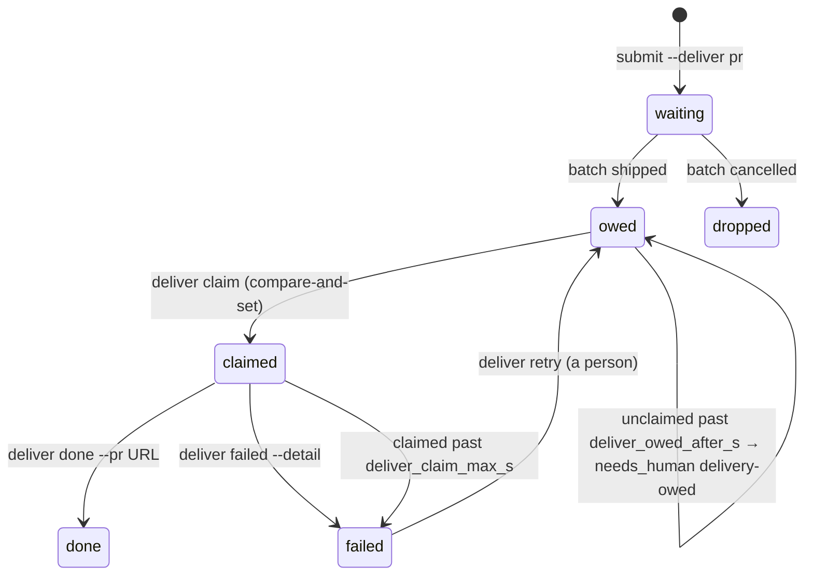

# 10. Delivering a batch as a pull request

**Status:** revision 3, Oct 22, 2026. **Accepted** (all four decisions in 10.6). Nothing is built yet; the order of work is 10.7. Revision 2 adds Chad's two decoupling rules: opt-in on both sides, and ilk2 never names gh-resolve (10.2, 10.3, 10.4). Revision 3 makes 10.3 the exact protocol (JSON, verbs, exit codes) before any code, at Chad's "update design docs first", and adds `deliver list`, the `dropped` state and a bound on a claim.
**Asked by Chad, Oct 21:** "do you think we can build something in the ilk2 side to support open PR for a job? can talk to the gh-resolve session, as the resolver can open PR after ilk2 finished a batch. let's get this designed properly before implementing". The trigger was a Codex session that had just submitted a kira-dev batch through `/ilk2-plan`. It found no "open a PR when done" hook, so it proposed a local watcher that polls status, then pushes and runs `gh pr create`.

## 10.1 The gap

- **A batch gh-resolve submits** is delivered by gh-resolve. After `batch.shipped`, its land phase takes the root lease, merges the base, runs the consumer's pre-push hook, pushes, and opens the PR (§2.8 sequence in [document 2](02-architecture.md)).
- **A batch a person submits** (`/ilk2-plan`, `/ilk2-inbox`, `ilk2 submit`) has no consumer. When it ships, its commits sit on a local branch, and nobody pushes them or opens a PR. Today a person does it by hand, or a session writes a one-off watcher.
- **A one-off watcher is the wrong fix.** Each batch needs its own. It pushes without the root lease, so it can race a rework batch on the same branch (§2.4.2). And it skips the base merge and pre-push steps that gh-resolve already gets right.

## 10.2 What does not change

- **ilk2 never pushes and holds no GitHub credentials.** The driver never pushes (§2.4.2). The consumer is the only writer to the remote branch, under the root lease. Delivery keeps that: ilk2 records that a batch wants a PR and tracks the request; a deliverer does the push.
- **Merging stays with a person.** KR SDLC R2: a non-author approval before merge. The deliverer never merges and never suggests merging.
- **ilk2 works without any particular consumer, and does not know which one exists** (Chad, Oct 22: "the ilk2 (V1 or V2) should work without gh-resolve whenever, and should not recognise the existence of gh-resolve"). ilk2's half is a consumer-neutral protocol: a request, a state, and four CLI verbs. A deliverer is an opaque name that ilk2 stores and compares, never a program it calls or a behaviour it special-cases. ilk2's code and tests never name gh-resolve. Any program that speaks the protocol (status scan, `deliver claim`, root lease, push, `deliver done|failed`) can deliver; gh-resolve is the first one (10.4).

## 10.3 The contract, ilk2 side

This section is the protocol a deliverer codes against. Every command prints JSON with `api_version` and follows the CLI's exit codes (`src/ilk2/cli.py:711-719`): **0** done; **2** rejected, `{"error": "rejected", "problems": [...]}`; **3** conflict, `{"error": "conflict", "detail": "..."}`.

### 10.3.1 Opting in

- **Project settings.** `deliverer` is an opaque name, default `null`; ilk2 only compares it with the name a claim gives. `deliver_owed_after_s` defaults to 1800 and `deliver_claim_max_s` to 7200 (10.5). Set with `ilk2 project set <project> 'deliverer="<name>"'` (the setting's value is JSON).
- **On the deliverer's side**, its own setting, off by default (10.4). Nothing is delivered unless both are on.

### 10.3.2 Asking at submit

`ilk2 submit <plan> --project P ... --deliver pr [--deliver-base <branch>] [--deliver-draft]`

- `--deliver-base` defaults to the project's `default_branch`.
- Rejected (exit 2), so a request nobody will serve fails at submit:
  - `--deliver` on a project whose `deliverer` is `null`: `"--deliver pr needs the project's deliverer setting"`;
  - `--deliver-base` or `--deliver-draft` without `--deliver pr`;
  - a `--deliver` kind other than `pr`.
- `/ilk2-plan` asks once whether the batch should end in a PR and passes the flag. That change lives in ilk-skills and is made by an ilk2 batch there (AGENTS.md).

### 10.3.3 The delivery object

`ilk2 status --json` shows it per batch: `null` when no delivery was asked for, otherwise:

```json
{"kind": "pr", "base": "dev", "draft": false, "deliverer": "<name>",
 "state": "waiting", "pr_url": null, "detail": null,
 "claimed_by": null, "claimed_at": null, "updated_at": 1792600000.0, "version": 1}
```

- `state` is one of `waiting`, `owed`, `claimed`, `done`, `failed`, `dropped`. `version` goes up by one on every change.
- `batch.shipped` carries the same object under `delivery`, already `owed`.



### 10.3.4 The deliver verbs

| Command | Moves | Prints (exit 0) | Exit 3 when | Exit 2 when |
|---|---|---|---|---|
| `ilk2 deliver list [--by NAME] [--state S]` | nothing | `{"deliveries": [D...]}` | never | an unknown state |
| `ilk2 deliver claim --batch B --by NAME` | `owed` → `claimed` | `{"batch": B, "delivery": {...}}` | the state is not `owed` (the detail names it and `claimed_by`), or NAME is not the deliverer | no such batch, or no delivery asked |
| `ilk2 deliver done --batch B --by NAME --pr URL` | `claimed` → `done` | the same | not `claimed`, or NAME is not `claimed_by` | the same; a URL not starting with `https://` |
| `ilk2 deliver failed --batch B --by NAME --detail TEXT` | `claimed` → `failed` | the same | not `claimed`, or NAME is not `claimed_by` | the same |
| `ilk2 deliver retry --batch B` | `failed` → `owed` | the same | not `failed` | the same |

- **A row D of `deliver list`** carries what a deliverer needs without a second call: `{"batch", "project", "branch", "execution_root", "accepted_head", "root_lease": {"holder", "generation"}, "delivery": {...}}`. Without `--state` it lists `owed` and `claimed`. This exists so a deliverer never scans `ilk2 status`, which prints every batch's history.
- **Needs-human rows.** `failed` opens a `delivery-failed` row with the detail; `retry`, or a later `done`, clears it. An `owed` delivery past `deliver_owed_after_s` opens `delivery-owed`; `claim` clears it.
- **A stuck claim.** A claim past `deliver_claim_max_s` goes to `failed`, detail `"claimed by NAME for more than N s"`. This is invariant I11: every non-terminal state is bounded. The supervisor checks both bounds every tick.
- **The push itself** still goes through the root lease: `lease acquire` (which checks the branch out again, `e0dfa47`), then the deliverer's merge, pre-push, push and PR, then `lease release --new-head`.
- **Rework.** A later batch on the same branch with `--deliver pr` is a new request. The deliverer finds the open PR for that branch and pushes to it instead of opening a second one; `done` records the same URL.

## 10.4 The first deliverer: gh-resolve

This section is gh-resolve's half, recorded here so the two halves can be reviewed together. Nothing in it is ilk2 code: ilk2 sees only the protocol in 10.3.

- **Opt-in on gh-resolve's side too, off by default** (Chad, Oct 22: gh-resolve must run without ilk2 by default). gh-resolve already treats ilk2 as an option: `ilk.engine` defaults to V1's `"ilk"` (`config.py:1094`), and its `ilk2` block applies only when the engine is `"ilk2"` (`config.py:1106`, engines at `:1202`). Delivery follows the same rule. A new gh-resolve setting turns the deliver pass on, and is off by default; the pass also refuses to run unless the engine is `"ilk2"`. With delivery off, or without ilk2, gh-resolve behaves exactly as today and never calls `ilk2 deliver`. An installation that is not opted in leaves ilk2's requests `owed`, so the `delivery-owed` row (10.3) is what tells a person nobody will deliver.

From gh-resolve-84's reading of gh-resolve `main` `0792de63` (Oct 21); gh-resolve plans and builds this half.
- **A new `deliver` pass, not `land`.** `gh-resolve land` is shaped around an issue and its ledger run (`cli.py:10166`; the branch is `branch_prefix` + issue, `config.py:908/928`). Delivery reuses land's primitives (`open_root_lease`, `verify_and_push`, `create_pr`) without an issue. Not yet traced: whether the base-merge and pre-push steps of `verify_and_push` read the issue number. That is the first check of gh-resolve's plan.
- **Wake-up costs no model tokens.** gh-resolve has no events cursor; its reap reads `ilk2 status` per row it dispatched (`ilk2_live.py:737-740`). The deliver pass adds one `ilk2 status --json` scan per tick (~5 min) for `delivery.state == "owed"` on projects whose `deliverer` is gh-resolve.
- **Scope: one repo per installation.** Each gh-resolve installation serves one consumer repo. It delivers for an ilk2 project only if the project's remote is that repo, and refuses others by name. kira-dev and kira-live both have origin `github.com/keyreply/kira-cloudflare` (checked Oct 21).
- **The PR body is the evidence.** It is built from `ilk2 status --json`: the submitter and scope, per-step commits, gate outcomes and attempt counts, the batch verification result against the base, and the ilk2 version. A marker `<!-- gh-resolve: delivered batch=<id> -->` identifies it. KR's Operations Security Policy makes the PR and its pipeline the authoritative evidence of a change.
- **A delivered PR is machine-owned.** gh-resolve's holder logic treats a branch that is not a resolver branch as a human PR, which holds any issue whose files it touches (D-617) and is named aloud on a yield. gh-resolve recognises the delivery marker as machine-owned instead.

## 10.5 Judgment calls

- **Ready for review by default, not draft:** for kira-cloudflare, the test workflows skip drafts (`convex-tests.yml:92`, `frontend-unit-tests.yml:50`, `consistency-check.yml:60` run on `ready_for_review`), so a draft PR carries no CI evidence. `--deliver-draft` stays available. Wrong if a repo's CI runs on drafts and reviewers prefer drafts for machine PRs; then the default becomes per project.
- **`deliver_claim_max_s` 2 h, a project setting:** a deliverer's base merge plus pre-push plus push. gh-resolve's pre-push alone has taken about 871 s on rezmac (docs/06 R2). Wrong if a pre-push regularly runs past 2 h, which would fail deliveries that were still working.
- **`deliver_owed_after_s` 30 min, a project setting:** for the first deliverer, six ticks of ~5 min. Wrong if its tick stretches past that under load (its reap passes have run longer while pre-push runs), which would page a person for a delivery that was about to happen.
- **One deliverer per project, named in project settings,** rather than any consumer claiming any batch. Basis: a deliverer holds one repo's push credentials (true of the first one: one gh-resolve installation per repo). Wrong if two installations ever serve one repo.

## 10.6 Decisions (Chad, Oct 22)

| # | Decision | Answer |
|---|---|---|
| 1 | Build delivery this way: ilk2 records and tracks through a consumer-neutral protocol; a deliverer opts in and delivers | **Yes**, with two rules: opt-in on both sides (gh-resolve runs without ilk2 by default), and ilk2 does not know which consumer exists (10.2) |
| 2 | gh-resolve's GOAL.md stops self-improvement for "a write into a consumer repo other than the pipeline's own gated push and PR". Does delivery count as that gated push and PR? | **Yes**, per the recommendation: it is the same lease → base merge → pre-push → push → PR path, from a new source |
| 3 | PRs open under chad007, as resolver PRs do today | **Accepted.** Under R2 Chad cannot approve them; another engineer does |
| 4 | Ready for review by default, not draft | **Ready**, per the recommendation (10.5); `--deliver-draft` stays available |

Decisions 2-4: Chad, Oct 22, "go by default (your recommendation)".

## 10.7 Order of work

1. **ilk2:**
   - the `deliverer` setting, `submit --deliver`, and the `delivery` field in `status` and `batch.shipped`;
   - `ilk2 deliver claim|done|failed|retry`;
   - the `delivery-owed` backstop;
   - tests for each state move, including a claim race;
   - a `/ilk2-plan` question;
   - a section in [document 2](02-architecture.md).
2. **gh-resolve** (its own plan): the deliver pass, the issue-less PR body and marker, and the holder rule.
3. **First live delivery:** one kira-dev batch, on chad-mbp, PR reviewed by a person before anything else uses the path.
